# 令牌管理

<cite>
**本文引用的文件**   
- [登录模块入口](file://codex-rs/login/src/auth/mod.rs)
- [认证管理器](file://codex-rs/login/src/auth/manager.rs)
- [令牌存储抽象](file://codex-rs/login/src/auth/storage.rs)
- [令牌文件存储实现](file://codex-rs/login/src/auth/storage_file.rs)
- [令牌提交锁与一致性包装](file://codex-rs/login/src/auth/storage_commit.rs)
- [访问令牌分类](file://codex-rs/login/src/auth/access_token.rs)
- [外部承载令牌刷新器](file://codex-rs/login/src/auth/external_bearer.rs)
- [令牌数据模型](file://codex-rs/login/src/token_data.rs)
- [系统密钥环封装](file://codex-rs/keyring-store/src/lib.rs)
- [本地加密密钥库接口](file://codex-rs/secrets/src/lib.rs)
- [本地加密存储后端](file://codex-rs/secrets/src/local.rs)
</cite>

## 目录
1. [简介](#简介)
2. [项目结构与定位](#项目结构与定位)
3. [核心组件](#核心组件)
4. [架构总览](#架构总览)
5. [详细组件分析](#详细组件分析)
6. [依赖关系分析](#依赖关系分析)
7. [生命周期、自动刷新与过期处理](#生命周期自动刷新与过期处理)
8. [安全策略与权限控制](#安全策略与权限控制)
9. [备份、迁移与恢复](#备份迁移与恢复)
10. [多工作区隔离](#多工作区隔离)
11. [性能特性与优化建议](#性能特性与优化建议)
12. [故障排除指南](#故障排除指南)
13. [结论](#结论)

## 简介
本文围绕 Codex 中的令牌管理机制展开，重点说明访问令牌的存储机制、自动刷新与过期处理、生命周期管理、存储后端抽象、事务与一致性保证、安全保护措施，以及多工作区环境下的隔离策略。文档同时给出备份、迁移和恢复建议，并提供故障排除方法和性能优化指导。

该机制的核心由以下部分组成：
- 令牌数据模型与解析。
- 令牌存储抽象及多种后端：本地 JSON 文件、系统密钥环、本地加密文件。
- 跨进程写入保护、原子替换与回退策略。
- 外部命令承载令牌刷新。
- 工作区路由与身份绑定。

## 项目结构与定位
令牌管理主要位于 `codex-rs/login` 模块中，并与 `codex-rs/keyring-store`、`codex-rs/secrets` 配合完成系统级安全和加密存储。

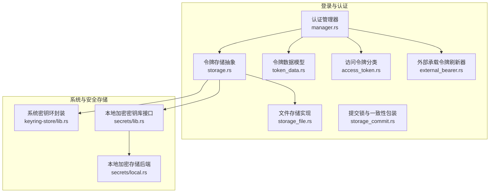

**图示来源**
- [认证管理器:1-200](file://codex-rs/login/src/auth/manager.rs#L1-L200)
- [令牌存储抽象:1-200](file://codex-rs/login/src/auth/storage.rs#L1-L200)
- [令牌文件存储实现:1-73](file://codex-rs/login/src/auth/storage_file.rs#L1-L73)
- [令牌提交锁与一致性包装:1-105](file://codex-rs/login/src/auth/storage_commit.rs#L1-L105)
- [令牌数据模型:1-200](file://codex-rs/login/src/token_data.rs#L1-L200)
- [访问令牌分类:1-18](file://codex-rs/login/src/auth/access_token.rs#L1-L18)
- [外部承载令牌刷新器:1-184](file://codex-rs/login/src/auth/external_bearer.rs#L1-L184)
- [系统密钥环封装:1-200](file://codex-rs/keyring-store/src/lib.rs#L1-L200)
- [本地加密密钥库接口:1-200](file://codex-rs/secrets/src/lib.rs#L1-L200)
- [本地加密存储后端:1-200](file://codex-rs/secrets/src/local.rs#L1-L200)

**章节来源**
- [登录模块入口:1-32](file://codex-rs/login/src/auth/mod.rs#L1-L32)

## 核心组件
本节从职责角度梳理令牌管理的关键组件。

| 组件 | 职责 | 关键行为 |
|---|---|---|
| 认证管理器 | 统一协调多种认证方式、令牌刷新、工作区路由、账户授权和身份注册 | 暴露 `CodexAuth` 枚举；管理 OAuth、API Key、Agent Identity、Personal Access Token、Bedrock 等模式 |
| 令牌存储抽象 | 定义统一的令牌读写、删除、比较并保存、持久化目录能力 | 支持文件、密钥环、加密密钥库、内存临时存储四种后端 |
| 文件存储实现 | 在 `$CODEX_HOME/auth.json` 上执行安全、原子的读写 | 防软链接攻击、硬链接拒绝、只读保护、原子替换 |
| 提交锁包装 | 对多个进程并发写入进行序列化与超时保护 | 使用 `.json.lock` 文件锁；提供 compare-and-save |
| 令牌数据模型 | 表示 OAuth 令牌、ID Token、账号信息、来源、登录归属 | 支持 JWT 载荷解析、过期时间提取、工作区标识 |
| 访问令牌分类 | 区分个人访问令牌与 Agent Identity JWT | 根据前缀判断类型 |
| 外部承载令牌刷新器 | 通过外部命令动态获取承载令牌 | 支持缓存、定时刷新、命令超时、非空校验 |
| 系统密钥环封装 | 封装操作系统密钥环的加载、保存、删除 | 将底层错误映射为 IO 错误 |
| 本地加密密钥库接口 | 提供命名空间、作用域、密钥名、后端抽象 | 支持全局与作用域密钥；默认后端基于系统密钥环 |
| 本地加密存储后端 | 使用 age 加密本地文件，并将密钥保存在系统密钥环 | 按命名空间分文件、带版本、缓存解密结果 |

**章节来源**
- [认证管理器:1-200](file://codex-rs/login/src/auth/manager.rs#L1-L200)
- [令牌存储抽象:1-200](file://codex-rs/login/src/auth/storage.rs#L1-L200)
- [令牌数据模型:1-200](file://codex-rs/login/src/token_data.rs#L1-L200)
- [访问令牌分类:1-18](file://codex-rs/login/src/auth/access_token.rs#L1-L18)
- [外部承载令牌刷新器:1-184](file://codex-rs/login/src/auth/external_bearer.rs#L1-L184)
- [系统密钥环封装:1-200](file://codex-rs/keyring-store/src/lib.rs#L1-L200)
- [本地加密密钥库接口:1-200](file://codex-rs/secrets/src/lib.rs#L1-L200)
- [本地加密存储后端:1-200](file://codex-rs/secrets/src/local.rs#L1-L200)

## 架构总览
令牌管理的整体流程如下：

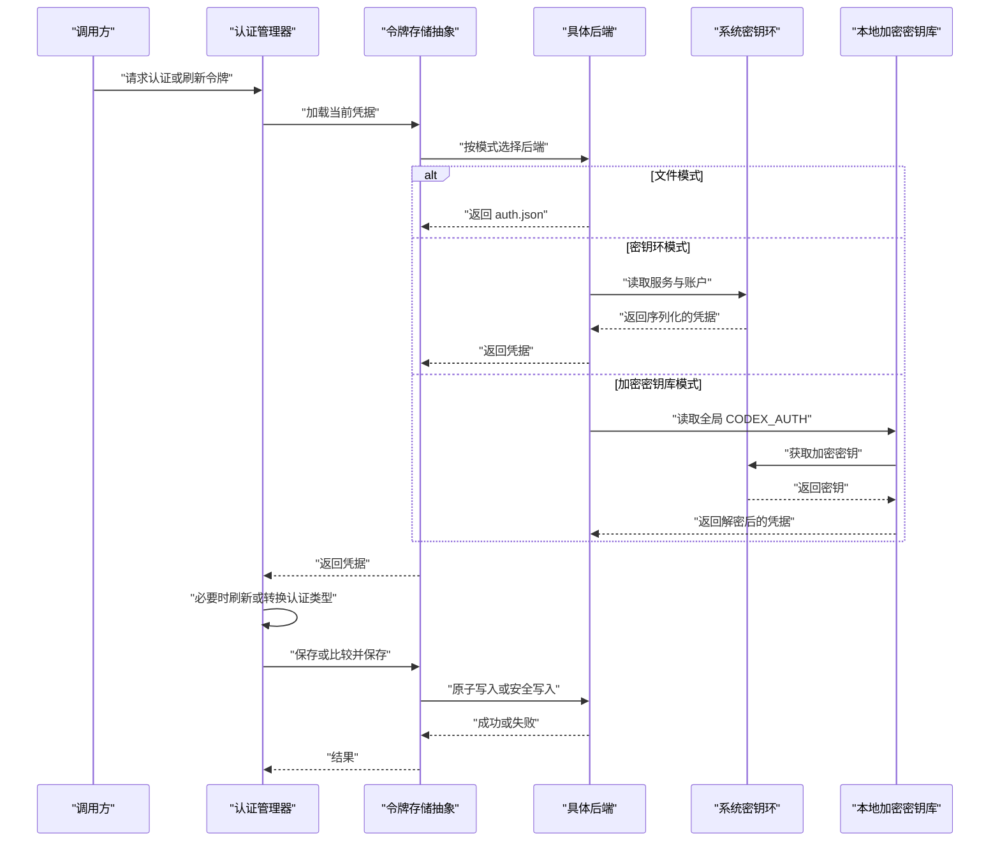

**图示来源**
- [认证管理器:1-200](file://codex-rs/login/src/auth/manager.rs#L1-L200)
- [令牌存储抽象:1-200](file://codex-rs/login/src/auth/storage.rs#L1-L200)
- [系统密钥环封装:1-200](file://codex-rs/keyring-store/src/lib.rs#L1-L200)
- [本地加密密钥库接口:1-200](file://codex-rs/secrets/src/lib.rs#L1-L200)
- [本地加密存储后端:1-200](file://codex-rs/secrets/src/local.rs#L1-L200)

## 详细组件分析

### 令牌存储抽象与后端
令牌存储抽象定义了统一的读写接口，并负责：
- 根据配置选择文件存储、直接密钥环、加密密钥库、自动回退或内存临时存储。
- 为所有持久化后端提供跨进程写锁。
- 提供比较并保存语义，避免竞态覆盖。
- 记录遥测，帮助诊断密钥环不可用时的回退路径。

关键设计点：
- `AuthDotJson` 是持久化的根结构，包含认证模式、API Key、OAuth 令牌、最后刷新时间、Agent Identity、个人访问令牌、Bedrock 相关凭据。
- `FileAuthStorage` 直接读写 `$CODEX_HOME/auth.json`。
- `DirectKeyringAuthStorage` 将完整凭据存入系统密钥环。
- `SecretsKeyringAuthStorage` 将完整凭据写入本地加密文件，并通过系统密钥环保护加密密钥。
- `AutoAuthStorage` 优先使用密钥环或加密密钥库，失败时回退到文件存储。
- `EphemeralAuthStorage` 仅保留进程内内存映射，适用于测试或临时会话。

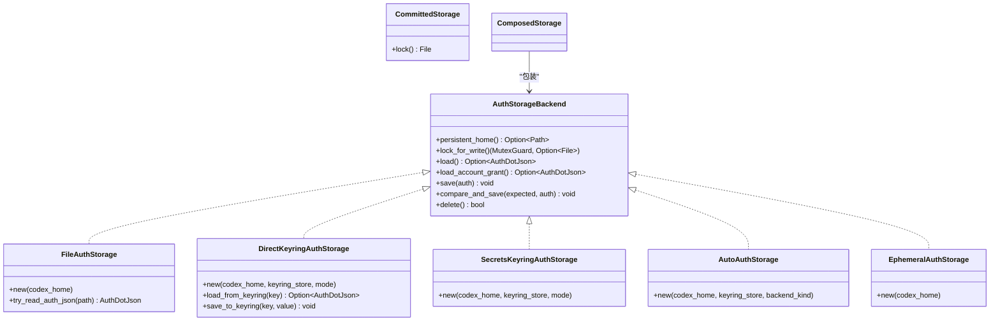

**图示来源**
- [令牌存储抽象:201-757](file://codex-rs/login/src/auth/storage.rs#L201-L757)
- [令牌提交锁与一致性包装:1-105](file://codex-rs/login/src/auth/storage_commit.rs#L1-L105)

**章节来源**
- [令牌存储抽象:1-757](file://codex-rs/login/src/auth/storage.rs#L1-L757)

### 文件存储的安全替换与路径验证
文件存储不是简单覆盖 `auth.json`，而是采用以下安全策略：
- 解析并限制软链接跳转次数，防止符号链接绕过预期路径。
- 检查目标文件是否为只读。
- 在非 Windows 平台拒绝硬链接目标，避免原子替换产生身份分裂。
- 在同目录下创建临时文件，完成后原子重命名。
- 在 Windows 上额外处理保留属性与已有句柄场景。

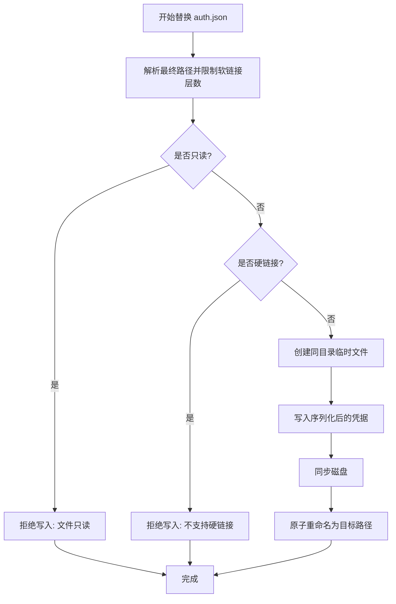

**图示来源**
- [令牌文件存储实现:1-73](file://codex-rs/login/src/auth/storage_file.rs#L1-L73)

**章节来源**
- [令牌文件存储实现:1-73](file://codex-rs/login/src/auth/storage_file.rs#L1-L73)

### 跨进程一致性与事务性写入
令牌写入需要满足：
- 同一时刻只有一个进程能修改凭据。
- 读取和写入之间不能发生其他进程覆盖。
- 比较并保存必须检测凭据是否变化。
- 网络请求不应持有锁。

实现方式：
- 使用全局互斥保护进程内读写修改写提交阶段。
- 使用 `.json.lock` 文件锁实现跨进程串行化。
- 锁等待设置超时，避免永久阻塞。
- `compare_and_save` 先校验当前凭据是否与期望值一致，再保存新值。

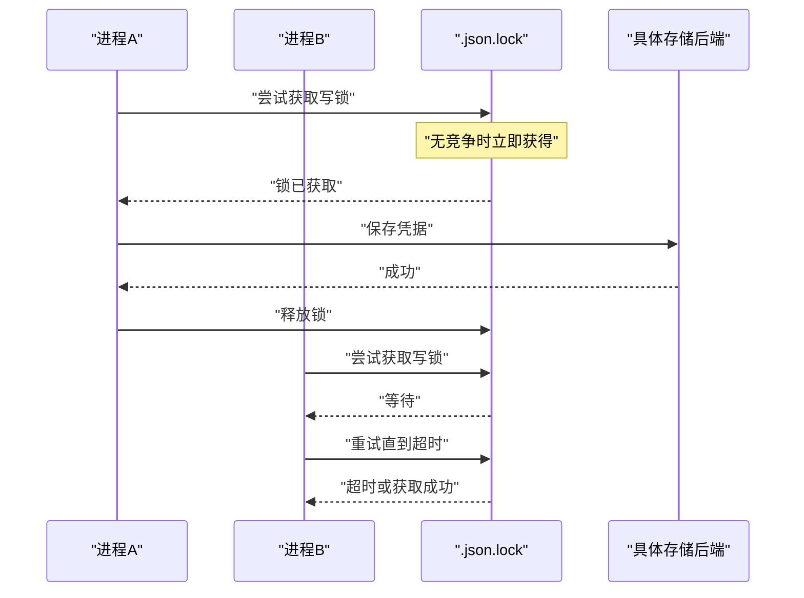

**图示来源**
- [令牌提交锁与一致性包装:1-105](file://codex-rs/login/src/auth/storage_commit.rs#L1-L105)
- [令牌存储抽象:201-300](file://codex-rs/login/src/auth/storage.rs#L201-L300)

**章节来源**
- [令牌提交锁与一致性包装:1-105](file://codex-rs/login/src/auth/storage_commit.rs#L1-L105)

### 令牌数据模型与生命周期字段
令牌数据模型包含：
- `id_token`：扁平化的 ID Token 信息，包括邮箱、订阅计划、用户标识、工作区标识、FedRAMP 标记、原始 JWT。
- `access_token`：访问令牌。
- `refresh_token`：刷新令牌。
- `oauth_provenance`：刷新令牌签发来源，用于后续刷新可信路由。
- `login_owner_id`：一次登录完成的标识，便于令牌轮换后保持会话归属。
- `account_id`：账号标识。

此外还提供：
- JWT 载荷解码工具。
- 过期时间解析。
- ChatGPT 工作区用户 ID 解析。

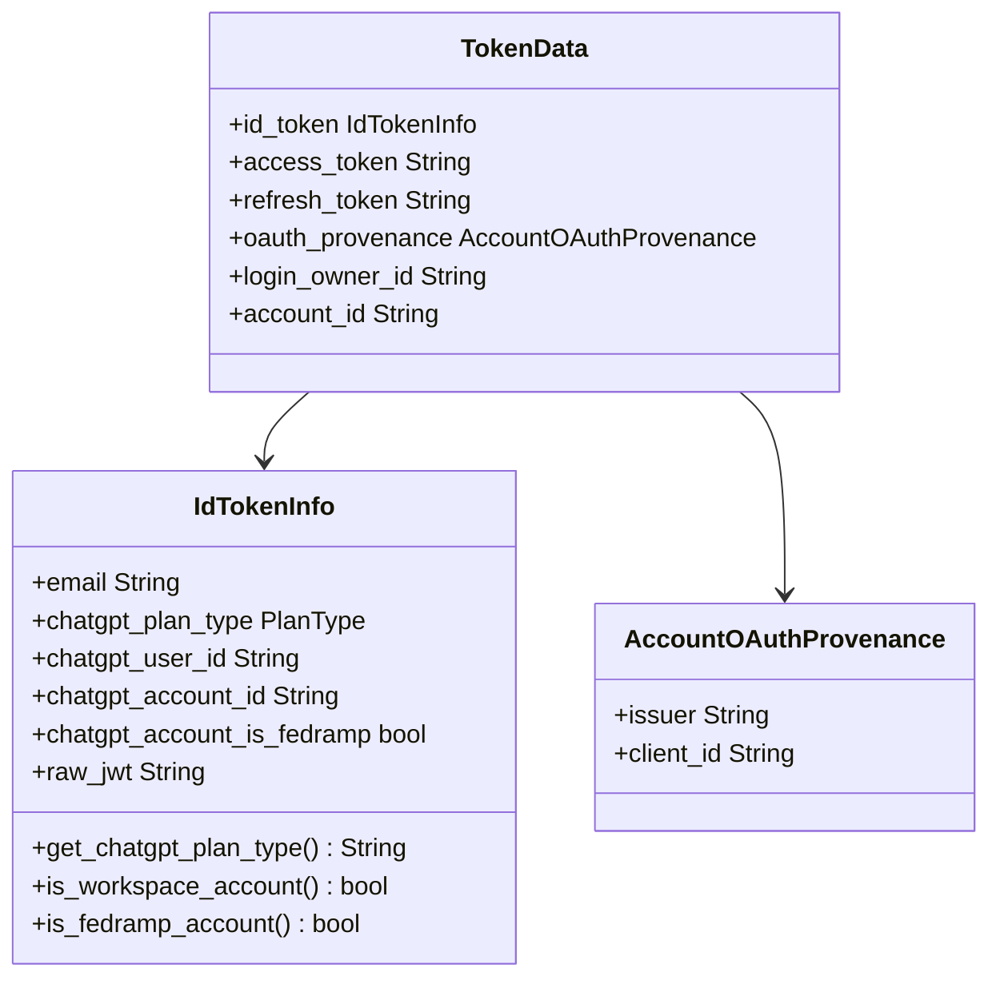

**图示来源**
- [令牌数据模型:1-200](file://codex-rs/login/src/token_data.rs#L1-L200)

**章节来源**
- [令牌数据模型:1-200](file://codex-rs/login/src/token_data.rs#L1-L200)

### 访问令牌分类
系统根据访问令牌前缀区分两类令牌：
- 以特定前缀开头的令牌被识别为个人访问令牌。
- 其余令牌被视为 Agent Identity JWT。

该分类影响后续的身份绑定、任务注册与代理身份协商逻辑。

**章节来源**
- [访问令牌分类:1-18](file://codex-rs/login/src/auth/access_token.rs#L1-L18)

### 外部承载令牌刷新器
当配置允许通过外部命令获取承载令牌时，刷新器会：
- 缓存最近一次获取的令牌。
- 根据配置的刷新间隔决定是否复用缓存。
- 调用外部命令输出作为新的访问令牌。
- 对命令执行结果做超时、退出码、标准输出 UTF-8 和非空校验。
- 将结果转换为 API Key 形式的认证对象。

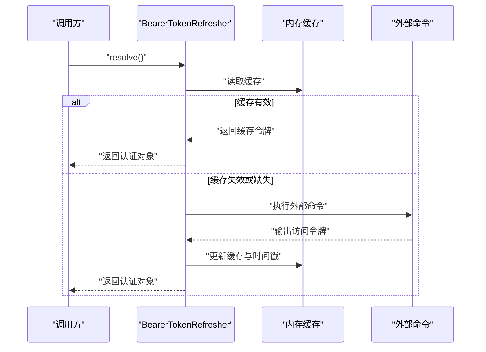

**图示来源**
- [外部承载令牌刷新器:1-184](file://codex-rs/login/src/auth/external_bearer.rs#L1-L184)

**章节来源**
- [外部承载令牌刷新器:1-184](file://codex-rs/login/src/auth/external_bearer.rs#L1-L184)

### 系统密钥环封装
系统密钥环封装提供：
- 统一 `KeyringStore` 接口。
- 默认实现基于操作系统密钥环。
- 将底层密钥环错误映射为 IO 错误。
- 测试用的模拟实现，便于单元测试。

该层屏蔽了不同操作系统密钥环的差异，让上层存储抽象无需关心具体系统实现。

**章节来源**
- [系统密钥环封装:1-200](file://codex-rs/keyring-store/src/lib.rs#L1-L200)

### 本地加密密钥库与加密存储后端
本地加密密钥库提供：
- 命名空间隔离：受管密钥、Codex 认证、MCP OAuth、网关 OAuth。
- 作用域：全局与环境。
- 密钥名严格校验：仅允许大写字母、数字和下划线。
- 默认后端使用系统密钥环存储加密口令，并使用 age 加密本地文件。

加密存储后端特点：
- 每个命名空间对应一个独立加密文件。
- 口令缺失时自动生成高熵口令并保存到系统密钥环。
- 解密结果带缓存，避免重复 scrypt 计算。
- 写入采用原子替换，不留下临时文件。
- 拒绝未来版本的密文格式，保证向前兼容。

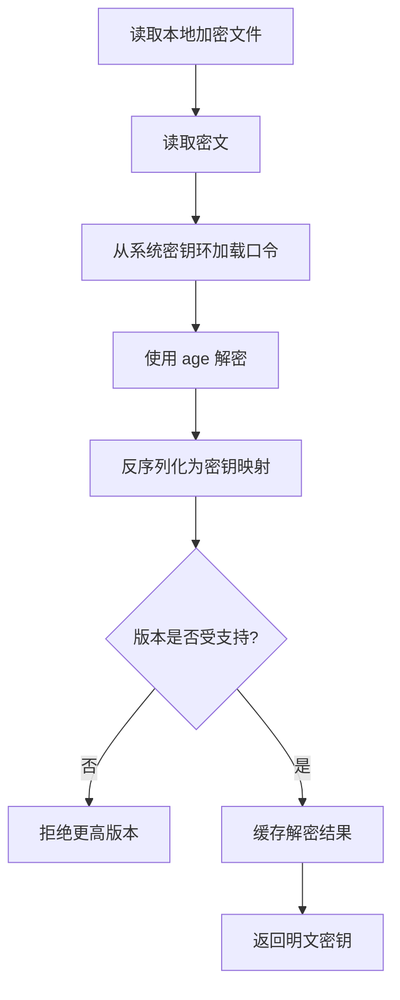

**图示来源**
- [本地加密密钥库接口:1-200](file://codex-rs/secrets/src/lib.rs#L1-L200)
- [本地加密存储后端:201-622](file://codex-rs/secrets/src/local.rs#L201-L622)

**章节来源**
- [本地加密密钥库接口:1-200](file://codex-rs/secrets/src/lib.rs#L1-L200)
- [本地加密存储后端:201-622](file://codex-rs/secrets/src/local.rs#L201-L622)

## 依赖关系分析
令牌管理模块依赖关系如下：

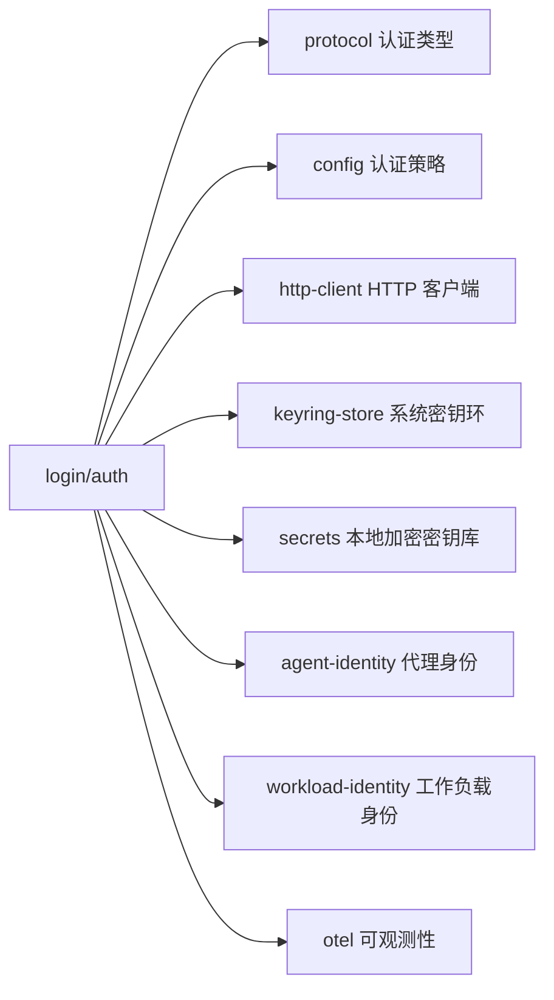

**图示来源**
- [认证管理器:1-200](file://codex-rs/login/src/auth/manager.rs#L1-L200)
- [令牌存储抽象:1-200](file://codex-rs/login/src/auth/storage.rs#L1-L200)

**章节来源**
- [认证管理器:1-200](file://codex-rs/login/src/auth/manager.rs#L1-L200)
- [令牌存储抽象:1-200](file://codex-rs/login/src/auth/storage.rs#L1-L200)

## 生命周期、自动刷新与过期处理

### 令牌生命周期阶段
令牌生命周期大致分为：
1. **获取**：通过 OAuth、API Key、Agent Identity、个人访问令牌或外部命令获取。
2. **存储**：按配置写入文件、系统密钥环或加密密钥库。
3. **使用**：构造认证头并发起 API 请求。
4. **刷新**：根据刷新令牌或外部命令重新获取访问令牌。
5. **轮换与归属**：保留登录归属标识，确保轮换后仍可关联到同一登录。
6. **撤销或删除**：清理文件、密钥环条目或加密密钥。

### 自动刷新策略
自动刷新涉及多个层面：
- OAuth 刷新令牌刷新由登录与 OAuth 子系统驱动。
- 外部承载令牌刷新器通过命令输出刷新，并按配置间隔缓存。
- 存储层提供 `last_refresh` 字段，便于审计与诊断。
- 工作区与 FedRAMP 标识会影响认证路由，间接影响刷新目标。

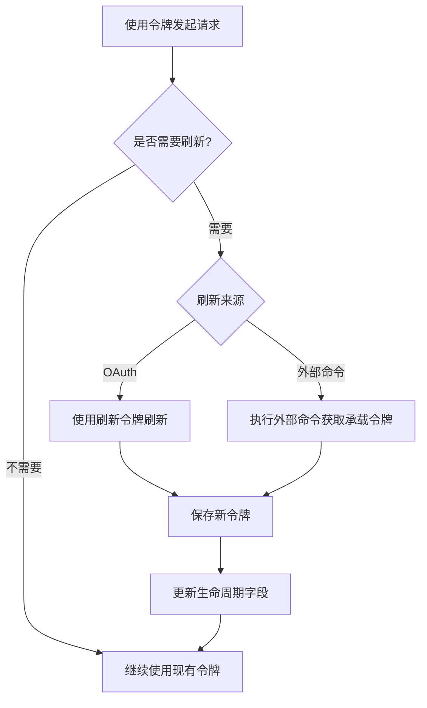

**图示来源**
- [令牌数据模型:1-200](file://codex-rs/login/src/token_data.rs#L1-L200)
- [外部承载令牌刷新器:1-184](file://codex-rs/login/src/auth/external_bearer.rs#L1-L184)

**章节来源**
- [令牌数据模型:1-200](file://codex-rs/login/src/token_data.rs#L1-L200)
- [外部承载令牌刷新器:1-184](file://codex-rs/login/src/auth/external_bearer.rs#L1-L184)

## 安全策略与权限控制

### 权限控制
- 文件存储要求目标文件可写；只读文件直接拒绝写入。
- 非 Windows 平台拒绝硬链接，避免多个路径指向同一文件导致状态分裂。
- 锁文件使用受限权限，减少意外共享风险。
- 系统密钥环依赖操作系统提供的凭据保护机制。
- 本地加密密钥库将口令存储在系统密钥环，密文存储在本地文件。

### 路径验证
- 软链接最多跳转固定次数，防止无限递归或路径逃逸。
- 绝对路径与相对路径在软链接解析中分别处理。
- 命名空间、密钥名、作用域均有合法性校验。

### 数据保护
- 文件存储使用原子替换，读者始终看到完整旧文件或完整新文件。
- 加密存储使用 age 加密，口令由系统密钥环保护。
- 生成随机口令后主动擦除内存中的字节，降低泄漏面。
- 密钥环操作失败时，自动模式会记录遥测并回退到文件存储。

**章节来源**
- [令牌文件存储实现:1-73](file://codex-rs/login/src/auth/storage_file.rs#L1-L73)
- [令牌提交锁与一致性包装:1-105](file://codex-rs/login/src/auth/storage_commit.rs#L1-L105)
- [本地加密存储后端:201-622](file://codex-rs/secrets/src/local.rs#L201-L622)

## 备份、迁移与恢复

### 备份
- 文件模式：可直接备份 `$CODEX_HOME/auth.json`。
- 密钥环模式：可通过系统密钥环导出工具备份对应服务与账户。
- 加密密钥库模式：需同时备份 `secrets` 目录中的加密文件与系统密钥环中的口令。
- 自动模式：优先使用密钥环或加密密钥库，若回退到文件则仍应备份文件。

### 迁移
- 从文件迁移到密钥环或加密密钥库：首次成功保存时会尝试删除旧文件，但建议手动确认迁移完成后再清理。
- 从密钥环迁移到文件：通常不会自动降级，除非显式切换存储模式。
- 加密文件版本升级：读取时拒绝更高版本，写入时只发布最新版本，旧缓存会被清空并等待下次正常读取。

### 恢复
- 文件损坏或解析失败：可恢复备份的 `auth.json`。
- 密钥环条目丢失：可从备份恢复系统密钥环条目。
- 加密口令丢失：本地加密文件无法解密，需要恢复系统密钥环中的口令。
- 比较并保存失败：表示凭据已在其他进程中被修改，应重新加载最新凭据后再写入。

**章节来源**
- [令牌存储抽象:201-757](file://codex-rs/login/src/auth/storage.rs#L201-L757)
- [本地加密存储后端:201-622](file://codex-rs/secrets/src/local.rs#L201-L622)

## 多工作区隔离

### 工作区范围
- 每个工作区对应一个 `codex_home`。
- 密钥环账户和工作区路径哈希绑定，避免不同工作区共用凭据。
- 加密密钥库按命名空间隔离，不同命名空间写入不同文件。
- 环境变量作用域可在密钥库中隔离不同环境。

### 工作区路由与切换
认证管理器支持工作区路由与工作区切换，使同一进程能在不同工作区上下文中使用不同凭据。该能力与令牌存储抽象解耦：存储层只负责按当前工作区路径存取凭据。

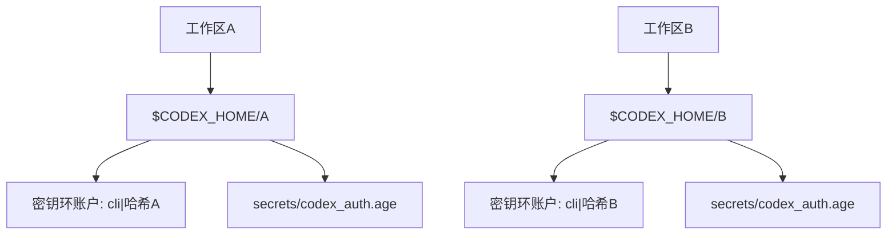

**图示来源**
- [令牌存储抽象:201-757](file://codex-rs/login/src/auth/storage.rs#L201-L757)
- [本地加密密钥库接口:1-200](file://codex-rs/secrets/src/lib.rs#L1-L200)

**章节来源**
- [令牌存储抽象:201-757](file://codex-rs/login/src/auth/storage.rs#L201-L757)
- [本地加密密钥库接口:1-200](file://codex-rs/secrets/src/lib.rs#L1-L200)

## 性能特性与优化建议

### 性能特性
- 文件存储使用原子替换，避免部分写入导致的读取异常。
- 加密存储缓存解密结果，避免每次读取都执行 scrypt。
- 外部承载令牌刷新器缓存令牌，减少外部命令调用频率。
- 自动模式在密钥环不可用时快速回退到文件存储，提高可用性。
- 跨进程写锁有超时保护，避免长时间阻塞。

### 优化建议
- 在高并发场景中优先使用密钥环或加密密钥库，减少频繁磁盘 I/O。
- 合理设置外部命令刷新间隔，避免过多子进程启动。
- 避免频繁切换存储模式，防止反复迁移和回退。
- 监控密钥环可用性和加密文件完整性，提前发现凭据读取失败。
- 对于自动化脚本，尽量使用确定性工作区路径，避免哈希变化导致密钥环账户变化。

[本节为通用性能讨论，未直接分析具体代码行]

## 故障排除指南

| 现象 | 可能原因 | 排查与修复 |
|---|---|---|
| 无法写入 `auth.json` | 文件只读、硬链接、父目录不可写、锁超时 | 检查文件权限；移除硬链接；确认锁文件未被其他进程占用 |
| 密钥环不可用 | 系统密钥环服务异常、权限不足 | 检查系统凭据管理器；确认服务运行；查看遥测日志 |
| 加密文件无法解密 | 口令丢失、文件损坏、版本过新 | 恢复系统密钥环口令；恢复加密文件；确认版本兼容 |
| 刷新失败 | 刷新令牌失效、外部命令失败、命令超时 | 重新登录；检查外部命令输出、退出码、超时配置 |
| 多进程写入冲突 | 多个实例同时修改凭据 | 等待锁释放；检查是否有重复进程；观察超时错误 |
| 工作区凭据错乱 | 使用了错误的工作区路径或密钥环账户 | 确认 `codex_home`；检查密钥环账户与工作区路径哈希 |
| 自动模式回退到文件 | 密钥环或加密密钥库写入失败 | 查看遥测；修复密钥环或加密存储；确认后切换回首选模式 |

**章节来源**
- [令牌提交锁与一致性包装:1-105](file://codex-rs/login/src/auth/storage_commit.rs#L1-L105)
- [令牌存储抽象:201-757](file://codex-rs/login/src/auth/storage.rs#L201-L757)
- [本地加密存储后端:201-622](file://codex-rs/secrets/src/local.rs#L201-L622)
- [外部承载令牌刷新器:1-184](file://codex-rs/login/src/auth/external_bearer.rs#L1-L184)

## 结论
Codex 的令牌管理采用分层抽象设计：上层认证管理器负责策略与流程，中间层存储抽象负责后端选择与一致性，下层系统密钥环和本地加密存储负责安全持久化。该设计在安全性、可用性和可维护性之间取得平衡：
- 通过文件原子替换、软链接与硬链接防护、跨进程锁提升可靠性。
- 通过系统密钥环和 age 加密提升机密性。
- 通过自动回退和遥测提升容错能力。
- 通过工作区哈希和命名空间实现多工作区隔离。

在实际使用中，建议优先启用密钥环或加密密钥库模式，配合稳定的工作区路径和合理的刷新策略，以获得更安全的令牌管理和更稳定的运行体验。