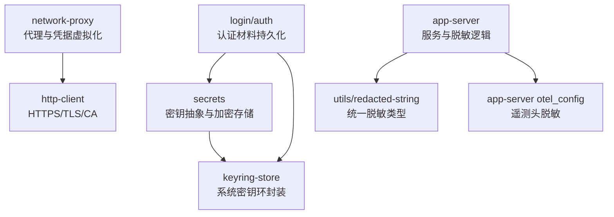
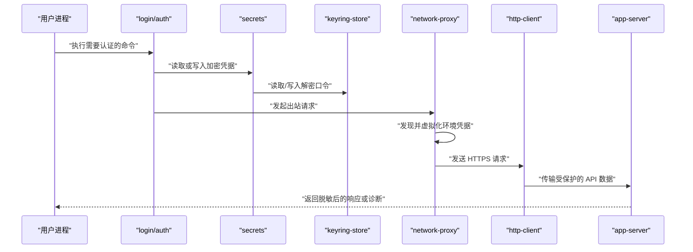
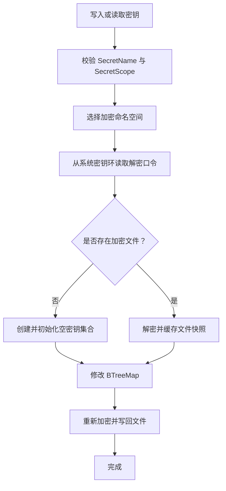
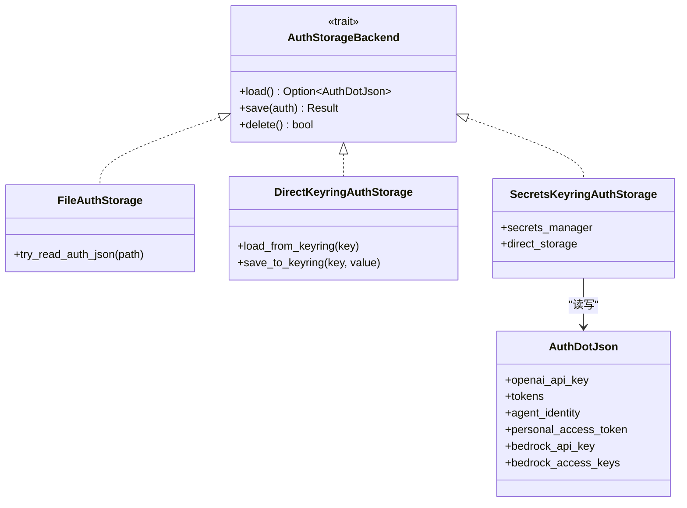
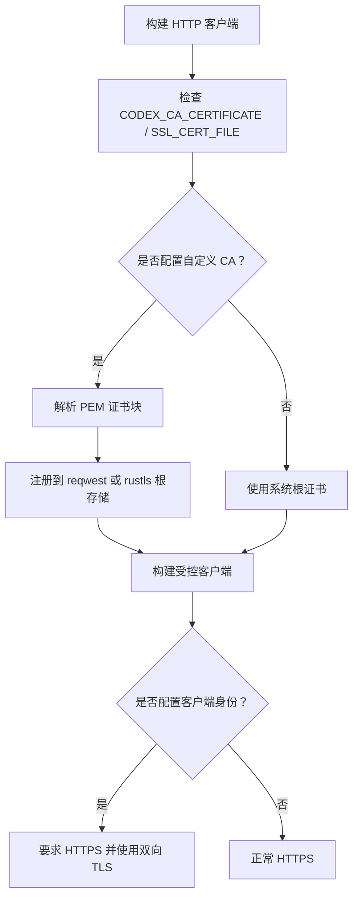
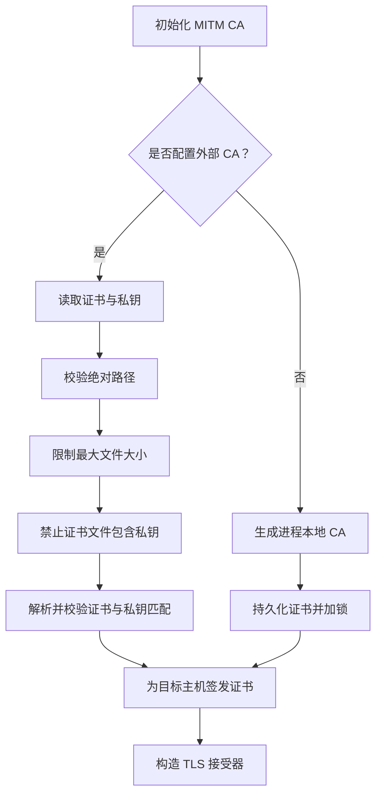
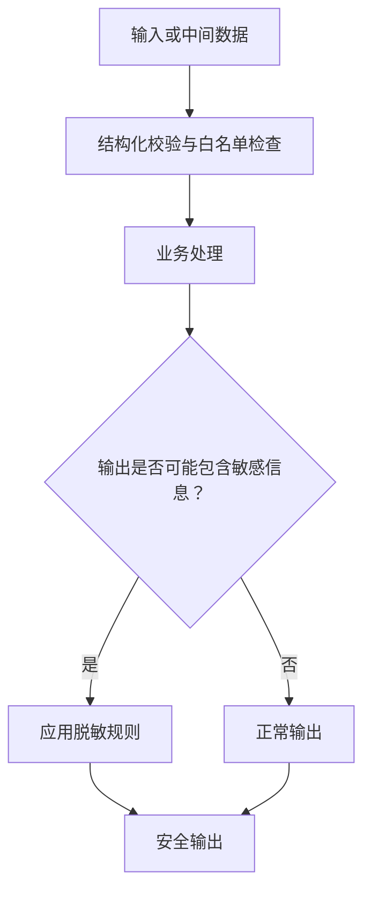
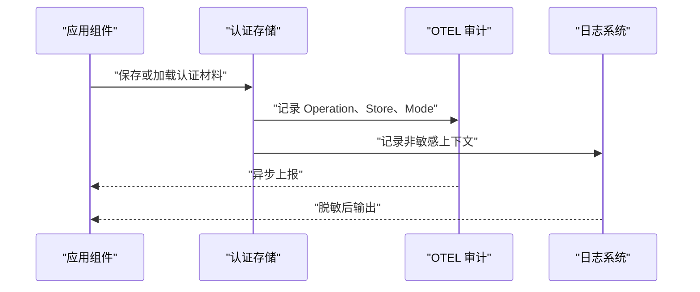
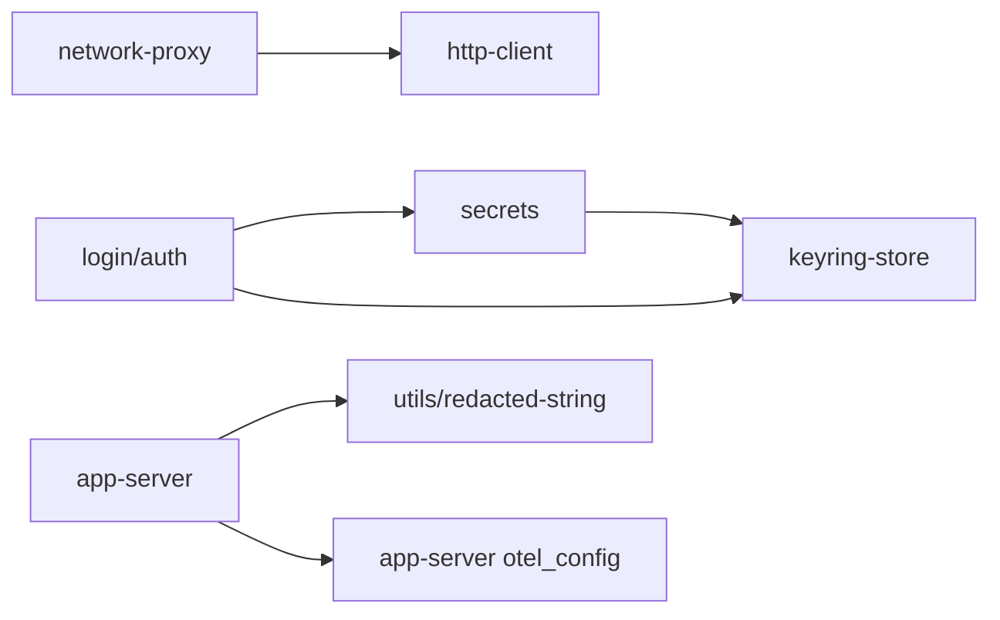

# 安全最佳实践

<cite>
**本文引用的文件**   
- [SECURITY.md](file://SECURITY.md)
- [lib.rs（secrets）](file://codex-rs/secrets/src/lib.rs)
- [local.rs（secrets）](file://codex-rs/secrets/src/local.rs)
- [sanitizer.rs（secrets）](file://codex-rs/secrets/src/sanitizer.rs)
- [lib.rs（keyring-store）](file://codex-rs/keyring-store/src/lib.rs)
- [storage.rs（login/auth）](file://codex-rs/login/src/auth/storage.rs)
- [access_token.rs（login/auth）](file://codex-rs/login/src/auth/access_token.rs)
- [credential_broker.rs（network-proxy）](file://codex-rs/network-proxy/src/credential_broker.rs)
- [certs.rs（network-proxy）](file://codex-rs/network-proxy/src/certs.rs)
- [client_tls.rs（http-client）](file://codex-rs/http-client/src/client_tls.rs)
- [custom_ca.rs（http-client）](file://codex-rs/http-client/src/custom_ca.rs)
- [lib.rs（redacted-string）](file://codex-rs/utils/redacted-string/src/lib.rs)
- [request_serialization.rs（app-server）](file://codex-rs/app-server/src/request_serialization.rs)
- [config_manager_service.rs（app-server）](file://codex-rs/app-server/src/config_manager_service.rs)
- [otel_config.rs（app-server）](file://codex-rs/app-server/src/otel_config.rs)
- [thread_resume_redaction.rs（app-server）](file://codex-rs/app-server/src/request_processors/thread_resume_redaction.rs)
</cite>

## 目录
1. [引言](#引言)
2. [项目结构与安全边界](#项目结构与安全边界)
3. [核心安全组件](#核心安全组件)
4. [架构总览](#架构总览)
5. [详细组件分析](#详细组件分析)
6. [依赖与耦合分析](#依赖与耦合分析)
7. [性能与可靠性考量](#性能与可靠性考量)
8. [常见问题排查](#常见问题排查)
9. [结论](#结论)
10. [附录：安全配置检查清单](#附录安全配置检查清单)

## 引言
本文件面向 Codex 项目的开发者、运维人员和安全审查人员，系统性梳理仓库中已实现的安全机制，并给出可操作的最佳实践。内容覆盖密钥管理、网络安全、输入输出处理、日志脱敏、审计追踪、常见威胁防护以及合规检查清单。文档中的建议均基于仓库中现有实现进行归纳，并在必要时标注具体源码位置以便进一步审计。

## 项目结构与安全边界
Codex 是一个多模块 Rust 工作区，安全相关能力分布在多个 crate 中：
- `secrets`：统一的密钥抽象、本地加密存储和敏感信息脱敏。
- `keyring-store`：对系统密钥环的封装，用于存放高敏感凭据。
- `login/auth`：登录凭据、令牌、JWT、API Key 等认证材料的管理与持久化。
- `network-proxy`：出站网络代理、证书校验、MITM CA、凭据虚拟化与环境注入控制。
- `http-client`：HTTPS、自定义根证书、客户端 TLS 身份及 Windows 代理 TLS 适配。
- `utils/redacted-string`：调试与序列化时的统一脱敏类型。
- `app-server`：服务端请求序列化、遥测头脱敏、会话恢复负载脱敏。
- `SECURITY.md`：漏洞报告与外部安全计划入口。

**图表来源**
- [lib.rs（secrets）:1-200](file://codex-rs/secrets/src/lib.rs#L1-L200)
- [lib.rs（keyring-store）:1-200](file://codex-rs/keyring-store/src/lib.rs#L1-L200)
- [storage.rs（login/auth）:1-200](file://codex-rs/login/src/auth/storage.rs#L1-L200)
- [credential_broker.rs（network-proxy）:1-200](file://codex-rs/network-proxy/src/credential_broker.rs#L1-L200)
- [client_tls.rs（http-client）:1-113](file://codex-rs/http-client/src/client_tls.rs#L1-L113)
- [lib.rs（redacted-string）:1-71](file://codex-rs/utils/redacted-string/src/lib.rs#L1-L71)
- [config_manager_service.rs（app-server）:4-210](file://codex-rs/app-server/src/config_manager_service.rs#L4-L210)

**章节来源**
- [SECURITY.md:1-17](file://SECURITY.md#L1-L17)

## 核心安全组件
本节概括仓库中与“安全”直接相关的核心能力，并按职责划分。

| 组件 | 主要职责 | 关键安全措施 |
|---|---|---|
| `secrets` | 提供统一密钥接口、命名空间、作用域和本地加密文件存储 | 名称与作用域严格校验；按命名空间拆分加密文件；通过系统密钥环保护解密口令；提供通用正则脱敏函数 |
| `keyring-store` | 封装系统密钥环读、写、删 | 错误不暴露原始凭据；测试使用模拟实现；支持 `CredentialStoreError` 分类 |
| `login/auth` | 管理 CLI 与代理的认证材料 | 支持明文 `auth.json`、系统密钥环、加密 secrets 三种后端；原子替换、锁保护、回退清理；访问令牌分类 |
| `network-proxy` | 出站代理、凭据发现与虚拟化、证书管理 | 环境变量中的真实凭据替换为占位符；MITM CA 生成与加载；证书大小、权限与匹配校验 |
| `http-client` | 构建受控 HTTPS 客户端 | 支持自定义根证书；强制 HTTPS；Windows 代理下显式构造 rustls 配置 |
| `app-server` | 服务端请求调度与数据输出 | 串行化队列保护共享状态；遥测导出头脱敏；会话恢复时脱敏工具调用结果与图像生成数据 |
| `utils/redacted-string` | 统一 Debug 与 JSON 序列化脱敏 | `Debug` 输出 `<redacted>`；JSON 序列化输出固定占位符 |

**章节来源**
- [lib.rs（secrets）:1-200](file://codex-rs/secrets/src/lib.rs#L1-L200)
- [lib.rs（keyring-store）:1-200](file://codex-rs/keyring-store/src/lib.rs#L1-L200)
- [storage.rs（login/auth）:1-200](file://codex-rs/login/src/auth/storage.rs#L1-L200)
- [credential_broker.rs（network-proxy）:1-200](file://codex-rs/network-proxy/src/credential_broker.rs#L1-L200)
- [client_tls.rs（http-client）:1-113](file://codex-rs/http-client/src/client_tls.rs#L1-L113)
- [lib.rs（redacted-string）:1-71](file://codex-rs/utils/redacted-string/src/lib.rs#L1-L71)
- [config_manager_service.rs（app-server）:4-210](file://codex-rs/app-server/src/config_manager_service.rs#L4-L210)

## 架构总览
从安全角度看，Codex 的数据流可以理解为“凭据采集 → 凭据隔离 → 加密或系统密钥环保存 → 代理或 HTTP 客户端发送 → 日志与遥测脱敏”。

**图表来源**
- [storage.rs（login/auth）:200-500](file://codex-rs/login/src/auth/storage.rs#L200-L500)
- [lib.rs（secrets）:1-200](file://codex-rs/secrets/src/lib.rs#L1-L200)
- [lib.rs（keyring-store）:1-200](file://codex-rs/keyring-store/src/lib.rs#L1-L200)
- [credential_broker.rs（network-proxy）:200-589](file://codex-rs/network-proxy/src/credential_broker.rs#L200-L589)
- [client_tls.rs（http-client）:1-113](file://codex-rs/http-client/src/client_tls.rs#L1-L113)
- [config_manager_service.rs（app-server）:4-210](file://codex-rs/app-server/src/config_manager_service.rs#L4-L210)

## 详细组件分析

### 密钥管理与敏感数据存储
#### 设计要点
- `SecretName` 仅允许大写英文字母、数字和下划线，且不能为空，防止非法密钥名进入存储。
- `SecretScope` 区分全局和作用域环境，并通过规范化键避免路径或环境名混淆。
- `LocalSecretsBackend` 将不同命名空间映射到不同加密文件，如 `local.age`、`codex_auth.age`、`mcp_oauth.age`、`gateway_oauth.age`。
- 解密口令由 `DefaultKeyringStore` 从系统密钥环读取，降低口令明文落盘风险。
- `secrets` 提供 `redact_secrets`，基于正则对 OpenAI Key、AWS Access Key、Bearer Token 和常见密钥赋值语句做尽力而为的脱敏。

**图表来源**
- [lib.rs（secrets）:1-200](file://codex-rs/secrets/src/lib.rs#L1-L200)
- [local.rs（secrets）:1-200](file://codex-rs/secrets/src/local.rs#L1-L200)
- [lib.rs（keyring-store）:1-200](file://codex-rs/keyring-store/src/lib.rs#L1-L200)

#### 安全注意事项
- 不要把真实密钥直接拼接到命令行参数、普通日志或遥测字段中。
- 优先使用 `SecretsManager` 而非自行拼接文件名或口令。
- 在新增敏感字段时，同步更新 `redact_secrets` 的正则模式或引入结构化脱敏。
- 若业务需要额外命名空间，应复用现有加密文件策略，而不是新建未加密文件。

**章节来源**
- [lib.rs（secrets）:1-200](file://codex-rs/secrets/src/lib.rs#L1-L200)
- [local.rs（secrets）:1-200](file://codex-rs/secrets/src/local.rs#L1-L200)
- [sanitizer.rs（secrets）:1-87](file://codex-rs/secrets/src/sanitizer.rs#L1-L87)
- [lib.rs（keyring-store）:1-200](file://codex-rs/keyring-store/src/lib.rs#L1-L200)

### 认证材料与登录流程
#### 设计要点
- `AuthDotJson` 承载 OpenAI API Key、令牌、Agent Identity、Personal Access Token、Bedrock 凭据等。
- 文件后端使用原子替换和临时文件，避免并发写入导致部分写入。
- 支持三类存储后端：
  - 文件：`auth.json`，配合 `auth.lock` 和临时文件替换。
  - 直接密钥环：以 `Codex Auth` 服务和稳定账户名存储序列化 JSON。
  - 加密 secrets：通过 `SecretsManager` + `LocalSecretsNamespace::CodexAuth` 存储。
- 当切换到密钥环或加密 secrets 后端时，会尝试删除旧的 `auth.json` 回退文件，并通过遥测记录删除尝试。
- Personal Access Token 以 `at-` 前缀识别，其余作为 Agent Identity JWT。

**图表来源**
- [storage.rs（login/auth）:1-200](file://codex-rs/login/src/auth/storage.rs#L1-L200)
- [storage.rs（login/auth）:200-500](file://codex-rs/login/src/auth/storage.rs#L200-L500)
- [access_token.rs（login/auth）:1-18](file://codex-rs/login/src/auth/access_token.rs#L1-L18)

#### 安全注意事项
- 生产部署优先使用密钥环或加密 secrets，不要长期保留明文 `auth.json`。
- 对 `auth.json` 的权限应限制为当前用户可读；仓库文件后端使用 `tempfile` 生成私有临时文件。
- 不要在日志中打印 `AuthDotJson` 完整结构，尤其是包含 API Key、Private Key 或 JWT 的字段。
- 如果启用密钥环失败，不应静默降级到明文文件而不记录告警。

**章节来源**
- [storage.rs（login/auth）:1-200](file://codex-rs/login/src/auth/storage.rs#L1-L200)
- [storage.rs（login/auth）:200-500](file://codex-rs/login/src/auth/storage.rs#L200-L500)
- [access_token.rs（login/auth）:1-18](file://codex-rs/login/src/auth/access_token.rs#L1-L18)

### 网络安全：HTTPS、证书验证与代理
#### HTTPS 与 TLS 配置
- `HttpClientTlsConfig` 支持设置自定义根证书和客户端身份；调试输出不会泄露 PEM 内容。
- Windows 代理路径下，代码显式构建 rustls `ClientConfig`，并拒绝缺少私钥的情况。
- 自定义 CA 支持通过 `CODEX_CA_CERTIFICATE` 和 `SSL_CERT_FILE` 加载 PEM 证书包，并提供详细的构建错误类型。

**图表来源**
- [client_tls.rs（http-client）:1-113](file://codex-rs/http-client/src/client_tls.rs#L1-L113)
- [custom_ca.rs（http-client）:1-200](file://codex-rs/http-client/src/custom_ca.rs#L1-L200)

#### 代理与 MITM CA
- `ManagedMitmCa` 支持自动生成本地 MITM CA，也支持从绝对路径加载外部 CA 证书和私钥。
- 外部 CA 文件加载时会拒绝相对路径、检查文件大小、禁止证书文件中包含私钥，并在 Unix 平台检查权限。
- 代理会为每个目标主机签发证书，并将 ALPN 设置为 HTTP/1.1 和 HTTP/2。

**图表来源**
- [certs.rs（network-proxy）:1-200](file://codex-rs/network-proxy/src/certs.rs#L1-L200)

**章节来源**
- [client_tls.rs（http-client）:1-113](file://codex-rs/http-client/src/client_tls.rs#L1-L113)
- [custom_ca.rs（http-client）:1-200](file://codex-rs/http-client/src/custom_ca.rs#L1-L200)
- [certs.rs（network-proxy）:1-200](file://codex-rs/network-proxy/src/certs.rs#L1-L200)

### 输入验证与输出清理
#### 输入验证
- 密钥名称和作用域在服务端和客户端侧都经过严格校验，避免恶意命名绕过命名空间隔离。
- MITM CA 的外部证书路径必须为绝对路径，并拒绝私钥混入证书文件。
- 自定义 CA 构建失败时返回结构化错误，而不是让后续 TLS 握手阶段才失败。

#### 输出清理与脱敏
- `RedactedString` 在 `Debug` 输出中始终显示 `<redacted>`，`SerdeRedactedString` 在 JSON 序列化中输出固定占位符。
- `secrets::redact_secrets` 针对 OpenAI Key、AWS Access Key、Bearer Token 和常见密钥赋值做正则脱敏。
- `app-server` 对 OTLP 遥测导出头进行脱敏，避免 Authorization、自定义密钥头等落入日志。
- 线程恢复过程中会对 MCP 工具调用结果和图像生成数据执行脱敏。

**图表来源**
- [lib.rs（secrets）:1-200](file://codex-rs/secrets/src/lib.rs#L1-L200)
- [sanitizer.rs（secrets）:1-87](file://codex-rs/secrets/src/sanitizer.rs#L1-L87)
- [lib.rs（redacted-string）:1-71](file://codex-rs/utils/redacted-string/src/lib.rs#L1-L71)
- [config_manager_service.rs（app-server）:4-210](file://codex-rs/app-server/src/config_manager_service.rs#L4-L210)
- [thread_resume_redaction.rs（app-server）:1-200](file://codex-rs/app-server/src/request_processors/thread_resume_redaction.rs#L1-L200)

**章节来源**
- [sanitizer.rs（secrets）:1-87](file://codex-rs/secrets/src/sanitizer.rs#L1-L87)
- [lib.rs（redacted-string）:1-71](file://codex-rs/utils/redacted-string/src/lib.rs#L1-L71)
- [config_manager_service.rs（app-server）:4-210](file://codex-rs/app-server/src/config_manager_service.rs#L4-L210)
- [thread_resume_redaction.rs（app-server）:1-200](file://codex-rs/app-server/src/request_processors/thread_resume_redaction.rs#L1-L200)

### 安全审计与日志记录
#### 审计点
- 密钥环操作通过 `tracing::trace` 记录加载、保存和删除开始与结果，但不记录敏感值。
- 认证存储变更通过 `otel::auth_storage` 记录操作类型、存储位置和清理行为。
- `app-server` 对 OTLP 导出头中的敏感头部进行脱敏后再写入遥测。
- 代理凭据虚拟化过程将父进程的真实凭据替换为虚拟占位符，避免子进程继承真实值。

**图表来源**
- [lib.rs（keyring-store）:1-200](file://codex-rs/keyring-store/src/lib.rs#L1-L200)
- [storage.rs（login/auth）:200-500](file://codex-rs/login/src/auth/storage.rs#L200-L500)
- [config_manager_service.rs（app-server）:4-210](file://codex-rs/app-server/src/config_manager_service.rs#L4-L210)
- [credential_broker.rs（network-proxy）:200-589](file://codex-rs/network-proxy/src/credential_broker.rs#L200-L589)

**章节来源**
- [lib.rs（keyring-store）:1-200](file://codex-rs/keyring-store/src/lib.rs#L1-L200)
- [storage.rs（login/auth）:200-500](file://codex-rs/login/src/auth/storage.rs#L200-L500)
- [config_manager_service.rs（app-server）:4-210](file://codex-rs/app-server/src/config_manager_service.rs#L4-L210)

### 常见安全威胁防护措施
| 威胁 | 仓库中的对应防护 | 建议补充 |
|---|---|---|
| 凭据泄露到日志 | `RedactedString`、`redact_secrets`、OTLP 头脱敏、会话恢复脱敏 | 对所有新日志通道统一接入脱敏过滤器 |
| 明文密钥落盘 | 加密 secrets、系统密钥环、原子替换、锁保护 | 禁用默认明文 `auth.json`，启用密钥环或加密存储 |
| 不受信任的 CA | 自定义 CA 解析、错误分类、PEM 块校验 | 在生产环境中明确配置受信任 CA 源 |
| MITM 攻击面扩大 | MITM CA 生命周期管理、文件权限与大小限制、证书私钥分离 | 仅在必要代理场景启用，限制证书可见范围 |
| 子进程继承凭据 | 凭据虚拟化、占位符替换、环境变量标记 | 对所有外部命令执行前扫描环境变量 |
| XSS / CSRF | 仓库中未发现专用 Web XSS/CSRF 处理器；TUI 与内部协议不是典型 Web 浏览器攻击面 | 对外部 Web 界面使用框架级防 XSS/CSRF 机制 |
| 重放攻击 | 仓库未直接体现重放防护实现；依赖上游 OAuth、Token、TLS 和代理策略 | 对关键 API 增加时间戳、nonce、绑定客户端指纹 |
| 注入攻击 | 密钥名与作用域校验、MITM CA 路径与格式校验、请求序列化队列 | 对所有用户可控输入采用白名单校验和结构化序列化 |

**章节来源**
- [lib.rs（redacted-string）:1-71](file://codex-rs/utils/redacted-string/src/lib.rs#L1-L71)
- [sanitizer.rs（secrets）:1-87](file://codex-rs/secrets/src/sanitizer.rs#L1-L87)
- [config_manager_service.rs（app-server）:4-210](file://codex-rs/app-server/src/config_manager_service.rs#L4-L210)
- [thread_resume_redaction.rs（app-server）:1-200](file://codex-rs/app-server/src/request_processors/thread_resume_redaction.rs#L1-L200)
- [credential_broker.rs（network-proxy）:200-589](file://codex-rs/network-proxy/src/credential_broker.rs#L200-L589)
- [certs.rs（network-proxy）:1-200](file://codex-rs/network-proxy/src/certs.rs#L1-L200)

## 依赖与耦合分析

- `secrets` 与 `keyring-store` 耦合较低，通过 trait 抽象系统密钥环。
- `login/auth` 同时依赖 `secrets` 和 `keyring-store`，形成认证材料的多后端组合。
- `network-proxy` 与 `http-client` 在网络层解耦，但共享 TLS 与 CA 策略语义。
- `app-server` 依赖脱敏类型和 OTLP 配置，属于输出侧安全聚合点。

**图表来源**
- [lib.rs（secrets）:1-200](file://codex-rs/secrets/src/lib.rs#L1-L200)
- [lib.rs（keyring-store）:1-200](file://codex-rs/keyring-store/src/lib.rs#L1-L200)
- [storage.rs（login/auth）:200-500](file://codex-rs/login/src/auth/storage.rs#L200-L500)
- [client_tls.rs（http-client）:1-113](file://codex-rs/http-client/src/client_tls.rs#L1-L113)
- [config_manager_service.rs（app-server）:4-210](file://codex-rs/app-server/src/config_manager_service.rs#L4-L210)

## 性能与可靠性考量
- 加密 secrets 使用缓存减少频繁解密开销，但每次读取仍检查文件和密钥环一致性。
- 认证存储提交使用进程内互斥锁和可选文件锁，保证并发写安全。
- MITM CA 使用进程级缓存和文件锁，避免重复生成和并发写冲突。
- 自定义 CA 构建会先解析和注册证书，失败时尽早报错，避免启动网络流量后才失败。
- 请求序列化队列支持独占与共享读，提高相同资源上的并发读效率。

**章节来源**
- [local.rs（secrets）:1-200](file://codex-rs/secrets/src/local.rs#L1-L200)
- [storage.rs（login/auth）:200-500](file://codex-rs/login/src/auth/storage.rs#L200-L500)
- [certs.rs（network-proxy）:1-200](file://codex-rs/network-proxy/src/certs.rs#L1-L200)
- [custom_ca.rs（http-client）:1-200](file://codex-rs/http-client/src/custom_ca.rs#L1-L200)
- [request_serialization.rs（app-server）:1-200](file://codex-rs/app-server/src/request_serialization.rs#L1-L200)

## 常见问题排查
| 现象 | 可能原因 | 排查步骤 |
|---|---|---|
| 无法读取加密凭据 | 系统密钥环不可用、口令不一致、命名空间错误 | 检查 `keyring-store` 错误、确认 `SecretsManager` 使用的 namespace |
| `auth.json` 被删除但凭据仍在 | 已迁移到密钥环或加密 secrets | 查看认证存储模式与遥测记录 |
| 企业代理下 TLS 握手失败 | 自定义 CA 未正确加载或证书链不完整 | 检查 `CODEX_CA_CERTIFICATE`、`SSL_CERT_FILE` 和内容格式 |
| 子进程继承了真实 API Key | 代理凭据虚拟化未启用或环境变量未替换 | 检查 `CREDENTIAL_BROKER_ACTIVE_ENV_KEY` 和相关环境变量 |
| 遥测中出现敏感头 | OTLP 导出头未脱敏或新增未覆盖字段 | 检查 `redact_otel_exporter_headers` 及新增配置 |
| 日志泄露密钥 | 直接使用字符串类型记录敏感字段 | 改用 `RedactedString` 或调用 `redact_secrets` |

**章节来源**
- [lib.rs（keyring-store）:1-200](file://codex-rs/keyring-store/src/lib.rs#L1-L200)
- [storage.rs（login/auth）:200-500](file://codex-rs/login/src/auth/storage.rs#L200-L500)
- [custom_ca.rs（http-client）:1-200](file://codex-rs/http-client/src/custom_ca.rs#L1-L200)
- [credential_broker.rs（network-proxy）:200-589](file://codex-rs/network-proxy/src/credential_broker.rs#L200-L589)
- [config_manager_service.rs（app-server）:4-210](file://codex-rs/app-server/src/config_manager_service.rs#L4-L210)

## 结论
Codex 在密钥管理、认证持久化、网络 TLS、代理凭据控制和日志脱敏方面已经形成了较为完整的内置安全机制。最佳实践的核心原则是：**最小暴露、集中管控、加密优先、默认安全**。开发新功能时应优先复用现有 `secrets`、`keyring-store`、`http-client` TLS 配置和 `app-server` 脱敏能力，而不是自行实现凭据存储、TLS 配置或日志过滤。对于 Web 类攻击面，应结合上层框架策略补齐 XSS、CSRF、重放防护；对于供应链和依赖风险，应继续使用仓库现有的依赖审计和安全政策入口。

## 附录：安全配置检查清单

### 密钥管理
- [ ] 不使用明文 API Key 或 Token 硬编码在源码中。
- [ ] 优先使用 `SecretsManager` 或 `KeyringStore`。
- [ ] 不在日志、遥测、错误消息中输出原始密钥。
- [ ] 新增敏感字段时同步更新脱敏逻辑。
- [ ] 不在命令行参数中传递密钥。

### 网络安全
- [ ] 所有外部通信使用 HTTPS。
- [ ] 企业代理环境正确配置 `CODEX_CA_CERTIFICATE` 或 `SSL_CERT_FILE`。
- [ ] 自定义 CA 文件只包含证书，不包含私钥。
- [ ] MITM CA 仅在必要代理场景中启用，并限制证书文件权限。
- [ ] Windows 代理环境下确认 TLS 配置能正确构造。

### 输入与输出
- [ ] 用户输入经过白名单或结构化校验。
- [ ] 密钥名、作用域、路径、端口等关键字段有严格约束。
- [ ] 输出到 UI、日志、遥测、诊断附件的内容经过脱敏。
- [ ] 对 MCP 工具调用结果、图像生成数据和会话恢复负载进行脱敏。

### 审计与合规
- [ ] 凭据加载、保存、删除操作有可观测性。
- [ ] 遥测导出头不包含 Authorization 或自定义密钥头。
- [ ] 认证存储模式符合组织策略，不长期保留明文文件。
- [ ] 安全漏洞通过 Bugcrowd 报告，不公开披露。

**章节来源**
- [SECURITY.md:1-17](file://SECURITY.md#L1-L17)
- [lib.rs（secrets）:1-200](file://codex-rs/secrets/src/lib.rs#L1-L200)
- [client_tls.rs（http-client）:1-113](file://codex-rs/http-client/src/client_tls.rs#L1-L113)
- [custom_ca.rs（http-client）:1-200](file://codex-rs/http-client/src/custom_ca.rs#L1-L200)
- [config_manager_service.rs（app-server）:4-210](file://codex-rs/app-server/src/config_manager_service.rs#L4-L210)