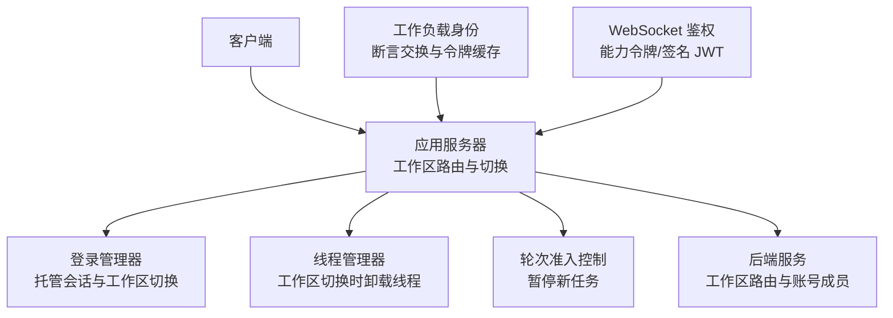
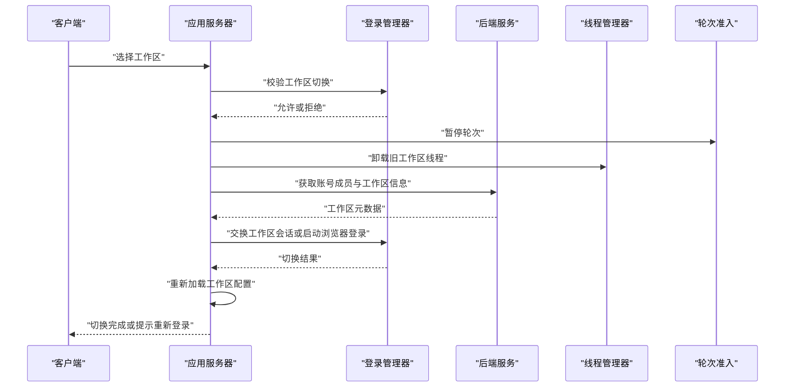
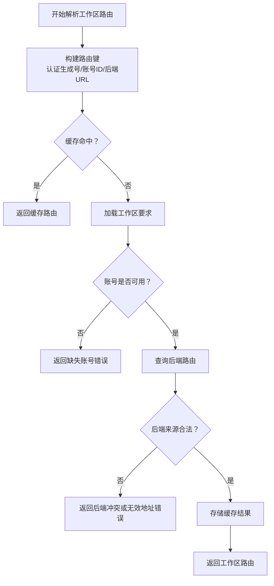
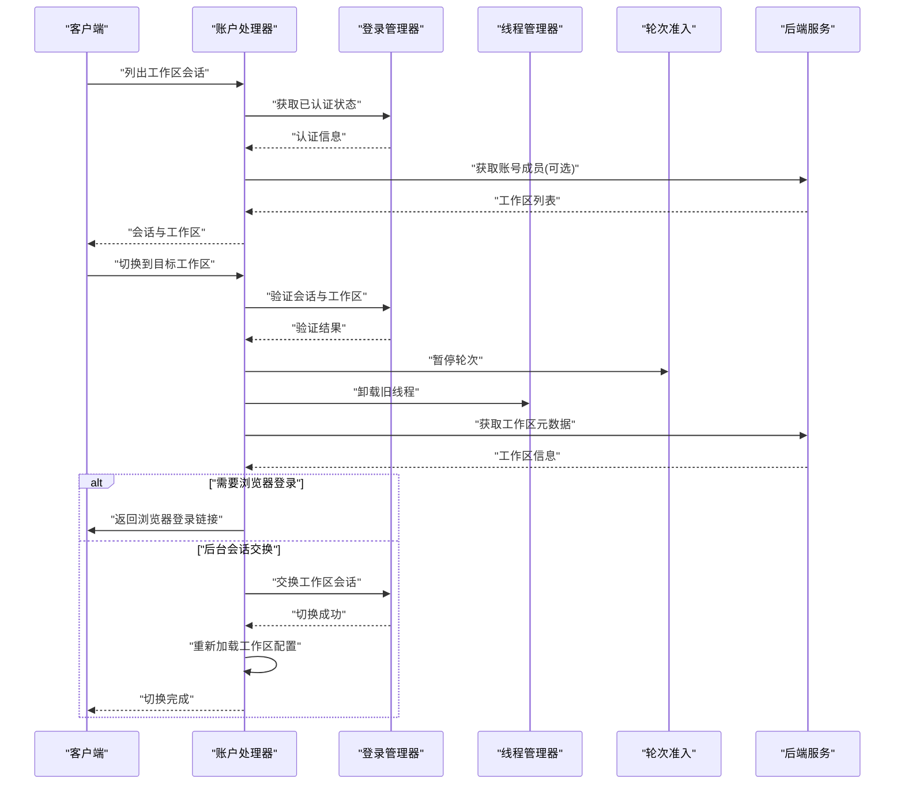
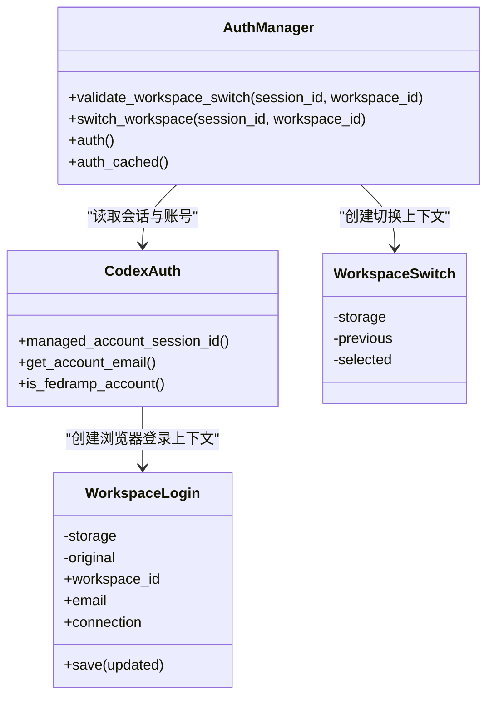
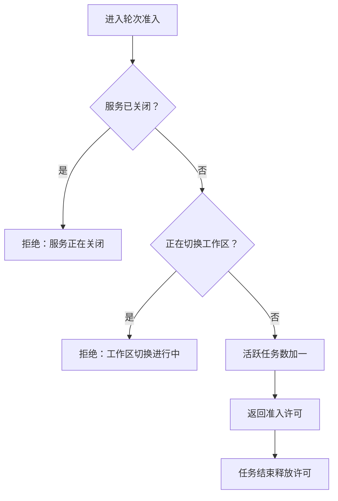
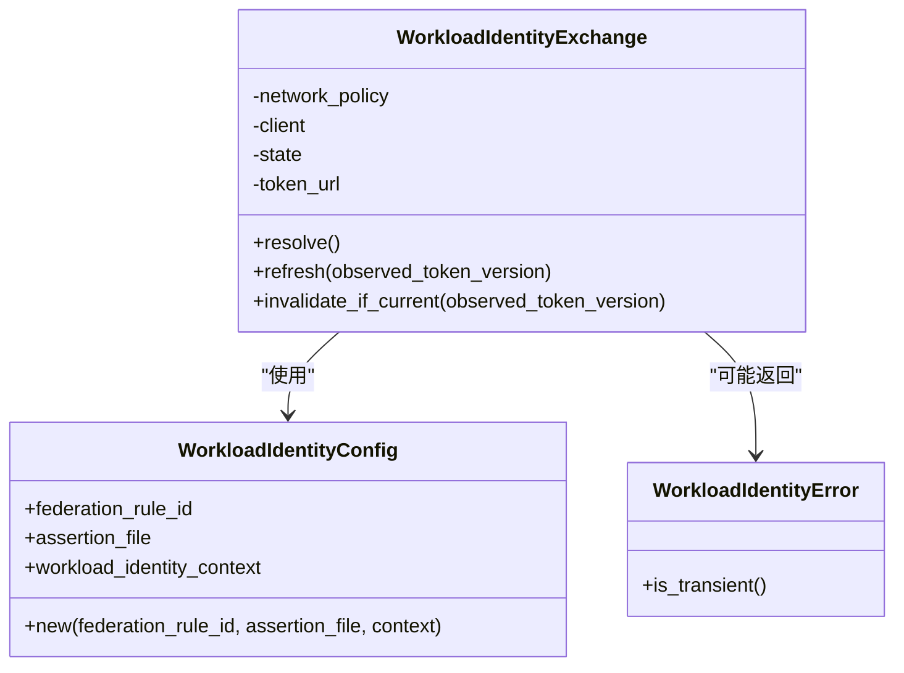
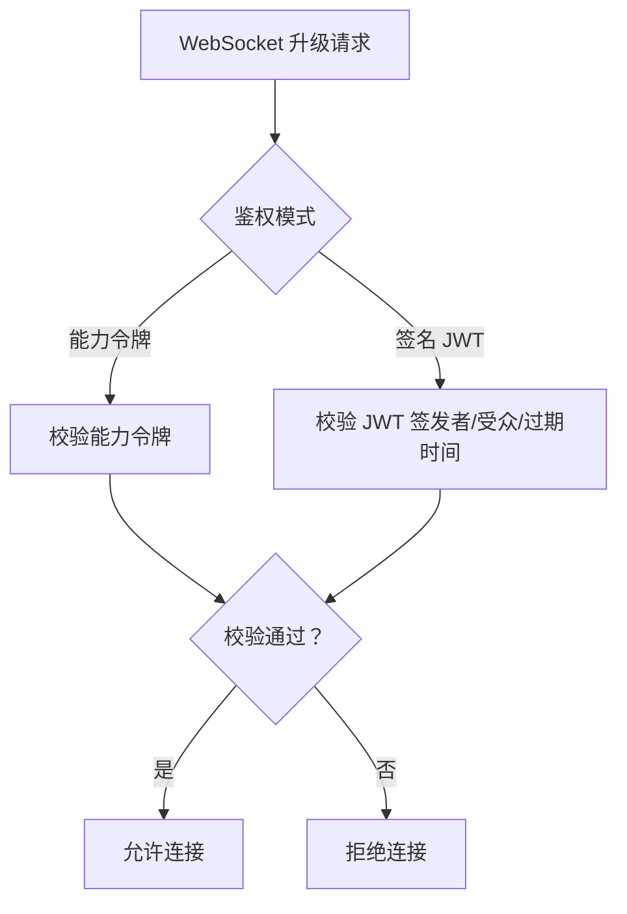
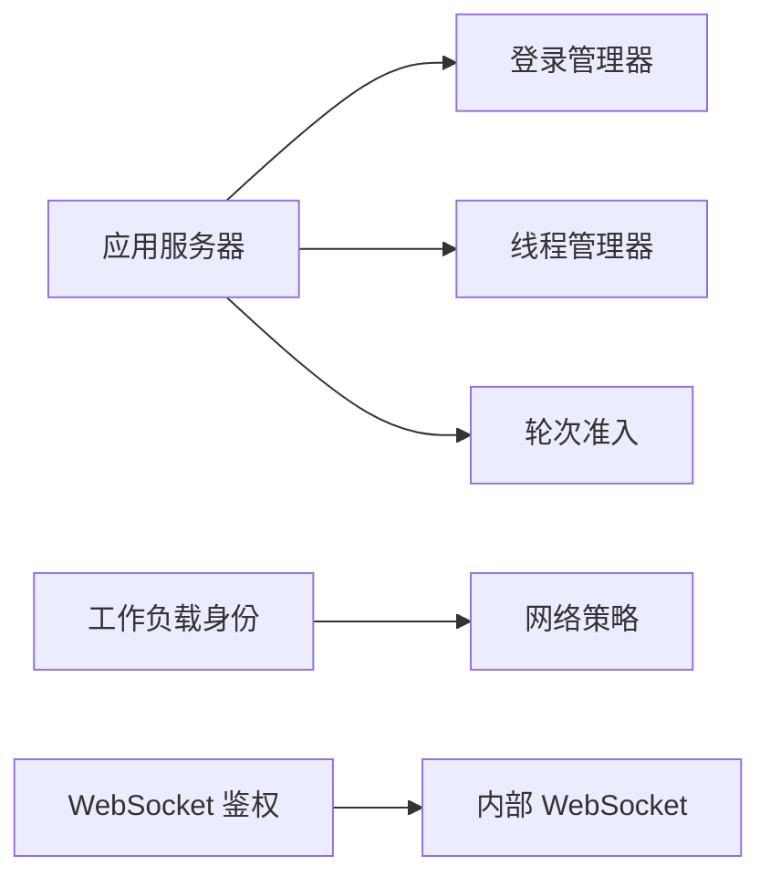

# 授权与权限

<cite>
**本文引用的文件**
- [workspace_routing.rs](file://codex-rs/app-server/src/request_processors/account_processor/workspace_routing.rs)
- [account_switching.rs](file://codex-rs/app-server/src/request_processors/account_processor/workspace_switching.rs)
- [thread_workspace_switching.rs](file://codex-rs/app-server/src/request_processors/thread_processor/workspace_switching.rs)
- [turn_admission.rs](file://codex-rs/app-server/src/turn_admission.rs)
- [manager_workspace_switching.rs](file://codex-rs/login/src/auth/manager/workspace_switching.rs)
- [websocket_auth.rs](file://codex-rs/websocket-auth/src/lib.rs)
- [workload_identity_lib.rs](file://codex-rs/workload-identity/src/lib.rs)
- [workload_identity_exchange.rs](file://codex-rs/workload-identity/src/exchange.rs)
</cite>

## 目录
1. [引言](#引言)
2. [项目结构](#项目结构)
3. [核心组件](#核心组件)
4. [架构总览](#架构总览)
5. [详细组件分析](#详细组件分析)
6. [依赖关系分析](#依赖关系分析)
7. [性能考虑](#性能考虑)
8. [故障排查指南](#故障排查指南)
9. [结论](#结论)

## 引言
本文面向授权、认证与工作区权限控制，重点覆盖以下目标：
- 权限模型设计：角色权限、资源访问控制和操作权限在系统中的体现。
- 工作区路由与切换：多租户支持、权限隔离、会话与会话内线程的生命周期管理。
- 工作负载身份验证：服务账户和工作进程的身份管理与令牌交换。
- 权限撤销与资源回收：工作区切换时的工作流暂停、线程卸载和状态清理。
- 权限检查执行流程与缓存策略：令牌缓存、并发单飞刷新、网络策略限制。
- 跨工作区权限传播与继承规则：当前实现以“按工作区重新解析”为主，而非传统 RBAC 继承。
- 最佳实践与安全建议：如何配置最小权限、避免凭据泄露、处理失败回滚。

本项目并未实现传统意义上的中心化 RBAC 系统；其“权限模型”主要由以下机制组成：
- 基于工作区的账号会话隔离（ChatGPT 托管登录与会话）。
- 后端路由发现返回的可用工作区列表与后端来源校验。
- 本地网络策略与出站代理策略对请求的限制。
- 工作区切换时对运行时执行的暂停与线程卸载。
- 工作负载身份的短期令牌交换与缓存。
- WebSocket 端点的能力令牌或签名 JWT 接入鉴权。

## 项目结构
授权与权限相关代码主要分布在以下模块：
- `app-server`：工作区路由、工作区切换、线程生命周期暂停与恢复、Turn 准入控制。
- `login`：托管 ChatGPT 登录、工作区切换验证、会话绑定与凭据快照恢复。
- `workload-identity`：服务账户/工作负载身份断言交换、短期令牌缓存。
- `websocket-auth`：WebSocket 升级时的能力令牌或签名 JWT 鉴权。

**图表来源**
- [workspace_routing.rs:1-200](file://codex-rs/app-server/src/request_processors/account_processor/workspace_routing.rs#L1-L200)
- [account_switching.rs:1-200](file://codex-rs/app-server/src/request_processors/account_processor/workspace_switching.rs#L1-L200)
- [thread_workspace_switching.rs:1-34](file://codex-rs/app-server/src/request_processors/thread_processor/workspace_switching.rs#L1-L34)
- [turn_admission.rs:1-125](file://codex-rs/app-server/src/turn_admission.rs#L1-L125)
- [manager_workspace_switching.rs:1-200](file://codex-rs/login/src/auth/manager/workspace_switching.rs#L1-L200)
- [workload_identity_exchange.rs:1-200](file://codex-rs/workload-identity/src/exchange.rs#L1-L200)
- [websocket_auth.rs:1-200](file://codex-rs/websocket-auth/src/lib.rs#L1-L200)

**章节来源**
- [workspace_routing.rs:1-200](file://codex-rs/app-server/src/request_processors/account_processor/workspace_routing.rs#L1-L200)
- [account_switching.rs:1-200](file://codex-rs/app-server/src/request_processors/account_processor/workspace_switching.rs#L1-L200)
- [thread_workspace_switching.rs:1-34](file://codex-rs/app-server/src/request_processors/thread_processor/workspace_switching.rs#L1-L34)
- [turn_admission.rs:1-125](file://codex-rs/app-server/src/turn_admission.rs#L1-L125)
- [manager_workspace_switching.rs:1-200](file://codex-rs/login/src/auth/manager/workspace_switching.rs#L1-L200)
- [workload_identity_exchange.rs:1-200](file://codex-rs/workload-identity/src/exchange.rs#L1-L200)
- [websocket_auth.rs:1-200](file://codex-rs/websocket-auth/src/lib.rs#L1-L200)

## 核心组件
- 工作区路由组件：负责根据账号与后端要求发现工作区路由，维护路由键、缓存与错误类型，并保证不跨越认证所有者边界。
- 工作区切换组件：负责列出受管会话、校验目标工作区、触发浏览器登录或后台会话交换，并在切换前暂停工作流。
- 线程工作区切换组件：在工作区切换期间卸载旧工作区线程，确保不再提交新任务。
- 轮次准入控制：防止在工作区切换或关闭阶段提交新的轮次任务。
- 登录管理器工作区切换：校验本地条件、绑定会话 ID、交换工作区令牌、保留凭据快照以便失败回滚。
- 工作负载身份交换：读取断言文件、调用令牌 URL、缓存短期令牌、支持重试与版本失效。
- WebSocket 鉴权：支持能力令牌或签名 JWT 模式，用于保护内部 WebSocket 连接。

**章节来源**
- [workspace_routing.rs:1-200](file://codex-rs/app-server/src/request_processors/account_processor/workspace_routing.rs#L1-L200)
- [account_switching.rs:1-200](file://codex-rs/app-server/src/request_processors/account_processor/workspace_switching.rs#L1-L200)
- [thread_workspace_switching.rs:1-34](file://codex-rs/app-server/src/request_processors/thread_processor/workspace_switching.rs#L1-L34)
- [turn_admission.rs:1-125](file://codex-rs/app-server/src/turn_admission.rs#L1-L125)
- [manager_workspace_switching.rs:1-200](file://codex-rs/login/src/auth/manager/workspace_switching.rs#L1-L200)
- [workload_identity_lib.rs:1-96](file://codex-rs/workload-identity/src/lib.rs#L1-L96)
- [workload_identity_exchange.rs:1-200](file://codex-rs/workload-identity/src/exchange.rs#L1-L200)
- [websocket_auth.rs:1-200](file://codex-rs/websocket-auth/src/lib.rs#L1-L200)

## 架构总览
工作区权限的核心不是集中式 RBAC，而是“账号 + 工作区 + 后端路由”的组合：
- 客户端通过应用服务器发起工作区相关请求。
- 应用服务器根据账号状态与工作区要求查询后端路由。
- 若需要切换工作区，则先暂停所有轮次，卸载旧线程，再交换会话或启动浏览器登录。
- 切换成功后重新加载工作区配置，并恢复路由与传输状态。
- 工作负载身份为服务端内部服务提供短期令牌，由断言文件与联邦规则驱动。
- WebSocket 连接使用能力令牌或签名 JWT 进行鉴权。

**图表来源**
- [account_switching.rs:1-200](file://codex-rs/app-server/src/request_processors/account_processor/workspace_switching.rs#L1-L200)
- [manager_workspace_switching.rs:1-200](file://codex-rs/login/src/auth/manager/workspace_switching.rs#L1-L200)
- [thread_workspace_switching.rs:1-34](file://codex-rs/app-server/src/request_processors/thread_processor/workspace_switching.rs#L1-L34)
- [turn_admission.rs:1-125](file://codex-rs/app-server/src/turn_admission.rs#L1-L125)

## 详细组件分析

### 工作区路由与权限隔离
工作区路由组件负责：
- 按认证生成号、聊天账号 ID、有效后端地址与必需后端地址构建路由键。
- 缓存工作区路由结果，并保证同一键下并发等待共享结果。
- 在路由失败时返回明确的错误类型，如缺少账号 ID、后端冲突、无效后端地址、未授权等。
- 对配置加载错误进行脱敏，避免将敏感配置路径或云配置原始消息直接暴露给客户端。
- 遵循“不跨越认证所有者”的原则，确保路由不会把不同认证主体混在一起。

该组件是工作区权限的第一道边界：它决定一个账号在当前后端环境下可以访问哪些工作区，以及这些工作区对应哪个后端来源。

**图表来源**
- [workspace_routing.rs:1-200](file://codex-rs/app-server/src/request_processors/account_processor/workspace_routing.rs#L1-L200)

**章节来源**
- [workspace_routing.rs:1-200](file://codex-rs/app-server/src/request_processors/account_processor/workspace_routing.rs#L1-L200)

### 工作区切换与会话管理
工作区切换组件承担以下职责：
- 列出受管账号会话，并根据是否需要刷新元数据决定是否调用后端接口。
- 校验当前认证是否与请求中的会话 ID 匹配。
- 校验目标工作区是否在账号成员列表中，且未被停用。
- 对政府工作区进行额外限制，必要时引导用户重新登录。
- 在切换前暂停轮次准入，卸载旧工作区线程，然后执行会话交换或浏览器登录。
- 切换后重新加载工作区配置，并在失败时尝试恢复之前登录状态。

**图表来源**
- [account_switching.rs:1-200](file://codex-rs/app-server/src/request_processors/account_processor/workspace_switching.rs#L1-L200)
- [manager_workspace_switching.rs:1-200](file://codex-rs/login/src/auth/manager/workspace_switching.rs#L1-L200)
- [thread_workspace_switching.rs:1-34](file://codex-rs/app-server/src/request_processors/thread_processor/workspace_switching.rs#L1-L34)

**章节来源**
- [account_switching.rs:1-200](file://codex-rs/app-server/src/request_processors/account_processor/workspace_switching.rs#L1-L200)
- [thread_workspace_switching.rs:1-34](file://codex-rs/app-server/src/request_processors/thread_processor/workspace_switching.rs#L1-L34)

### 登录管理器工作区切换
登录管理器工作区切换组件负责：
- 校验工作区 ID 非空、当前认证类型为托管 ChatGPT、不存在外部认证。
- 校验请求中的会话 ID 必须与当前受管会话一致。
- 在刷新锁保护下重新校验会话，避免并发登录覆盖。
- 保存当前凭据快照，交换工作区令牌，并在失败时保留回滚能力。
- 如果目标工作区已经是当前工作区，则快速返回而不改变状态。

该组件强调“凭据不出本地存储”，并通过会话 ID 绑定切换操作，避免不同会话之间的权限交叉。

**图表来源**
- [manager_workspace_switching.rs:1-200](file://codex-rs/login/src/auth/manager/workspace_switching.rs#L1-L200)

**章节来源**
- [manager_workspace_switching.rs:1-200](file://codex-rs/login/src/auth/manager/workspace_switching.rs#L1-L200)

### 轮次准入与工作区隔离
轮次准入控制用于防止在工作区切换、服务关闭或运行时变更期间提交新的任务：
- `pause()` 会标记暂停状态，并等待现有活跃任务归零。
- `admit()` 在服务关闭或暂停时拒绝新任务。
- 每次任务开始时计数加一，结束时计数减一，并通知订阅者。
- 工作区切换流程中先暂停，再卸载线程，最后才恢复。

这构成了工作区切换期间的“操作权限冻结”：在切换未完成前，不允许继续在新工作区上下文中提交工作。

**图表来源**
- [turn_admission.rs:1-125](file://codex-rs/app-server/src/turn_admission.rs#L1-L125)

**章节来源**
- [turn_admission.rs:1-125](file://codex-rs/app-server/src/turn_admission.rs#L1-L125)

### 工作负载身份验证
工作负载身份组件用于服务账户与工作进程获取短期访问令牌：
- 配置包含联邦规则 ID、断言文件路径与可选上下文。
- 断言文件必须为绝对路径，且大小有限制。
- 令牌 URL 仅允许 HTTPS 或回环 HTTP。
- 交换过程使用网络策略，生产环境走代理策略，开发回环直连。
- 内存中缓存短期令牌，支持过期前刷新、并发单飞刷新与版本失效。
- 错误分为瞬时与非瞬时两类，便于调用方决定重试策略。

**图表来源**
- [workload_identity_lib.rs:1-96](file://codex-rs/workload-identity/src/lib.rs#L1-L96)
- [workload_identity_exchange.rs:1-200](file://codex-rs/workload-identity/src/exchange.rs#L1-L200)

**章节来源**
- [workload_identity_lib.rs:1-96](file://codex-rs/workload-identity/src/lib.rs#L1-L96)
- [workload_identity_exchange.rs:1-200](file://codex-rs/workload-identity/src/exchange.rs#L1-L200)

### WebSocket 接入鉴权
WebSocket 鉴权组件支持两种模式：
- 能力令牌模式：从文件或哈希值读取能力令牌。
- 签名 JWT 模式：从共享密钥文件加载签名，校验签发者、受众与时钟偏差。

默认策略允许未认证连接，但具体监听器可决定其绑定地址是否允许未认证接入。这种设计适合内部服务之间通信，同时保留管理员按需收紧策略的能力。

**图表来源**
- [websocket_auth.rs:1-200](file://codex-rs/websocket-auth/src/lib.rs#L1-L200)

**章节来源**
- [websocket_auth.rs:1-200](file://codex-rs/websocket-auth/src/lib.rs#L1-L200)

## 依赖关系分析
授权与权限相关模块之间存在明确依赖：
- 应用服务器依赖登录管理器进行工作区会话切换。
- 应用服务器依赖线程管理器卸载旧工作区线程。
- 应用服务器依赖轮次准入控制阻止切换期间的任务提交。
- 工作负载身份依赖网络策略与 HTTP 客户端工厂。
- WebSocket 鉴权独立于工作区路由，主要用于内部服务连接安全。

**图表来源**
- [account_switching.rs:1-200](file://codex-rs/app-server/src/request_processors/account_processor/workspace_switching.rs#L1-L200)
- [manager_workspace_switching.rs:1-200](file://codex-rs/login/src/auth/manager/workspace_switching.rs#L1-L200)
- [turn_admission.rs:1-125](file://codex-rs/app-server/src/turn_admission.rs#L1-L125)
- [workload_identity_exchange.rs:1-200](file://codex-rs/workload-identity/src/exchange.rs#L1-L200)
- [websocket_auth.rs:1-200](file://codex-rs/websocket-auth/src/lib.rs#L1-L200)

**章节来源**
- [account_switching.rs:1-200](file://codex-rs/app-server/src/request_processors/account_processor/workspace_switching.rs#L1-L200)
- [manager_workspace_switching.rs:1-200](file://codex-rs/login/src/auth/manager/workspace_switching.rs#L1-L200)
- [turn_admission.rs:1-125](file://codex-rs/app-server/src/turn_admission.rs#L1-L125)
- [workload_identity_exchange.rs:1-200](file://codex-rs/workload-identity/src/exchange.rs#L1-L200)
- [websocket_auth.rs:1-200](file://codex-rs/websocket-auth/src/lib.rs#L1-L200)

## 性能考虑
- 工作区路由缓存：同一路由键下的并发请求共享一次后端查询，减少重复网络开销。
- 工作负载令牌缓存：短期令牌在有效期内复用，避免频繁交换；失败时按瞬时错误策略延迟刷新。
- 轮次准入控制：使用短锁更新活跃任务计数，降低锁竞争。
- 工作区切换前的线程卸载：设置超时与完成报告，避免长时间阻塞切换流程。
- WebSocket 鉴权：能力令牌哈希比较与 JWT 解码均为轻量操作，适合高频连接场景。

[本节为通用性能指导，不直接分析具体代码行]

## 故障排查指南
常见权限与切换问题及定位方式：
- 工作区路由失败：检查账号 ID 是否存在、后端地址是否合法、网络策略是否拒绝访问。
- 工作区切换被拒绝：确认会话 ID 是否匹配、是否为托管 ChatGPT 登录、是否存在外部认证。
- 工作区切换卡住：查看是否有线程仍在运行，或轮次准入仍处于暂停状态。
- 工作负载令牌刷新失败：区分瞬时错误与非瞬时错误，检查断言文件路径、大小、令牌 URL 协议与网络策略。
- WebSocket 连接被拒：检查能力令牌文件或哈希是否正确，JWT 签发者、受众与过期时间是否匹配。

**章节来源**
- [workspace_routing.rs:1-200](file://codex-rs/app-server/src/request_processors/account_processor/workspace_routing.rs#L1-L200)
- [account_switching.rs:1-200](file://codex-rs/app-server/src/request_processors/account_processor/workspace_switching.rs#L1-L200)
- [turn_admission.rs:1-125](file://codex-rs/app-server/src/turn_admission.rs#L1-L125)
- [workload_identity_lib.rs:1-96](file://codex-rs/workload-identity/src/lib.rs#L1-L96)
- [websocket_auth.rs:1-200](file://codex-rs/websocket-auth/src/lib.rs#L1-L200)

## 结论
该项目的权限模型以“工作区 + 账号会话 + 后端路由”为核心，而不是传统的 RBAC 体系。权限控制体现在：
- 工作区路由只允许当前认证主体访问其所属工作区。
- 工作区切换通过会话 ID 绑定、凭据快照与轮次暂停保证一致性。
- 工作负载身份通过断言与短期令牌提供服务间最小权限访问。
- WebSocket 鉴权为内部连接提供可选的安全边界。

跨工作区的权限继承并非通过角色继承实现，而是通过每个工作区的后端路由与账号成员关系重新评估。最佳实践包括：
- 严格限定工作区切换的会话 ID 与账号 ID。
- 使用托管登录并避免混合外部认证。
- 对工作负载身份启用最小断言与最短令牌有效期。
- 在生产环境中开启网络策略与 WebSocket 鉴权。
- 在工作区切换失败时保留凭据快照，避免凭据泄露或状态不一致。

[本节为总结性内容，不直接分析具体代码行]