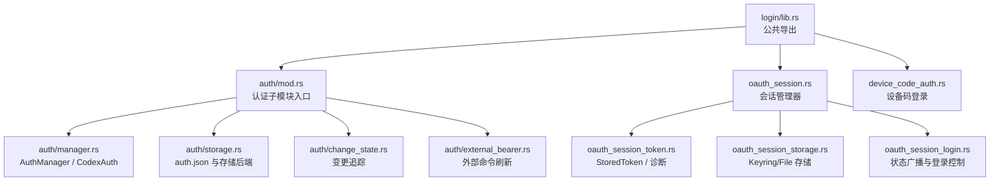
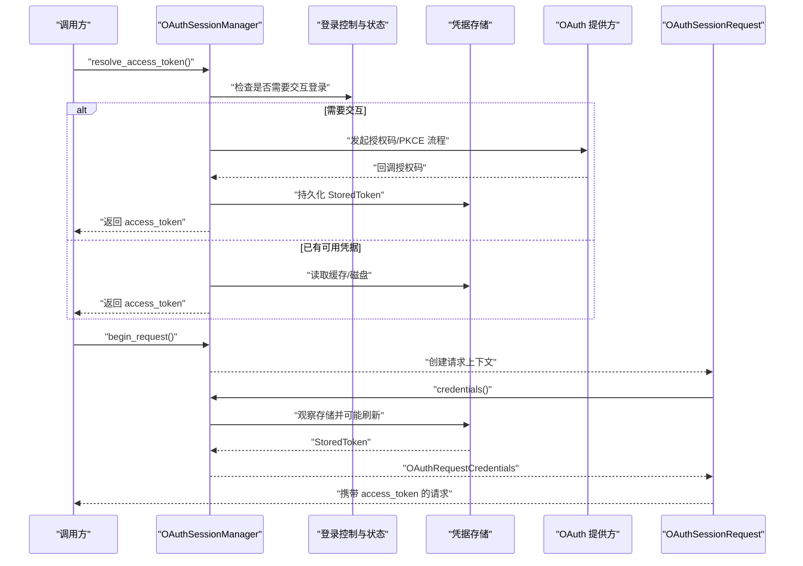
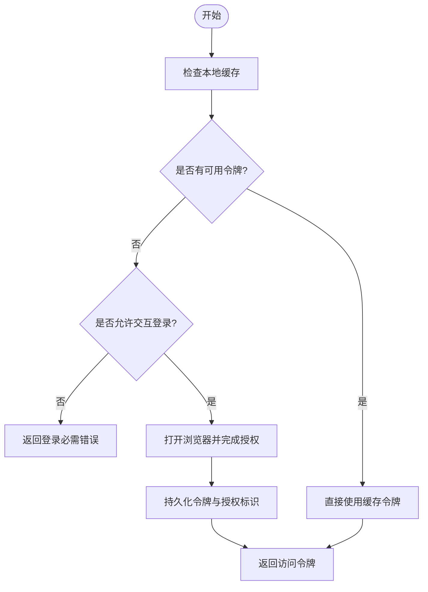
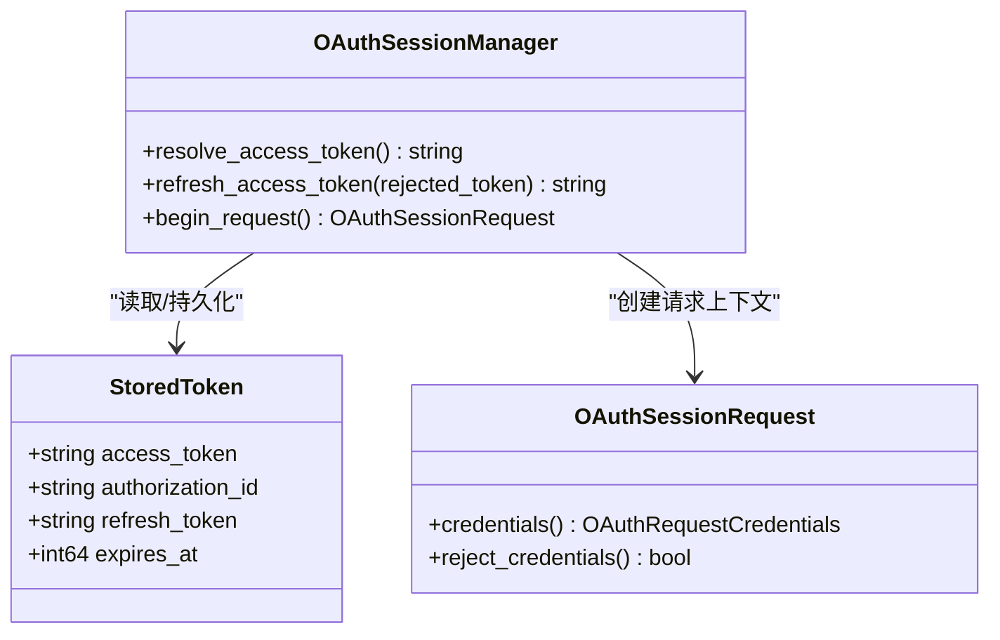
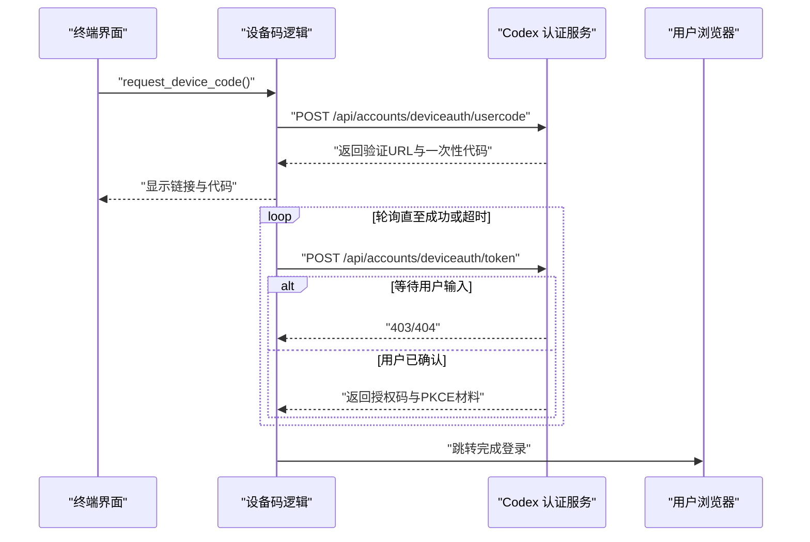
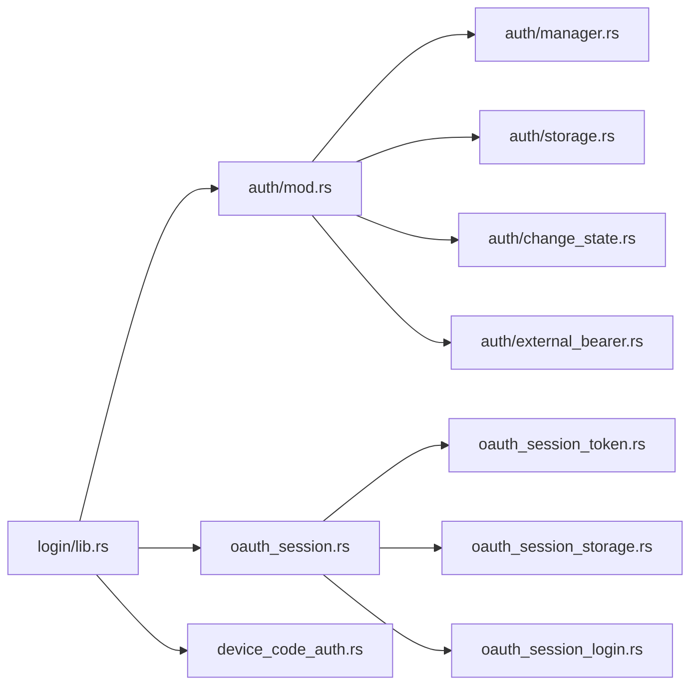

# 认证与安全

<cite>
**本文引用的文件**   
- [codex-rs/login/src/lib.rs](file://codex-rs/login/src/lib.rs)
- [codex-rs/login/src/auth/mod.rs](file://codex-rs/login/src/auth/mod.rs)
- [codex-rs/login/src/auth/manager.rs](file://codex-rs/login/src/auth/manager.rs)
- [codex-rs/login/src/auth/api_key.rs](file://codex-rs/login/src/auth/api_key.rs)
- [codex-rs/login/src/auth/access_token.rs](file://codex-rs/login/src/auth/access_token.rs)
- [codex-rs/login/src/auth/personal_access_token.rs](file://codex-rs/login/src/auth/personal_access_token.rs)
- [codex-rs/login/src/auth/workload_identity.rs](file://codex-rs/login/src/auth/workload_identity.rs)
- [codex-rs/login/src/auth/change_state.rs](file://codex-rs/login/src/auth/change_state.rs)
- [codex-rs/login/src/auth/storage.rs](file://codex-rs/login/src/auth/storage.rs)
- [codex-rs/login/src/auth/storage_file.rs](file://codex-rs/login/src/auth/storage_file.rs)
- [codex-rs/login/src/auth/auth_headers.rs](file://codex-rs/login/src/auth/auth_headers.rs)
- [codex-rs/login/src/auth/external_bearer.rs](file://codex-rs/login/src/auth/external_bearer.rs)
- [codex-rs/login/src/oauth_session.rs](file://codex-rs/login/src/oauth_session.rs)
- [codex-rs/login/src/oauth_session_login.rs](file://codex-rs/login/src/oauth_session_login.rs)
- [codex-rs/login/src/oauth_session_request.rs](file://codex-rs/login/src/oauth_session_request.rs)
- [codex-rs/login/src/oauth_session_token.rs](file://codex-rs/login/src/oauth_session_token.rs)
- [codex-rs/login/src/oauth_session_storage.rs](file://codex-rs/login/src/oauth_session_storage.rs)
- [codex-rs/login/src/device_code_auth.rs](file://codex-rs/login/src/device_code_auth.rs)
- [docs/authentication.md](file://docs/authentication.md)
</cite>

## 目录
1. [简介](#简介)
2. [项目结构](#项目结构)
3. [核心组件](#核心组件)
4. [架构总览](#架构总览)
5. [详细组件分析](#详细组件分析)
6. [依赖关系分析](#依赖关系分析)
7. [性能与可用性特征](#性能与可用性特征)
8. [安全配置指南](#安全配置指南)
9. [故障排查](#故障排查)
10. [结论](#结论)

## 简介
本文件系统性梳理 Codex CLI 与相关 Rust 库中的认证与安全机制，覆盖以下方面：
- 支持的认证方式：ChatGPT 账户登录、API Key、设备码登录、个人访问令牌、工作负载身份、外部头信息注入等。
- 访问令牌管理：缓存、过期判断、刷新策略、失败恢复、持久化与密钥环存储。
- 权限控制：基于身份来源的 API 模式区分、FedRAMP 路由提示、账号与工作区身份提取。
- 安全最佳实践：密钥最小暴露、网络传输约束、输入校验、日志脱敏、原子写入与锁保护。
- 审计与日志：OAuth 错误诊断、遥测扩展点、存储操作钩子。
- 外部系统集成：模型提供商命令刷新外部 Bearer、工作负载身份交换、代理与出站策略。

文档面向开发者与安全工程师，同时尽量以分层说明帮助非专业读者理解。

## 项目结构
认证与安全能力主要集中在 `codex-rs/login` 模块中，按职责划分为：
- `auth/`：统一认证抽象、身份枚举、凭据加载、刷新、存储与变更追踪。
- `oauth_session*`：浏览器 OAuth 会话、状态广播、请求级凭据包装、Token 持久化。
- `device_code_auth.rs`：设备码授权流程实现。
- 顶层导出：通过 `lib.rs` 暴露登录服务器、设备码、凭据导出、工作区路由等公共 API。

**图示来源**
- [codex-rs/login/src/lib.rs:1-102](file://codex-rs/login/src/lib.rs#L1-L102)
- [codex-rs/login/src/auth/mod.rs:1-32](file://codex-rs/login/src/auth/mod.rs#L1-L32)
- [codex-rs/login/src/auth/manager.rs:1-200](file://codex-rs/login/src/auth/manager.rs#L1-L200)
- [codex-rs/login/src/oauth_session.rs:1-120](file://codex-rs/login/src/oauth_session.rs#L1-L120)

**章节来源**
- [codex-rs/login/src/lib.rs:1-102](file://codex-rs/login/src/lib.rs#L1-L102)
- [codex-rs/login/src/auth/mod.rs:1-32](file://codex-rs/login/src/auth/mod.rs#L1-L32)

## 核心组件
### 统一认证抽象与身份枚举
`CodexAuth` 是统一的当前认证值，封装多种认证后端，并对外提供身份元数据、计划类型、FedRAMP 提示等能力。它支持：
- API Key 认证
- ChatGPT 账户 OAuth（含自动刷新）
- 仅使用已解析 Token 的模式（由外部系统负责生命周期）
- 外部头信息注入
- Agent Identity（Agent 身份）
- 个人访问令牌
- Bedrock API Key 与 AWS Access Keys

该枚举还定义“内部 API 认证模式”和“是否使用 Codex 后端”等判断方法，供上层路由与策略选择。

**章节来源**
- [codex-rs/login/src/auth/manager.rs:1-200](file://codex-rs/login/src/auth/manager.rs#L1-L200)
- [codex-rs/login/src/auth/manager.rs:501-700](file://codex-rs/login/src/auth/manager.rs#L501-L700)

### 会话与请求级凭据包装
`OAuthSessionManager` 负责：
- 解析、刷新、缓存并持久化 OAuth access token。
- 根据策略决定是否允许交互式浏览器登录。
- 在请求失败时进行未授权恢复。
- 广播登录状态变化。

`OAuthSessionRequest` 将一次请求与“拒绝过的令牌”绑定，避免重试时丢失恢复上下文。

**章节来源**
- [codex-rs/login/src/oauth_session.rs:1-260](file://codex-rs/login/src/oauth_session.rs#L1-L260)
- [codex-rs/login/src/oauth_session_request.rs:1-70](file://codex-rs/login/src/oauth_session_request.rs#L1-L70)

### 凭据存储与密钥管理
- `auth.json` 存储 ChatGPT/OAuth 元数据、Agent Identity 记录、Bedrock 凭据等，并通过可插拔后端保存。
- Gateway OAuth 凭据可选择保存在系统密钥环或本地 JSON 文件中。
- 文件替换采用原子写与锁保护，防止硬链接、只读文件和符号链接导致的竞争条件。

**章节来源**
- [codex-rs/login/src/auth/storage.rs:1-220](file://codex-rs/login/src/auth/storage.rs#L1-L220)
- [codex-rs/login/src/oauth_session_storage.rs:1-147](file://codex-rs/login/src/oauth_session_storage.rs#L1-L147)
- [codex-rs/login/src/auth/storage_file.rs:1-73](file://codex-rs/login/src/auth/storage_file.rs#L1-L73)

### 外部认证集成
- 外部 Bearer 刷新器调用用户配置的命令获取临时令牌，并在超时或退出后丢弃。
- 工作负载身份通过环境变量、断言文件和联邦规则 ID 交换令牌。
- 外部头信息注入允许第三方服务直接提供身份头，Codex 不验证其内容但可用于策略决策。

**章节来源**
- [codex-rs/login/src/auth/external_bearer.rs:1-184](file://codex-rs/login/src/auth/external_bearer.rs#L1-L184)
- [codex-rs/login/src/auth/workload_identity.rs:1-220](file://codex-rs/login/src/auth/workload_identity.rs#L1-L220)
- [codex-rs/login/src/auth/auth_headers.rs:1-32](file://codex-rs/login/src/auth/auth_headers.rs#L1-L32)

## 架构总览
下面的序列图描述一次典型 ChatGPT 账户登录与后续请求调用的完整链路：

**图示来源**
- [codex-rs/login/src/oauth_session.rs:1-260](file://codex-rs/login/src/oauth_session.rs#L1-L260)
- [codex-rs/login/src/oauth_session_login.rs:1-200](file://codex-rs/login/src/oauth_session_login.rs#L1-L200)
- [codex-rs/login/src/oauth_session_request.rs:1-70](file://codex-rs/login/src/oauth_session_request.rs#L1-L70)
- [codex-rs/login/src/oauth_session_storage.rs:1-147](file://codex-rs/login/src/oauth_session_storage.rs#L1-L147)

## 详细组件分析

### ChatGPT 账户登录与浏览器 OAuth 流程
- 会话管理器创建专用 HTTP 客户端，禁用重定向与请求日志，尊重出站代理策略。
- 首次无有效凭据且允许交互时，打开浏览器完成授权码 + PKCE 流程。
- 成功后将 `access_token`、可选 `refresh_token`、过期时间、稳定 `authorization_id` 写入存储。
- 后续请求优先复用缓存；若缓存失效或被上游拒绝，则尝试刷新或重新授权。

**图示来源**
- [codex-rs/login/src/oauth_session.rs:120-260](file://codex-rs/login/src/oauth_session.rs#L120-L260)
- [codex-rs/login/src/oauth_session_login.rs:1-200](file://codex-rs/login/src/oauth_session_login.rs#L1-L200)

**章节来源**
- [codex-rs/login/src/oauth_session.rs:1-260](file://codex-rs/login/src/oauth_session.rs#L1-L260)
- [codex-rs/login/src/oauth_session_login.rs:1-200](file://codex-rs/login/src/oauth_session_login.rs#L1-L200)

### 访问令牌管理与自动刷新
- 令牌结构包含访问令牌、刷新令牌、过期时间与跨刷新稳定的授权标识。
- 刷新前会校验响应字段，包括禁止空令牌、仅接受 Bearer 类型、拒绝零有效期。
- 会话管理器维护三类策略：到期刷新、观察存储、因特定令牌被拒绝而跳过该令牌。
- 当上游返回未授权时，调用方可标记已发送令牌为“被拒绝”，从而触发刷新或重新授权。

**图示来源**
- [codex-rs/login/src/oauth_session_token.rs:1-181](file://codex-rs/login/src/oauth_session_token.rs#L1-L181)
- [codex-rs/login/src/oauth_session.rs:120-260](file://codex-rs/login/src/oauth_session.rs#L120-L260)
- [codex-rs/login/src/oauth_session_request.rs:1-70](file://codex-rs/login/src/oauth_session_request.rs#L1-L70)

**章节来源**
- [codex-rs/login/src/oauth_session_token.rs:1-181](file://codex-rs/login/src/oauth_session_token.rs#L1-L181)
- [codex-rs/login/src/oauth_session.rs:120-260](file://codex-rs/login/src/oauth_session.rs#L120-L260)
- [codex-rs/login/src/oauth_session_request.rs:1-70](file://codex-rs/login/src/oauth_session_request.rs#L1-L70)

### 设备码登录流程
设备码登录适用于无法直接打开浏览器的环境：
1. 向 `/api/accounts/deviceauth/usercode` 申请设备码与验证 URL。
2. 在终端展示验证链接与一次性代码。
3. 轮询 `/api/accounts/deviceauth/token`，直到获得授权码与 PKCE 材料或超时。
4. 完成后进入常规 OAuth 会话流程，最终落地到凭据存储。

**图示来源**
- [codex-rs/login/src/device_code_auth.rs:1-200](file://codex-rs/login/src/device_code_auth.rs#L1-L200)

**章节来源**
- [codex-rs/login/src/device_code_auth.rs:1-200](file://codex-rs/login/src/device_code_auth.rs#L1-L200)

### API Key 认证与 FedRAMP 提示
- API Key 认证直接从配置或环境变量读取 key，不做网络验证。
- 通过 key 前缀识别 FedRAMP 发行标记，用于路由提示；该判断不验证密钥有效性。
- 工作负载身份可与 API Key 关联，作为附加元数据参与后续策略。

**章节来源**
- [codex-rs/login/src/auth/api_key.rs:1-9](file://codex-rs/login/src/auth/api_key.rs#L1-L9)
- [codex-rs/login/src/auth/manager.rs:201-260](file://codex-rs/login/src/auth/manager.rs#L201-L260)

### 个人访问令牌
- 通过 `/v1/user-auth-credential/whoami` 拉取令牌元数据，包括邮箱、用户 ID、账户 ID、计划类型与 FedRAMP 标志。
- 支持缓存相同令牌以避免重复网络请求。
- 可作为独立认证模式使用，也可被 `CodexAuth` 统一管理。

**章节来源**
- [codex-rs/login/src/auth/personal_access_token.rs:1-134](file://codex-rs/login/src/auth/personal_access_token.rs#L1-L134)

### 工作负载身份
- 通过进程环境变量检测是否启用工作负载身份。
- 要求联邦规则 ID、断言令牌文件路径与可选上下文。
- 根据 ChatGPT 基础地址分类生产或预发环境，并构造对应令牌端点。
- 与 `WorkloadIdentityExchange` 协作完成令牌交换。

**章节来源**
- [codex-rs/login/src/auth/workload_identity.rs:1-220](file://codex-rs/login/src/auth/workload_identity.rs#L1-L220)

### 外部头信息注入
- 允许外部认证提供者直接传入 HTTP 头。
- Codex 不验证头内容，但将其视为受管身份来源，并可据此应用策略。
- 调试输出对头信息进行脱敏。

**章节来源**
- [codex-rs/login/src/auth/auth_headers.rs:1-32](file://codex-rs/login/src/auth/auth_headers.rs#L1-L32)

### 凭据变更追踪与所有权
`AuthChangeState` 提供多粒度生成号：
- 凭证变化
- 所有者变化
- 来源变化
- 登录严格所有权变化

上层可在长时间任务中比较期望的 owner 与当前状态，决定是否需要重建请求或重置连接。

**章节来源**
- [codex-rs/login/src/auth/change_state.rs:1-114](file://codex-rs/login/src/auth/change_state.rs#L1-L114)

### 外部 Bearer 刷新
- 通过配置的命令异步执行，从标准输出读取临时访问令牌。
- 支持超时、工作目录、参数与环境变量传递。
- 结果缓存在内存中，下次请求命中缓存直到刷新间隔过期。

**章节来源**
- [codex-rs/login/src/auth/external_bearer.rs:1-184](file://codex-rs/login/src/auth/external_bearer.rs#L1-L184)

## 依赖关系分析

**图示来源**
- [codex-rs/login/src/lib.rs:1-102](file://codex-rs/login/src/lib.rs#L1-L102)
- [codex-rs/login/src/auth/mod.rs:1-32](file://codex-rs/login/src/auth/mod.rs#L1-L32)
- [codex-rs/login/src/oauth_session.rs:1-120](file://codex-rs/login/src/oauth_session.rs#L1-L120)

**章节来源**
- [codex-rs/login/src/lib.rs:1-102](file://codex-rs/login/src/lib.rs#L1-L102)

## 性能与可用性特征
- 会话管理器在本地维护缓存，避免每次请求都访问磁盘或远端。
- 刷新策略区分“到期刷新”“观察存储”“因拒绝而跳过旧令牌”，减少无效重试。
- Gateway OAuth 存储使用文件锁或密钥环，保证并发读写安全。
- 浏览器登录状态通过广播通道共享，避免同一主机重复启动多个登录流程。
- 外部命令刷新带超时，避免阻塞主流程。

[本节为通用性能讨论，不直接分析具体代码行]

## 安全配置指南

### 密钥管理
- 优先使用系统密钥环存储 OAuth 凭据，降低明文泄露风险。
- 本地文件存储应限制目录与文件权限，避免其他用户读取。
- 外部命令输出的令牌应在进程内处理，不要写入日志或控制台。
- 对敏感字段（如 API Key、access_token）使用脱敏调试输出。

**章节来源**
- [codex-rs/login/src/oauth_session_storage.rs:1-147](file://codex-rs/login/src/oauth_session_storage.rs#L1-L147)
- [codex-rs/login/src/auth/storage_file.rs:1-73](file://codex-rs/login/src/auth/storage_file.rs#L1-L73)
- [codex-rs/login/src/oauth_session_token.rs:120-181](file://codex-rs/login/src/oauth_session_token.rs#L120-L181)

### 网络安全
- OAuth HTTP 客户端禁用重定向，避免跳转到不可信端点。
- 禁用请求日志，避免敏感参数进入日志。
- 遵循出站代理策略，限制认证流量路径。
- 设备码登录设置最大等待时间，防止无限轮询。

**章节来源**
- [codex-rs/login/src/oauth_session.rs:1-120](file://codex-rs/login/src/oauth_session.rs#L1-L120)
- [codex-rs/login/src/device_code_auth.rs:120-200](file://codex-rs/login/src/device_code_auth.rs#L120-L200)

### 输入校验
- 拒绝空 access_token、不支持的 token_type 与零有效期。
- 对工作负载身份的路径、Unicode 字符串与空值进行严格校验。
- 对 auth.json 与 gateway_oauth.json 的反序列化失败进行统一错误包装，避免泄露原始凭据。

**章节来源**
- [codex-rs/login/src/oauth_session_token.rs:1-120](file://codex-rs/login/src/oauth_session_token.rs#L1-L120)
- [codex-rs/login/src/auth/workload_identity.rs:120-220](file://codex-rs/login/src/auth/workload_identity.rs#L120-L220)
- [codex-rs/login/src/oauth_session_storage.rs:100-147](file://codex-rs/login/src/oauth_session_storage.rs#L100-L147)

### 安全审计与日志记录
- OAuth 端点错误会构建诊断消息，包含 grant_type、client_id、scopes、resource 等上下文，但会对敏感内容进行脱敏。
- 存储操作可通过 OpenTelemetry 扩展点进行埋点。
- 日志中对凭据字段使用 `<redacted>` 表示。

**章节来源**
- [codex-rs/login/src/oauth_session_token.rs:120-181](file://codex-rs/login/src/oauth_session_token.rs#L120-L181)
- [codex-rs/login/src/auth/storage.rs:1-80](file://codex-rs/login/src/auth/storage.rs#L1-L80)
- [codex-rs/login/src/auth/auth_headers.rs:15-32](file://codex-rs/login/src/auth/auth_headers.rs#L15-L32)

### 漏洞防护措施
- 原子替换 `auth.json` 与 gateway_oauth.json，防止部分写入导致凭据损坏。
- 拒绝硬链接与只读文件的替换，避免身份分裂。
- 限制符号链接展开深度，防止符号链接循环。
- 对 OAuth 回调与设备码响应进行状态码与超时保护。

**章节来源**
- [codex-rs/login/src/auth/storage_file.rs:1-73](file://codex-rs/login/src/auth/storage_file.rs#L1-L73)
- [codex-rs/login/src/device_code_auth.rs:80-160](file://codex-rs/login/src/device_code_auth.rs#L80-L160)

## 故障排查
常见认证问题及定位建议：
- **登录必需但未打开浏览器**：检查是否通过 `without_interactive_login` 禁用了交互登录，或运行时显式要求了手动登录。
- **刷新失败**：查看是否为永久失败原因（刷新令牌过期、已被撤销、账户不匹配），这类错误不应重试缓存失败凭据。
- **设备码超时**：确认用户在 15 分钟内完成验证，并检查服务端是否启用设备码登录。
- **凭据存储损坏**：检查 gateway_oauth.json 或密钥环条目是否可反序列化；必要时清除本地凭据后重新登录。
- **外部命令刷新失败**：检查命令是否存在、返回值是否成功、标准输出是否为空或非 UTF-8。

**章节来源**
- [codex-rs/login/src/oauth_session.rs:120-260](file://codex-rs/login/src/oauth_session.rs#L120-L260)
- [codex-rs/login/src/device_code_auth.rs:1-200](file://codex-rs/login/src/device_code_auth.rs#L1-L200)
- [codex-rs/login/src/auth/external_bearer.rs:120-184](file://codex-rs/login/src/auth/external_bearer.rs#L120-L184)

## 结论
Codex 的认证与安全体系围绕“统一身份抽象、会话级凭据管理、安全存储、外部集成与可观测性”构建。它既支持人类用户的浏览器与设备码登录，也支持机器场景下的 API Key、工作负载身份与外部头注入。通过严格的输入校验、网络策略、日志脱敏与原子写入，系统在可用性与安全性之间取得平衡。部署时应优先使用密钥环、限制文件权限、配置合适的刷新策略与外部命令超时，并结合错误诊断与审计扩展进行持续监控。

[本节为总结性内容，不直接分析具体代码行]