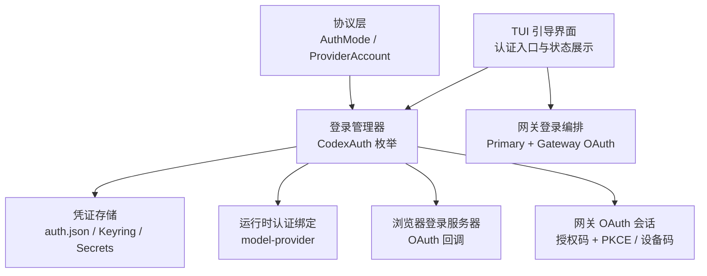
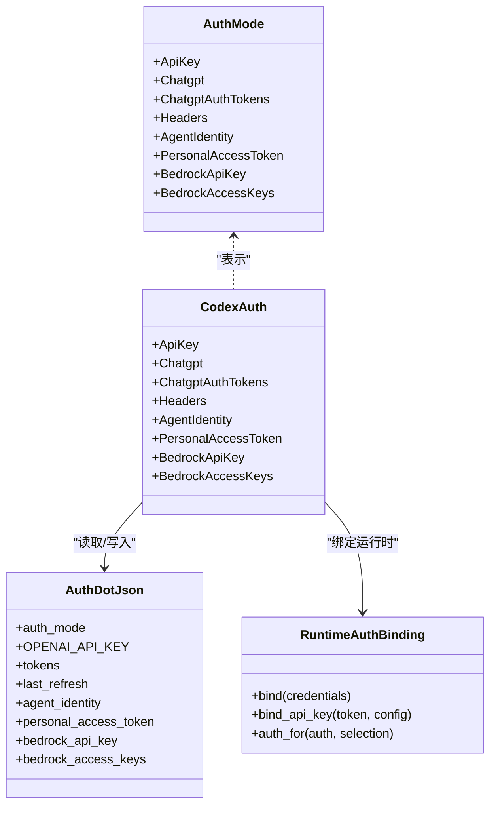
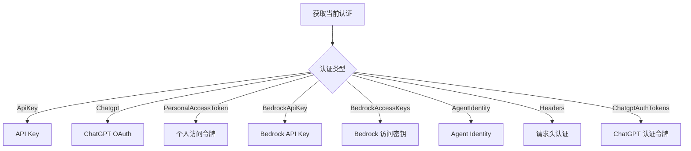
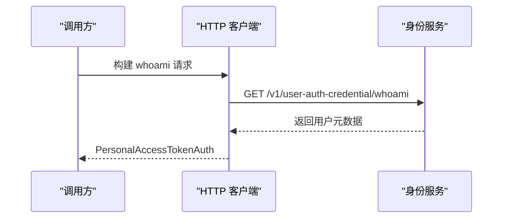
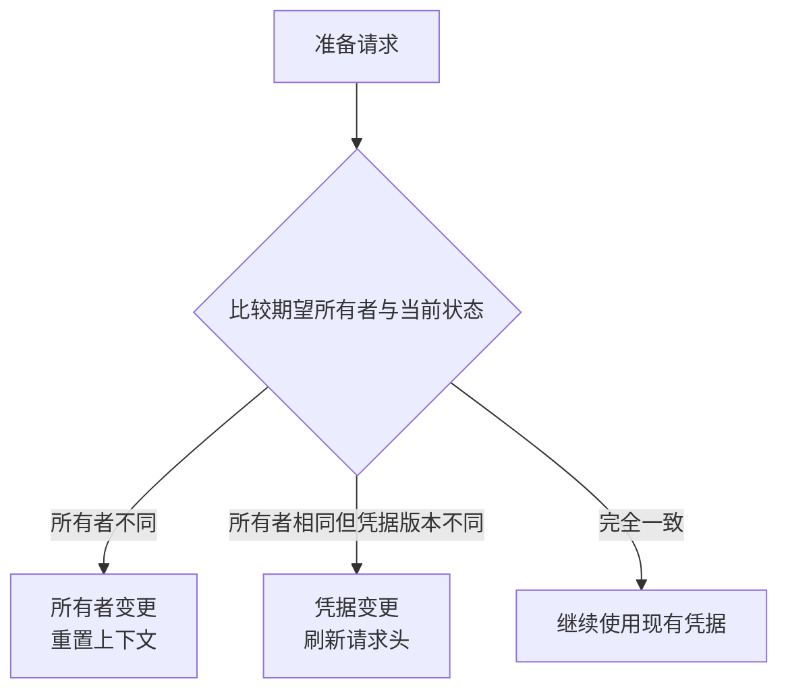
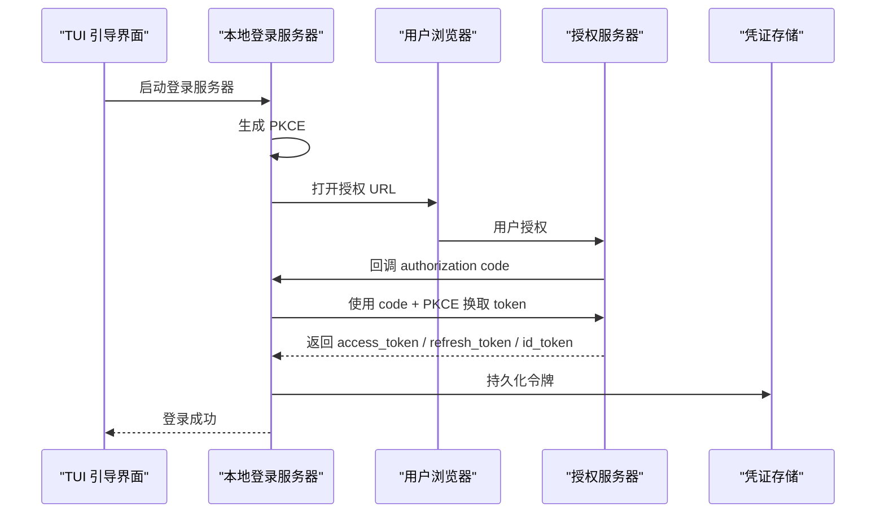
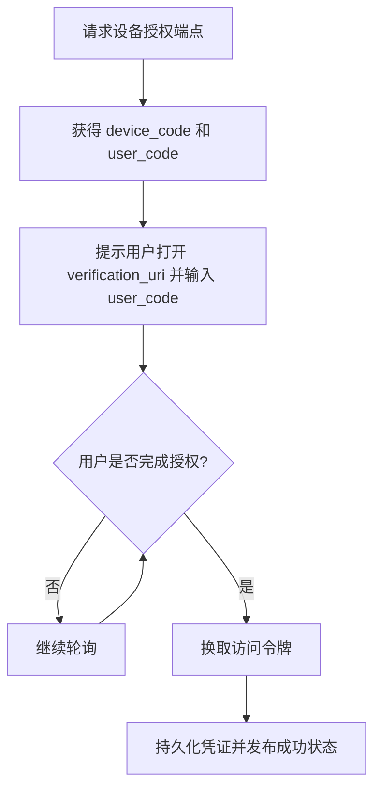
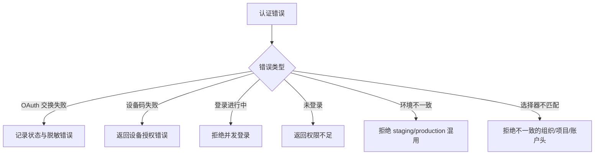

# 认证方式

<cite>
**本文引用的文件**   
- [authentication.md](file://docs/authentication.md)
- [auth.rs](file://codex-rs/protocol/src/auth.rs)
- [account.rs](file://codex-rs/protocol/src/account.rs)
- [manager.rs](file://codex-rs/login/src/auth/manager.rs)
- [change_state.rs](file://codex-rs/login/src/auth/change_state.rs)
- [personal_access_token.rs](file://codex-rs/login/src/auth/personal_access_token.rs)
- [bedrock_api_key.rs](file://codex-rs/login/src/auth/bedrock_api_key.rs)
- [access_token.rs](file://codex-rs/login/src/auth/access_token.rs)
- [storage.rs](file://codex-rs/login/src/auth/storage.rs)
- [server.rs](file://codex-rs/login/src/server.rs)
- [oauth_session_login.rs](file://codex-rs/login/src/oauth_session_login.rs)
- [types.rs](file://codex-rs/config/src/types.rs)
- [runtime_auth.rs](file://codex-rs/model-provider/src/runtime_auth.rs)
- [gateway_login.rs](file://codex-rs/tui/src/onboarding/gateway_login.rs)
- [auth.rs](file://codex-rs/tui/src/onboarding/auth.rs)
</cite>

## 目录
1. [引言](#引言)
2. [项目结构与定位](#项目结构与定位)
3. [支持的认证类型总览](#支持的认证类型总览)
4. [架构概览](#架构概览)
5. [核心组件分析](#核心组件分析)
6. [认证状态与切换机制](#认证状态与切换机制)
7. [OAuth2 流程与 PKCE 扩展](#oauth2-流程与-pkce-扩展)
8. [设备码登录流程](#设备码登录流程)
9. [配置方法与最佳实践](#配置方法与最佳实践)
10. [错误处理与恢复](#错误处理与恢复)
11. [性能特征与选择建议](#性能特征与选择建议)
12. [故障排查指南](#故障排查指南)
13. [结论](#结论)

## 引言
本文围绕 Codex 代码库中的认证实现，系统化说明支持的认证类型、配置位置、安全特性、OAuth2/PKCE 流程、设备码登录、认证状态管理、错误恢复机制，以及不同认证方式的适用场景和性能建议。文档面向两类读者：需要理解系统架构的开发者，以及希望正确配置和使用认证的终端用户或集成方。

Codex 官方文档指出，关于 Codex CLI 认证的具体信息可参考 OpenAI 开发者文档；本仓库内部则通过 Rust 模块实现具体的认证模式枚举、本地凭证存储、浏览器登录服务器、网关 OAuth 会话和设备码登录等能力。

**章节来源**
- [authentication.md:1-3](file://docs/authentication.md#L1-L3)

## 项目结构与定位
认证相关逻辑主要分布在以下模块：
- 协议层：`codex-rs/protocol/src/auth.rs`、`codex-rs/protocol/src/account.rs`
- 登录与凭证管理：`codex-rs/login/src/auth/*`
- 本地凭证持久化：`codex-rs/login/src/auth/storage.rs`
- 配置与密钥存储策略：`codex-rs/config/src/types.rs`
- 模型运行时认证绑定：`codex-rs/model-provider/src/runtime_auth.rs`
- TUI 引导登录与网关登录：`codex-rs/tui/src/onboarding/auth.rs`、`codex-rs/tui/src/onboarding/gateway_login.rs`
- 浏览器登录服务器与 OAuth 回调：`codex-rs/login/src/server.rs`
- 网关 OAuth 会话与设备码：`codex-rs/login/src/oauth_session_login.rs`

**图表来源**
- [auth.rs:9-35](file://codex-rs/protocol/src/auth.rs#L9-L35)
- [manager.rs:1-200](file://codex-rs/login/src/auth/manager.rs#L1-L200)
- [storage.rs:1-120](file://codex-rs/login/src/auth/storage.rs#L1-L120)
- [runtime_auth.rs:1-120](file://codex-rs/model-provider/src/runtime_auth.rs#L1-L120)
- [server.rs:180-210](file://codex-rs/login/src/server.rs#L180-L210)
- [oauth_session_login.rs:1-80](file://codex-rs/login/src/oauth_session_login.rs#L1-L80)
- [gateway_login.rs:1-60](file://codex-rs/tui/src/onboarding/gateway_login.rs#L1-L60)

**章节来源**
- [auth.rs:9-35](file://codex-rs/protocol/src/auth.rs#L9-L35)
- [account.rs:52-60](file://codex-rs/protocol/src/account.rs#L52-L60)
- [manager.rs:1-200](file://codex-rs/login/src/auth/manager.rs#L1-L200)
- [storage.rs:1-120](file://codex-rs/login/src/auth/storage.rs#L1-L120)
- [runtime_auth.rs:1-120](file://codex-rs/model-provider/src/runtime_auth.rs#L1-L120)
- [server.rs:180-210](file://codex-rs/login/src/server.rs#L180-L210)
- [oauth_session_login.rs:1-80](file://codex-rs/login/src/oauth_session_login.rs#L1-L80)
- [gateway_login.rs:1-60](file://codex-rs/tui/src/onboarding/gateway_login.rs#L1-L60)

## 支持的认证类型总览
协议层定义了统一的认证模式枚举，用于描述当前用户使用的认证机制。这些模式贯穿 TUI、登录管理器、后端协议和运行时请求构造。

| 认证模式 | 含义 | 典型使用场景 | 是否包含 ChatGPT 账户上下文 | 是否支持运行时工作区选择 |
|---|---|---|---:|---:|
| `ApiKey` | OpenAI API Key 认证 | 直接调用 OpenAI 兼容接口 | 否 | 否 |
| `Chatgpt` | ChatGPT OAuth 认证，由 Codex 管理令牌 | 交互式登录、浏览器授权 | 是 | 否 |
| `ChatgptAuthTokens` | ChatGPT 认证令牌模式 | 上游已持有令牌并传入 | 是 | 否 |
| `Headers` | 通过请求头提供后端认证 | 代理、企业网关或自定义鉴权 | 否 | 否 |
| `AgentIdentity` | Agent Identity 认证 | 程序化 Agent 身份、托管环境 | 否 | 否 |
| `PersonalAccessToken` | 个人访问令牌 | 非浏览器自动化、CI 或脚本 | 是 | 否 |
| `BedrockApiKey` | Amazon Bedrock API Key | AWS Bedrock 模型调用 | 否 | 否 |
| `BedrockAccessKeys` | Amazon Bedrock AWS 访问密钥 | AWS 访问密钥驱动的 Bedrock 调用 | 否 | 否 |

此外，`ProviderAccount` 在账户级别区分 `ApiKey` 与 ChatGPT 账户结构，用于 UI 和上层逻辑判断是否需要 ChatGPT 账户相关的认证。

**章节来源**
- [auth.rs:9-63](file://codex-rs/protocol/src/auth.rs#L9-L63)
- [account.rs:52-60](file://codex-rs/protocol/src/account.rs#L52-L60)

## 架构概览
Codex 的认证架构可以理解为“协议定义 → 登录管理器 → 凭证存储 → 运行时绑定”的分层结构：

1. **协议定义**：`AuthMode` 暴露统一认证模式，供 TUI、服务端、模型提供者共享。
2. **登录管理器**：`CodexAuth` 封装具体认证实现，包括 API Key、ChatGPT、Agent Identity、个人访问令牌、Bedrock 等。
3. **凭证存储**：通过 `AuthDotJson` 和可选的系统密钥链或加密 secrets 存储敏感数据。
4. **运行时绑定**：模型提供者根据请求头选择组织、项目或账户，并将认证绑定到运行时。

**图表来源**
- [auth.rs:9-35](file://codex-rs/protocol/src/auth.rs#L9-L35)
- [manager.rs:1-200](file://codex-rs/login/src/auth/manager.rs#L1-L200)
- [storage.rs:1-120](file://codex-rs/login/src/auth/storage.rs#L1-L120)
- [runtime_auth.rs:1-120](file://codex-rs/model-provider/src/runtime_auth.rs#L1-L120)

**章节来源**
- [auth.rs:9-35](file://codex-rs/protocol/src/auth.rs#L9-L35)
- [manager.rs:1-200](file://codex-rs/login/src/auth/manager.rs#L1-L200)
- [storage.rs:1-120](file://codex-rs/login/src/auth/storage.rs#L1-L120)
- [runtime_auth.rs:1-120](file://codex-rs/model-provider/src/runtime_auth.rs#L1-L120)

## 核心组件分析

### 登录管理器与认证类型封装
登录管理器集中维护当前用户的认证快照。它支持多种认证类型，并通过比较策略决定两次认证是否等价，例如相同工作负载身份主体、相同 ChatGPT 用户与账户、相同 Bedrock 凭据等。

关键职责：
- 维护 `CodexAuth` 枚举实例。
- 提供 Agent Identity 策略，决定是否允许从 ChatGPT 认证派生 Agent Identity。
- 与 OAuth、外部 Bearer Token、工作区路由、撤销、负载身份等子模块协作。

**图表来源**
- [manager.rs:1-200](file://codex-rs/login/src/auth/manager.rs#L1-L200)

**章节来源**
- [manager.rs:1-200](file://codex-rs/login/src/auth/manager.rs#L1-L200)

### API Key 认证
API Key 是最直接的认证方式，适合不需要 ChatGPT 账户上下文、仅调用 OpenAI 兼容接口的场景。它通常由配置或环境变量注入，并在 `AuthDotJson` 中以 `OPENAI_API_KEY` 字段存储。

特点：
- 不携带 ChatGPT 账户信息。
- 适合简单脚本、批量任务、非交互式调用。
- 安全性依赖 API Key 的保管策略。

**章节来源**
- [storage.rs:1-120](file://codex-rs/login/src/auth/storage.rs#L1-L120)
- [auth.rs:9-15](file://codex-rs/protocol/src/auth.rs#L9-L15)

### 个人访问令牌认证
个人访问令牌是一种面向程序的认证方式。实现会向身份服务查询令牌元数据，包括用户 ID、账户 ID、邮箱、计划类型和 FedRAMP 标识。该认证类型属于 ChatGPT 账户体系，但更适合自动化场景。

关键流程：
1. 从环境变量或配置中读取基础地址。
2. 调用 whoami 端点验证令牌并拉取元数据。
3. 构造 `PersonalAccessTokenAuth` 对象。
4. 通过 `AuthDotJson.personal_access_token` 字段持久化。

**图表来源**
- [personal_access_token.rs:1-134](file://codex-rs/login/src/auth/personal_access_token.rs#L1-L134)

**章节来源**
- [personal_access_token.rs:1-134](file://codex-rs/login/src/auth/personal_access_token.rs#L1-L134)
- [auth.rs:26-29](file://codex-rs/protocol/src/auth.rs#L26-L29)

### Bedrock API Key 认证
Bedrock API Key 认证用于连接 Amazon Bedrock。实现将 `api_key` 和 `region` 作为受管凭据写入 `auth.json`，并将 `auth_mode` 设置为 `BedrockApiKey`。

适用场景：
- 直接使用 Bedrock API Key 调用 AWS Bedrock 模型。
- 无需完整 AWS 访问密钥链的场景。

**章节来源**
- [bedrock_api_key.rs:1-60](file://codex-rs/login/src/auth/bedrock_api_key.rs#L1-L60)
- [auth.rs:30-33](file://codex-rs/protocol/src/auth.rs#L30-L33)

### Bedrock 访问密钥认证
仓库中还导出 `BedrockAccessKeysAuth` 和对应的登录函数，表明系统支持以 AWS 访问密钥形式管理 Bedrock 认证。其存储结构与 Bedrock API Key 类似，但凭据类型为访问密钥。

**章节来源**
- [manager.rs:1-200](file://codex-rs/login/src/auth/manager.rs#L1-L200)
- [auth.rs:34-35](file://codex-rs/protocol/src/auth.rs#L34-L35)

### Agent Identity 认证
Agent Identity 认证用于程序化 Agent 身份，常见于托管环境或平台集成。系统支持从 JWT 解析 Agent Identity 记录，并在 `AuthDotJson.agent_identity` 中持久化。

关键点：
- 支持 JWT 字符串和结构化记录两种存储形态。
- 可从 JWT 解码出运行 ID、私钥、账户 ID、用户 ID、邮箱、计划类型等信息。
- 登录管理器提供 Agent Identity 策略，控制是否允许从 ChatGPT 认证派生。

**章节来源**
- [storage.rs:120-200](file://codex-rs/login/src/auth/storage.rs#L120-L200)
- [manager.rs:1-200](file://codex-rs/login/src/auth/manager.rs#L1-L200)

### 请求头认证
`Headers` 模式允许上游组件直接注入认证头，常用于代理、企业网关或自定义鉴权中间件。它不包含账号上下文，也不等同于传统 API Key。

**章节来源**
- [auth.rs:18-21](file://codex-rs/protocol/src/auth.rs#L18-L21)

### 令牌分类与 Agent Identity JWT
系统会根据令牌前缀区分个人访问令牌与 Agent Identity JWT。前缀为特定值时视为个人访问令牌，否则视为 Agent Identity JWT。

**章节来源**
- [access_token.rs:1-18](file://codex-rs/login/src/auth/access_token.rs#L1-L18)

## 认证状态与切换机制
认证状态不仅关注“当前凭证”，还关注“谁拥有当前登录”。登录管理器通过多代计数器区分：
- `generation`：缓存凭证变化或显式失效。
- `owner_generation`：登录、登出、用户变更、工作区变更、服务账户变更或认证模式变更。
- `source_generation`：底层 Actor 凭据或来源变化。
- `login_generation`：严格登录所有权，用于 EMA 等强一致性场景。

请求准备阶段可比较期望的所有者与当前状态，得到三种结果：
- `Unchanged`：可使用已有凭据。
- `CredentialsChanged`：凭据发生变化，需重新准备。
- `OwnerChanged`：所有者变化，必须重置上下文。

**图表来源**
- [change_state.rs:1-114](file://codex-rs/login/src/auth/change_state.rs#L1-L114)

**章节来源**
- [change_state.rs:1-114](file://codex-rs/login/src/auth/change_state.rs#L1-L114)

## OAuth2 流程与 PKCE 扩展
Codex 的浏览器登录服务器实现了基于授权码模式和 PKCE 的 OAuth2 流程。整体流程如下：

1. 启动本地回环服务器监听回调端口。
2. 生成 PKCE challenge。
3. 构造授权 URL，包含客户端 ID、重定向 URI、scope、state、PKCE 和额外参数。
4. 用户在浏览器完成授权后回调本地服务器。
5. 本地服务器校验 authorization code 并交换 token。
6. 将 access token、refresh token、id token 持久化到本地凭证存储。

**图表来源**
- [server.rs:180-210](file://codex-rs/login/src/server.rs#L180-L210)
- [server.rs:580-620](file://codex-rs/login/src/server.rs#L580-L620)
- [server.rs:715-830](file://codex-rs/login/src/server.rs#L715-L830)

安全要点：
- 使用 PKCE 防止授权码被拦截替换。
- state 参数用于防 CSRF。
- scope 包含 openid、profile、email、offline_access 及连接器相关权限。
- 本地服务器优先绑定 127.0.0.1，并在端口冲突时尝试取消旧进程或使用 fallback 端口。

**章节来源**
- [server.rs:180-210](file://codex-rs/login/src/server.rs#L180-L210)
- [server.rs:580-620](file://codex-rs/login/src/server.rs#L580-L620)
- [server.rs:715-830](file://codex-rs/login/src/server.rs#L715-L830)

## 设备码登录流程
对于无浏览器或受限终端环境，Codex 支持 RFC 8628 设备码登录。流程如下：

1. 客户端向设备授权端点发起请求。
2. 授权服务器返回 device_code、user_code、verification_uri、expires_in。
3. TUI 或前端展示 verification_uri 和 user_code。
4. 客户端轮询 token 端点直到用户完成激活或过期。
5. 成功后持久化凭证并发布登录成功状态。

**图表来源**
- [oauth_session_login.rs:330-407](file://codex-rs/login/src/oauth_session_login.rs#L330-L407)

注意：
- 设备码登录要求配置 `gateway_oauth.device_authorization_url`。
- TUI 的引导界面同时支持 ChatGPT 浏览器登录和设备码登录。
- 网关登录还可以与主登录分开执行，即先完成主登录，再完成网关 OAuth。

**章节来源**
- [oauth_session_login.rs:330-407](file://codex-rs/login/src/oauth_session_login.rs#L330-L407)
- [auth.rs:1-260](file://codex-rs/tui/src/onboarding/auth.rs#L1-L260)
- [gateway_login.rs:1-172](file://codex-rs/tui/src/onboarding/gateway_login.rs#L1-L172)

## 配置方法与最佳实践

### 凭证存储策略
Codex 支持多种凭证存储模式：

| 存储模式 | 行为 | 适用场景 |
|---|---|---|
| `file` | 存储在 `CODEX_HOME/auth.json` | 默认行为，便于调试和备份 |
| `keyring` | 存储在系统密钥链，不可用时报错 | 高安全要求环境 |
| `auto` | 优先密钥链，不可用时回退文件 | 大多数桌面环境 |
| `ephemeral` | 仅内存存储，进程结束即消失 | CI、测试、临时会话 |

密钥后端还可选择：
- `direct`：直接将序列化凭证存入系统密钥链。
- `secrets`：将凭证写入本地加密 secrets 文件，文件密钥由系统密钥链管理。Windows 默认使用 `secrets`。

**章节来源**
- [types.rs:120-200](file://codex-rs/config/src/types.rs#L120-L200)
- [storage.rs:1-120](file://codex-rs/login/src/auth/storage.rs#L1-L120)

### API Key 配置
- 适用于仅需 OpenAI API Key 的场景。
- 推荐通过环境变量或配置文件注入，避免硬编码。
- 若启用高安全存储模式，应确保密钥链可用。

### 个人访问令牌配置
- 适合自动化脚本、CI 或非交互式环境。
- 建议在最小权限原则下创建令牌。
- 可通过环境变量覆盖基础身份服务地址，便于测试或私有部署。

### Bedrock 配置
- 若只持有 Bedrock API Key，使用 `BedrockApiKey`。
- 若已有 AWS 访问密钥，使用 `BedrockAccessKeys`。
- 区域信息对 Bedrock 调用至关重要，应准确配置。

### ChatGPT 与网关 OAuth
- ChatGPT 登录推荐使用浏览器授权码 + PKCE。
- 网关 OAuth 可与主登录分离，适用于需要先登录主账户、再配置第三方网关的场景。
- 设备码登录适用于无浏览器的受限终端。

### 最佳实践
1. 生产环境优先使用 `keyring` 或 `secrets` 存储模式。
2. 避免在日志中输出完整令牌；实现中已对部分字段进行脱敏。
3. 自动化场景优先使用个人访问令牌或 Agent Identity。
4. 多工作区或多组织场景应结合运行时认证绑定，确保请求头与工作区一致。
5. 网关登录失败时应明确提示 provider_id 是否匹配，避免跨提供商误用。

**章节来源**
- [types.rs:120-200](file://codex-rs/config/src/types.rs#L120-L200)
- [personal_access_token.rs:1-134](file://codex-rs/login/src/auth/personal_access_token.rs#L1-L134)
- [gateway_login.rs:1-172](file://codex-rs/tui/src/onboarding/gateway_login.rs#L1-L172)

## 错误处理与恢复
认证错误在不同层级有不同处理策略：

| 错误类型 | 处理方式 |
|---|---|
| OAuth 授权码缺失 | 返回无效数据错误，提示无法完成登录 |
| OAuth 令牌交换失败 | 区分传输错误、非成功状态、响应体解析错误，并记录脱敏日志 |
| 设备码登录失败 | 返回设备授权错误，可能包含错误码和描述 |
| 登录进行中 | 返回阻塞错误，防止并发重复登录 |
| 未登录 | 返回权限不足错误，触发 NotReady 状态 |
| 凭证保存失败 | 保留 pending 凭证，下次请求重试但不重复要求用户登录 |
| 运行时环境不一致 | 拒绝 staging 与 production 混用 |
| 运行时选择器不匹配 | 拒绝组织、项目或账户头与注册 Actor 不一致的请求 |

**图表来源**
- [server.rs:715-830](file://codex-rs/login/src/server.rs#L715-L830)
- [oauth_session_login.rs:200-330](file://codex-rs/login/src/oauth_session_login.rs#L200-L330)
- [runtime_auth.rs:120-221](file://codex-rs/model-provider/src/runtime_auth.rs#L120-L221)

**章节来源**
- [server.rs:715-830](file://codex-rs/login/src/server.rs#L715-L830)
- [oauth_session_login.rs:200-330](file://codex-rs/login/src/oauth_session_login.rs#L200-L330)
- [runtime_auth.rs:120-221](file://codex-rs/model-provider/src/runtime_auth.rs#L120-L221)

## 性能特征与选择建议

### 各认证方式对比
| 认证方式 | 首次延迟 | 常规请求开销 | 安全强度 | 适用场景 |
|---|---:|---:|---:|---|
| API Key | 低 | 低 | 中等 | 简单脚本、批量调用 |
| ChatGPT OAuth | 较高（浏览器授权） | 较低（令牌复用） | 高 | 交互式用户登录 |
| 个人访问令牌 | 低 | 低 | 中高 | 自动化、CI、非交互 |
| Agent Identity | 中等（JWT 解析/绑定） | 低 | 高 | 托管 Agent、平台集成 |
| Bedrock API Key | 低 | 低 | 中等 | AWS Bedrock 直接调用 |
| Bedrock 访问密钥 | 低 | 低 | 中高 | AWS 访问密钥场景 |
| 请求头认证 | 极低 | 极低 | 取决于上游 | 代理、企业网关 |

### 选择建议
- 如果是普通用户日常使用，优先选择 ChatGPT OAuth，安全性最好且能享受令牌刷新机制。
- 如果是 CI 或脚本，优先选择个人访问令牌或 Agent Identity，避免浏览器交互。
- 如果调用 AWS Bedrock，根据是否有 AWS 访问密钥选择 `BedrockApiKey` 或 `BedrockAccessKeys`。
- 如果由上游代理负责鉴权，使用 `Headers` 模式，减少本地凭证管理成本。
- 如果需要按组织或项目隔离，应使用运行时认证绑定，并确保请求头与注册 Actor 一致。

**章节来源**
- [manager.rs:1-200](file://codex-rs/login/src/auth/manager.rs#L1-L200)
- [runtime_auth.rs:1-221](file://codex-rs/model-provider/src/runtime_auth.rs#L1-L221)

## 故障排查指南

### 常见问题
1. **本地登录服务器端口占用**  
   系统会尝试发送取消请求给旧进程，并在多次重试后切换到 fallback 端口。若仍失败，检查是否有其他 Codex 实例或进程占用端口。

2. **OAuth 授权码缺失**  
   回调未携带 authorization code，可能是浏览器跳转失败、网络异常或授权被中断。

3. **OAuth 令牌交换失败**  
   查看是否为传输错误、非成功状态或响应体解析错误。系统会避免重复 POST 已消费的一次性 code。

4. **设备码未显示或链接不安全**  
   设备码登录应只显示 verification_uri 和 user_code，不应直接展示不安全链接。

5. **网关 OAuth provider_id 不匹配**  
   TUI 会在登录过程中校验 provider_id，防止跨提供商误用。

6. **运行时环境与目标不一致**  
   如果注册环境是 staging，而请求目标是 production，系统会拒绝请求。

7. **组织或项目头不匹配**  
   运行时认证要求请求头中的组织、项目或账户与注册 Actor 一致。

### 排查步骤
1. 确认当前 `AuthMode` 是否符合预期。
2. 检查 `CODEX_HOME/auth.json` 是否存在且格式正确。
3. 检查凭证存储模式是否可用，尤其是 keyring。
4. 检查浏览器登录服务器是否成功启动并收到回调。
5. 检查设备码配置是否包含 `device_authorization_url`。
6. 检查网关 provider_id 是否与所选提供商一致。
7. 检查运行时认证绑定是否选择了正确的组织、项目或账户。

**章节来源**
- [server.rs:210-350](file://codex-rs/login/src/server.rs#L210-L350)
- [server.rs:715-830](file://codex-rs/login/src/server.rs#L715-L830)
- [oauth_session_login.rs:330-407](file://codex-rs/login/src/oauth_session_login.rs#L330-L407)
- [gateway_login.rs:100-172](file://codex-rs/tui/src/onboarding/gateway_login.rs#L100-L172)
- [runtime_auth.rs:120-221](file://codex-rs/model-provider/src/runtime_auth.rs#L120-L221)

## 结论
Codex 的认证体系以 `AuthMode` 为中心，向上支撑 TUI 引导界面和网关登录，向下支撑本地凭证存储、浏览器 OAuth 服务器、设备码登录和运行时认证绑定。API Key、个人访问令牌、Bedrock API Key、Bedrock 访问密钥、Agent Identity、请求头认证和 ChatGPT OAuth 覆盖了从简单脚本到复杂交互式登录的广泛场景。

在实际使用中，应优先根据安全需求、交互能力和运行环境选择认证方式，并结合凭证存储模式、运行时认证绑定和错误恢复机制，构建稳定可靠的认证流程。