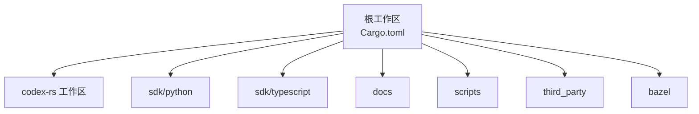
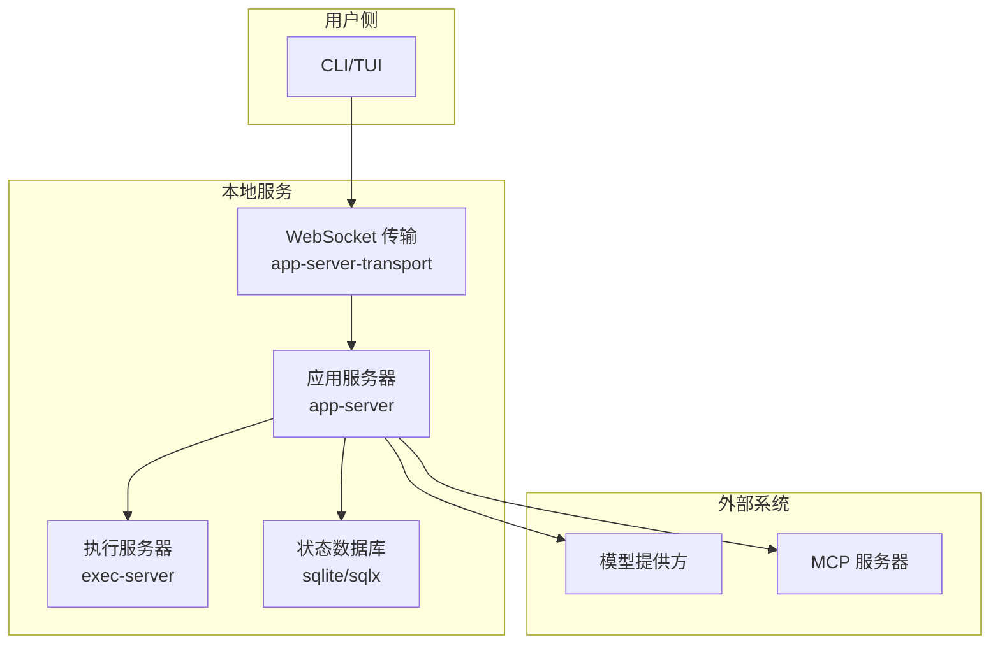
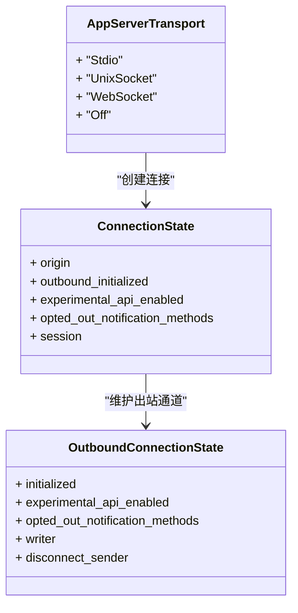
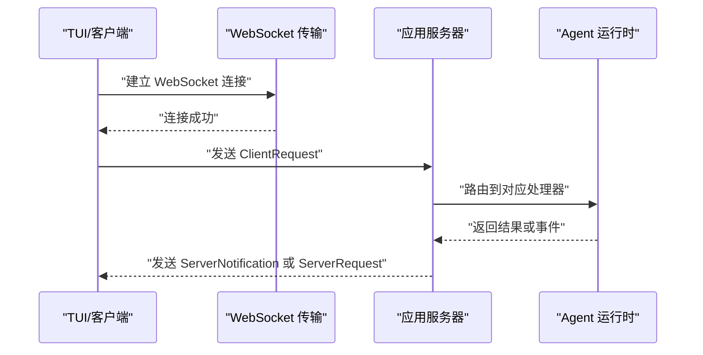
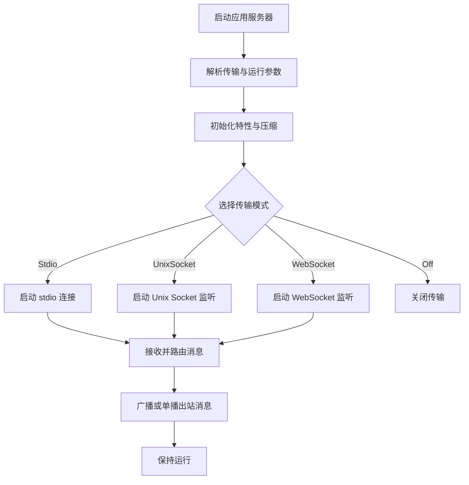
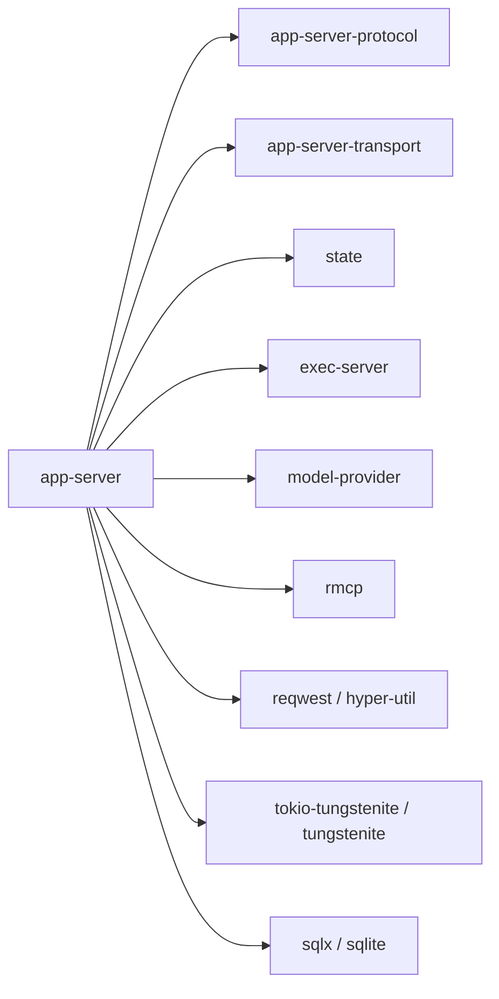
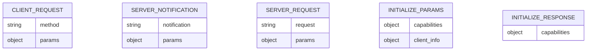

# 附录

<cite>
**本文引用的文件**   
- [README.md](file://README.md)
- [docs/config.md](file://docs/config.md)
- [docs/example-config.md](file://docs/example-config.md)
- [codex-rs/config/defaults.toml](file://codex-rs/config/defaults.toml)
- [codex-rs/config/src/types.rs](file://codex-rs/config/src/types.rs)
- [codex-rs/app-server/src/lib.rs](file://codex-rs/app-server/src/lib.rs)
- [codex-rs/app-server/src/transport.rs](file://codex-rs/app-server/src/transport.rs)
- [codex-rs/app-server-protocol/schema/json/codex_app_server_protocol.v2.schemas.json](file://codex-rs/app-server-protocol/schema/json/codex_app_server_protocol.v2.schemas.json)
- [codex-rs/Cargo.toml](file://codex-rs/Cargo.toml)
</cite>

## 目录
1. [引言](#引言)
2. [项目结构](#项目结构)
3. [核心组件](#核心组件)
4. [架构总览](#架构总览)
5. [详细组件分析](#详细组件分析)
6. [依赖关系分析](#依赖关系分析)
7. [性能与基准](#性能与基准)
8. [故障排查指南](#故障排查指南)
9. [结论](#结论)
10. [附录：配置项、API、术语与兼容性](#附录配置项api术语与兼容性)

## 引言
本附录是 Codex 仓库的“参考型”文档，聚焦于配置、接口、术语、兼容性与依赖信息。由于该仓库同时包含本地 CLI、应用服务器、协议定义、TUI、执行环境、MCP/SDK 等大量子系统，本附录以“可验证来源 + 指向式引用”的方式组织内容，避免臆造未在代码或文档中出现的默认值、端口号、版本矩阵或许可证声明。

需要特别说明的是：
- 仓库根 README 指出该项目使用 Apache-2.0 许可证。
- 配置参考文档将读者引导至在线开发者文档；本附录对本地可见的配置默认值与类型进行归纳。
- 应用服务器对外暴露 JSON-RPC over WebSocket 的消息协议，由 app-server-protocol 模块通过 JSON Schema 固化；gRPC 在仓库中未作为公开 API 暴露。
- 第三方依赖版本集中在 Cargo.toml 中，但仓库未提供完整的第三方许可证清单，因此仅列出可确认的关键依赖及其版本范围。

## 项目结构
Codex 是一个多 crate 的 Rust 工作区，核心子工程包括：
- codex-rs：Rust 核心实现（CLI、应用服务器、协议、TUI、执行服务器、状态存储、模型提供者、网络代理等）。
- sdk：Python 和 TypeScript SDK。
- docs：用户与贡献者文档。
- scripts：构建、打包、测试脚本。
- third_party：V8、OpenSSL、SQLite 等外部源码集成。
- bazel：Bazel 构建规则与工具链。

图表来源
- [codex-rs/Cargo.toml:172-184](file://codex-rs/Cargo.toml#L172-L184)

章节来源
- [codex-rs/Cargo.toml:172-184](file://codex-rs/Cargo.toml#L172-L184)

## 核心组件
本节从“运行边界”角度梳理四个关键部分：
- CLI 与 TUI：用户交互入口。
- 应用服务器：进程内 Agent 运行时与消息路由。
- 协议层：客户端与服务端之间的 JSON-RPC over WebSocket 消息规范。
- 配置层：用户配置、项目配置、托管配置与默认值的合并加载。

| 组件 | 职责 | 主要入口或类型 | 说明 |
|---|---|---|---|
| CLI/TUI | 用户命令、会话选择、连接远程或本地服务 | `tui`、`cli` | TUI 负责渲染与交互；CLI 负责启动与参数解析。 |
| 应用服务器 | 启动并管理 Agent 运行时、WebSocket 接入、出站消息广播 | `app-server::lib::run_main`、`AppServerRuntimeOptions` | 支持 stdio、Unix Socket、WebSocket 多种传输模式。 |
| 协议层 | 定义 ClientRequest/ServerNotification/ServerRequest 等消息 | `app-server-protocol` 生成的 JSON Schema | 消息类型通过 schema 生成器产出 JSON Schema 与 TypeScript 类型。 |
| 配置层 | 加载 defaults、config.toml、requirements、project 等层 | `config::types`、`config::loader` | 提供结构化配置类型、合并策略与校验。 |

章节来源
- [codex-rs/app-server/src/lib.rs:451-512](file://codex-rs/app-server/src/lib.rs#L451-L512)
- [codex-rs/app-server-protocol/schema/json/codex_app_server_protocol.v2.schemas.json:1-60](file://codex-rs/app-server-protocol/schema/json/codex_app_server_protocol.v2.schemas.json#L1-L60)
- [codex-rs/config/src/types.rs:226-250](file://codex-rs/config/src/types.rs#L226-L250)

## 架构总览
下图展示典型部署下的端到端路径：用户通过 CLI/TUI 连接应用服务器，应用服务器以 WebSocket 承载 JSON-RPC 消息，内部再调用 Agent 运行时、执行服务器、模型提供者与状态存储。

图表来源
- [codex-rs/app-server/src/lib.rs:825-866](file://codex-rs/app-server/src/lib.rs#L825-L866)
- [codex-rs/app-server/src/transport.rs:1-30](file://codex-rs/app-server/src/transport.rs#L1-L30)

## 详细组件分析

### 配置系统
配置系统由多层组成：固定默认值、配置文件、项目 requirements、托管配置等。仓库提供了固定的默认 TOML 与一组强类型配置结构体。

#### 固定默认值
默认值位于 `codex-rs/config/defaults.toml`，其中包含：
- 指令包含开关：如 `include_permissions_instructions`、`include_apps_instructions`、`include_collaboration_mode_instructions`。
- 环境上下文开关：`include_environment_context`、`include_environment_context_time`。
- 凭证存储后端：`cli_auth_credentials_store = "file"`、`mcp_oauth_credentials_store = "auto"`。
- 项目文档大小限制：`project_doc_max_bytes = 32768`。
- 文件打开器：`file_opener = "vscode"`。
- 推理隐藏：`hide_agent_reasoning = false`。
- ChatGPT 后端地址：`chatgpt_base_url = "https://chatgpt.com/backend-api/"`。
- 项目根标记：`project_root_markers = [".git"]`。
- 历史持久化：`[history] persistence = "save-all"`。

这些默认值构成配置的“最低可行基线”，用户可通过更高层配置覆盖。

章节来源
- [codex-rs/config/defaults.toml:1-18](file://codex-rs/config/defaults.toml#L1-L18)

#### 配置类型与枚举
`codex-rs/config/src/types.rs` 定义了较多与用户行为相关的配置结构体与枚举，例如：
- `History`：控制对话历史行为。
- `AnalyticsConfigToml`、`FeedbackConfigToml`：分析与反馈相关配置。
- `Tui`：终端界面行为配置。
- 多个枚举用于约束行为，例如认证凭证存储模式、OAuth 存储模式、通知方法、通知条件、TUI 锚点、右键粘贴行为、复制时选择行为等。

这些类型通常带有 `Default` 实现，使配置系统在缺少显式值时回退到合理默认值。

章节来源
- [codex-rs/config/src/types.rs:226-250](file://codex-rs/config/src/types.rs#L226-L250)
- [codex-rs/config/src/types.rs:250-265](file://codex-rs/config/src/types.rs#L250-L265)
- [codex-rs/config/src/types.rs:730-752](file://codex-rs/config/src/types.rs#L730-L752)
- [codex-rs/config/src/types.rs:764-783](file://codex-rs/config/src/types.rs#L764-L783)
- [codex-rs/config/src/types.rs:783-838](file://codex-rs/config/src/types.rs#L783-L838)
- [codex-rs/config/src/types.rs:850-876](file://codex-rs/config/src/types.rs#L850-L876)

#### 配置文档定位
仓库中的配置文档不直接展开全部字段，而是指向 OpenAI 开发者文档的基础配置、高级配置与完整参考。示例配置也通过链接指向在线示例。

章节来源
- [docs/config.md:1-15](file://docs/config.md#L1-L15)
- [docs/example-config.md:1-3](file://docs/example-config.md#L1-L3)

### 应用服务器与传输
应用服务器提供三种主要传输模式：
- `Stdio`：标准输入输出，常用于进程内或管道场景。
- `UnixSocket`：本地 Unix Socket，适合本机守护进程通信。
- `WebSocket`：基于 WebSocket 的网络传输，支持 `ws://` 与 `wss://` 地址格式。

图表来源
- [codex-rs/app-server/src/transport.rs:1-30](file://codex-rs/app-server/src/transport.rs#L1-L30)
- [codex-rs/app-server/src/transport.rs:31-120](file://codex-rs/app-server/src/transport.rs#L31-L120)
- [codex-rs/app-server/src/transport.rs:121-200](file://codex-rs/app-server/src/transport.rs#L121-L200)

章节来源
- [codex-rs/app-server/src/lib.rs:488-512](file://codex-rs/app-server/src/lib.rs#L488-L512)
- [codex-rs/app-server/src/lib.rs:825-866](file://codex-rs/app-server/src/lib.rs#L825-L866)
- [codex-rs/app-server/src/transport.rs:480-520](file://codex-rs/app-server/src/transport.rs#L480-L520)

### 协议与消息格式
应用服务器的对外协议不是 REST API，也不是 gRPC，而是基于 JSON-RPC 的消息协议，并通过 WebSocket 传输。协议定义的核心对象包括：
- `ClientRequest`：客户端请求。
- `ServerNotification`：服务端通知。
- `ServerRequest`：服务端发起的请求。
- 初始化相关类型：`InitializeParams`、`InitializeResponse`、`InitializeCapabilities`、`ClientInfo`。
- 会话、线程、模型、权限、MCP、钩子、实时能力等扩展类型。

JSON Schema 位于 `codex-app-server-protocol/schema/json`，v2 版本的主 Schema 文件为 `codex_app_server_protocol.v2.schemas.json`。TypeScript 类型则位于 `schema/typescript`。

图表来源
- [codex-rs/app-server/src/lib.rs:825-866](file://codex-rs/app-server/src/lib.rs#L825-L866)
- [codex-rs/app-server-protocol/schema/json/codex_app_server_protocol.v2.schemas.json:1-60](file://codex-rs/app-server-protocol/schema/json/codex_app_server_protocol.v2.schemas.json#L1-L60)

章节来源
- [codex-rs/app-server-protocol/schema/json/codex_app_server_protocol.v2.schemas.json:1-60](file://codex-rs/app-server-protocol/schema/json/codex_app_server_protocol.v2.schemas.json#L1-L60)
- [codex-rs/app-server-protocol/schema/json/codex_app_server_protocol.v2.schemas.json:2040-2045](file://codex-rs/app-server-protocol/schema/json/codex_app_server_protocol.v2.schemas.json#L2040-L2045)
- [codex-rs/app-server-protocol/schema/json/codex_app_server_protocol.v2.schemas.json:17681-17690](file://codex-rs/app-server-protocol/schema/json/codex_app_server_protocol.v2.schemas.json#L17681-L17690)

### 启动流程
应用服务器启动流程大致如下：
1. 解析传输选项与运行参数。
2. 初始化日志、特性开关、压缩策略。
3. 根据传输模式启动 stdio、Unix Socket 或 WebSocket 监听。
4. 接收连接并维护连接状态。
5. 分发出站消息，支持广播与单播。
6. 处理慢连接断开、实验性 API 过滤与通知选择退出。

图表来源
- [codex-rs/app-server/src/lib.rs:825-866](file://codex-rs/app-server/src/lib.rs#L825-L866)
- [codex-rs/app-server/src/transport.rs:121-200](file://codex-rs/app-server/src/transport.rs#L121-L200)

## 依赖关系分析
仓库使用 Bazel 与 Cargo 共同管理构建，Rust 依赖集中在顶层 `Cargo.toml` 中。关键依赖包括：
- HTTP/网络：`reqwest`、`hyper-util`、`tokio-tungstenite`、`tungstenite`。
- RPC 与序列化：`tonic`、`serde`。
- 数据库：`sqlx`、`libsqlite3-sys`、`sqlx-sqlite`。
- UI：`ratatui`。
- Git：`gix`。
- 音频与媒体：`symphonia`、`image`。
- MCP 集成：`rmcp`。

图表来源
- [codex-rs/Cargo.toml:350-425](file://codex-rs/Cargo.toml#L350-L425)
- [codex-rs/Cargo.toml:471-523](file://codex-rs/Cargo.toml#L471-L523)
- [codex-rs/Cargo.toml:542-560](file://codex-rs/Cargo.toml#L542-L560)

章节来源
- [codex-rs/Cargo.toml:350-425](file://codex-rs/Cargo.toml#L350-L425)
- [codex-rs/Cargo.toml:471-523](file://codex-rs/Cargo.toml#L471-L523)
- [codex-rs/Cargo.toml:542-560](file://codex-rs/Cargo.toml#L542-L560)

## 性能与基准
仓库中存在一些基准与性能相关目标，例如：
- `direct-tool-timing`：针对工具调用的时序测量。
- `e2e_benches`：端到端基准。
- `ci/e2e_benches`：CI 中的基准任务。
- `scripts/mcp_conformance`：MCP 一致性测试与回归基线。

不过，仓库并未提供一份统一的“性能基准测试结果报告”。实际基准数据通常由本地或 CI 执行后生成，不在源代码树中静态发布。因此，本附录无法给出具体吞吐、延迟、内存占用数值；建议使用者根据上述基准目标与测试脚本自行采集指标。

优化建议（基于代码结构）：
- 合理启用 WebSocket 压缩：应用服务器会根据特性开关选择 zstd 或明文压缩。
- 控制出站队列：慢连接会被检测并在队列满时断开，避免拖垮整体广播性能。
- 谨慎开启实验性 API：实验性通知会在未启用实验性 API 的连接中被过滤。
- 合理配置历史持久化与项目文档大小限制，避免过大上下文影响响应时间。
- 使用合适的传输模式：本地守护进程可用 Unix Socket，跨主机或浏览器场景用 WebSocket。

章节来源
- [codex-rs/app-server/src/lib.rs:825-831](file://codex-rs/app-server/src/lib.rs#L825-L831)
- [codex-rs/app-server/src/transport.rs:121-200](file://codex-rs/app-server/src/transport.rs#L121-L200)
- [codex-rs/config/defaults.toml:1-18](file://codex-rs/config/defaults.toml#L1-L18)

## 故障排查指南
常见排错方向：
- 连接地址无效：当远程地址不符合 `ws://host:port`、`wss://host:port`、`unix://` 或 `unix://PATH` 格式时，会返回明确错误信息。
- 慢连接断开：如果出站队列已满或写入失败，连接会被断开并记录警告。
- 实验性 API 被过滤：未启用实验性 API 的连接不会收到实验性通知，且部分请求参数会被裁剪。
- 配置问题：配置错误位置、执行策略警告、项目配置警告会以结构化方式提示。

建议操作：
- 检查 WebSocket 地址是否使用正确协议前缀。
- 查看应用服务器日志中的出站队列与连接断开警告。
- 确认是否需要启用实验性 API，以及是否允许相应通知。
- 使用配置类型提供的校验与默认值，逐步缩小配置差异。

章节来源
- [codex-rs/app-server/src/transport.rs:480-520](file://codex-rs/app-server/src/transport.rs#L480-L520)
- [codex-rs/app-server/src/transport.rs:121-200](file://codex-rs/app-server/src/transport.rs#L121-L200)
- [codex-rs/app-server/src/lib.rs:325-398](file://codex-rs/app-server/src/lib.rs#L325-L398)

## 结论
本附录汇总了 Codex 的可验证参考信息：
- 配置默认值与类型来自 `defaults.toml` 与 `config/src/types.rs`。
- 对外 API 是 JSON-RPC over WebSocket，而非 REST 或 gRPC。
- 协议 Schema 由 `app-server-protocol` 生成并保存在 JSON Schema 文件中。
- 依赖版本集中在 `Cargo.toml`，许可证由根 README 指明为 Apache-2.0。
- 性能基准存在于仓库目标中，但未提供统一报告，应通过本地或 CI 运行获取。

## 附录：配置项、API、术语与兼容性

### 配置项参考
由于完整配置参考在在线文档中，本附录仅列举本地可确认的默认值与类型类别。

| 配置类别 | 字段或类型 | 默认值或取值范围 | 数据类型 | 说明与用途 |
|---|---|---|---|---|
| 固定默认值 | `include_permissions_instructions` | 未显示布尔值，但存在键名 | 布尔 | 是否包含权限相关指令 |
| 固定默认值 | `include_apps_instructions` | 未显示布尔值，但存在键名 | 布尔 | 是否包含应用相关指令 |
| 固定默认值 | `include_collaboration_mode_instructions` | 未显示布尔值，但存在键名 | 布尔 | 是否包含协作模式指令 |
| 固定默认值 | `include_environment_context` | 未显示布尔值，但存在键名 | 布尔 | 是否包含环境上下文 |
| 固定默认值 | `include_environment_context_time` | 未显示布尔值，但存在键名 | 布尔 | 是否在环境上下文中包含时间 |
| 固定默认值 | `cli_auth_credentials_store` | `"file"` | 字符串 | CLI 认证凭证存储后端 |
| 固定默认值 | `mcp_oauth_credentials_store` | `"auto"` | 字符串 | MCP OAuth 凭证存储后端 |
| 固定默认值 | `project_doc_max_bytes` | `32768` | 整数 | 项目文档最大字节数 |
| 固定默认值 | `project_root_markers` | `[].git]` | 字符串数组 | 项目根目录识别标记 |
| 固定默认值 | `background_terminal_max_timeout` | `300000` | 整数 | 后台终端最大超时 |
| 固定默认值 | `file_opener` | `"vscode"` | 字符串 | 默认文件打开器 |
| 固定默认值 | `hide_agent_reasoning` | `false` | 布尔 | 是否隐藏 Agent 推理过程 |
| 固定默认值 | `chatgpt_base_url` | `"https://chatgpt.com/backend-api/"` | 字符串 | ChatGPT 后端基础地址 |
| 历史配置 | `history.persistence` | `"save-all"` | 字符串 | 历史持久化策略 |

使用示例：
- 修改凭证存储后端：在用户配置中将 `cli_auth_credentials_store` 设置为期望的后端标识。
- 调整项目文档大小：设置 `project_doc_max_bytes` 以适应大型项目。
- 切换文件打开器：将 `file_opener` 改为系统或其他编辑器支持的标识。
- 调整历史保存策略：将 `history.persistence` 设置为更严格的保留策略。

章节来源
- [codex-rs/config/defaults.toml:1-18](file://codex-rs/config/defaults.toml#L1-L18)
- [codex-rs/config/src/types.rs:226-250](file://codex-rs/config/src/types.rs#L226-L250)

### API 参考

#### REST API
仓库未提供面向用户的 REST API 端点列表。应用服务器以 WebSocket 承载 JSON-RPC 消息，REST 并非其对外协议形态。

#### gRPC
仓库中包含 `tonic` 依赖，但该依赖主要用于内部或特定组件，仓库未暴露公共 gRPC 接口。因此，本附录不提供 gRPC 服务定义或端点。

#### WebSocket 消息格式
协议采用 JSON-RPC over WebSocket，核心消息类型包括：
- `ClientRequest`：客户端向服务端发送的请求。
- `ServerNotification`：服务端主动推送给客户端的通知。
- `ServerRequest`：服务端向客户端发起的请求。
- 初始化消息：`InitializeParams`、`InitializeResponse`、`InitializeCapabilities`、`ClientInfo`。

JSON Schema 定义位于 `codex_app_server_protocol.v2.schemas.json`，可作为客户端或服务端实现的权威类型来源。TypeScript 类型也一并生成，便于前端或 Node.js 客户端使用。

图表来源
- [codex-rs/app-server-protocol/schema/json/codex_app_server_protocol.v2.schemas.json:1-60](file://codex-rs/app-server-protocol/schema/json/codex_app_server_protocol.v2.schemas.json#L1-L60)

章节来源
- [codex-rs/app-server-protocol/schema/json/codex_app_server_protocol.v2.schemas.json:2040-2045](file://codex-rs/app-server-protocol/schema/json/codex_app_server_protocol.v2.schemas.json#L2040-L2045)
- [codex-rs/app-server-protocol/schema/json/codex_app_server_protocol.v2.schemas.json:17681-17690](file://codex-rs/app-server-protocol/schema/json/codex_app_server_protocol.v2.schemas.json#L17681-L17690)

### 术语表
| 术语 | 含义 |
|---|---|
| CLI | 命令行界面，用于在终端中启动和控制 Codex。 |
| TUI | 终端用户界面，提供更丰富的交互式体验。 |
| 应用服务器 | 本地运行的 Agent 运行时服务，负责会话、工具执行、模型调用与消息路由。 |
| WebSocket | 一种全双工通信协议，在本项目中承载 JSON-RPC 消息。 |
| JSON-RPC | 一种基于 JSON 的远程过程调用协议，用于客户端与服务端之间的结构化通信。 |
| MCP | Model Context Protocol，用于连接外部工具与服务。 |
| 执行服务器 | 负责安全执行命令、沙箱隔离与进程管理的组件。 |
| 状态存储 | 基于 SQLite 的持久化存储，用于会话、线程、记忆等状态。 |
| 配置层 | 包括默认值、用户配置、项目配置、托管配置等多层合并机制。 |
| 传输模式 | 应用服务器支持的通信方式，包括 stdio、Unix Socket 与 WebSocket。 |

### 版本兼容性矩阵
仓库未提供官方发布的“版本兼容性矩阵”。根 README 只说明如何安装、运行与使用 ChatGPT 计划，以及指向开发者文档。因此，本附录不能列出 CLI 版本与应用服务器版本、SDK 版本之间的精确兼容关系。

建议做法：
- 使用同一发行包中的 CLI、TUI 与应用服务器二进制。
- 使用与 Codex 版本配套的 Python 或 TypeScript SDK。
- 对于自定义客户端，优先遵循 `app-server-protocol` 中公开的 JSON Schema。

### 升级路径说明
仓库没有独立的升级迁移文档。结合现有结构，可归纳以下通用原则：
- 优先使用官方安装包或包管理器安装，而不是混用不同来源的二进制。
- 升级时同步更新 CLI、TUI 与应用服务器。
- 若自定义客户端依赖协议类型，应以 `app-server-protocol` 的 JSON Schema 为准进行适配。
- 配置变更应参考在线配置参考，并注意本地默认值可能仅提供最小集合。

### 第三方依赖版本要求与许可证
- 许可证：根 README 明确指出仓库使用 Apache-2.0 许可证。
- 关键依赖版本可在 `Cargo.toml` 中确认，例如 `reqwest`、`tokio-tungstenite`、`tonic`、`sqlx`、`ratatui`、`gix`、`rmcp` 等。
- 仓库未提供完整的第三方许可证清单，因此不能断言每个依赖的许可证。

章节来源
- [README.md:1-81](file://README.md#L1-L81)
- [codex-rs/Cargo.toml:175-181](file://codex-rs/Cargo.toml#L175-L181)
- [codex-rs/Cargo.toml:350-425](file://codex-rs/Cargo.toml#L350-L425)
- [codex-rs/Cargo.toml:471-560](file://codex-rs/Cargo.toml#L471-L560)