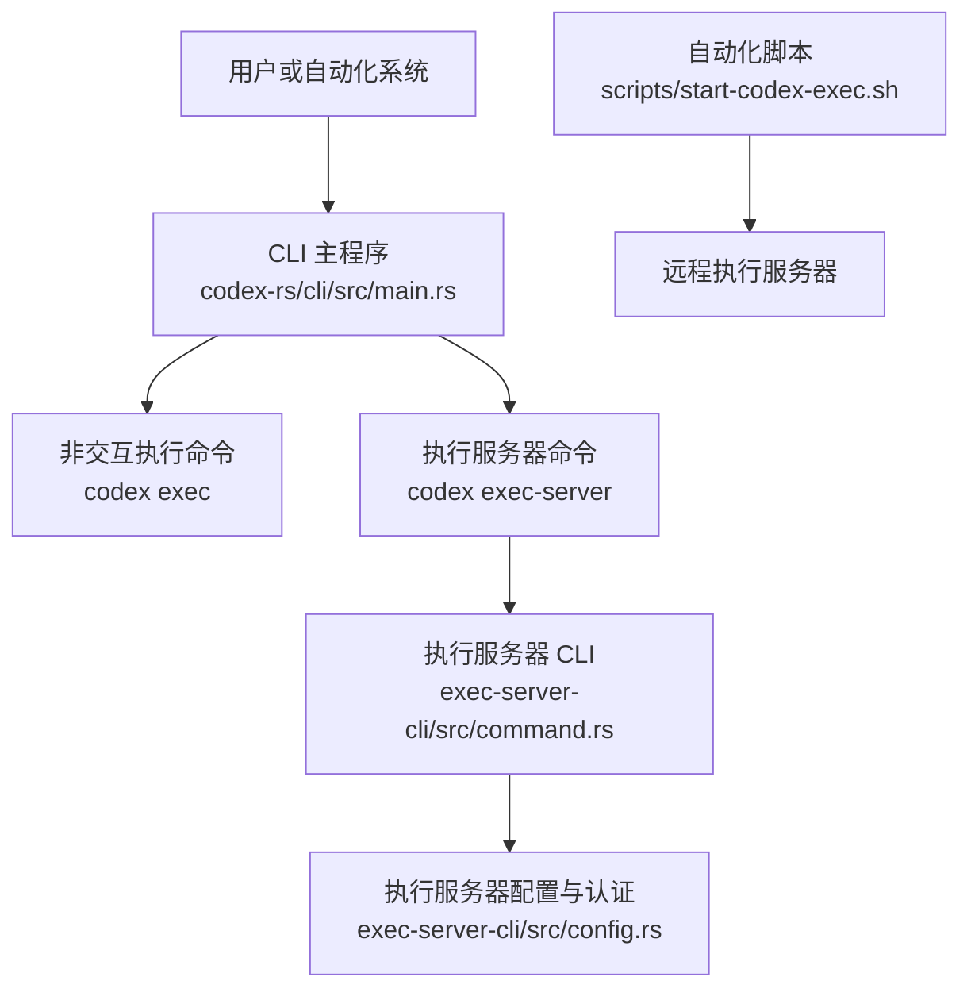
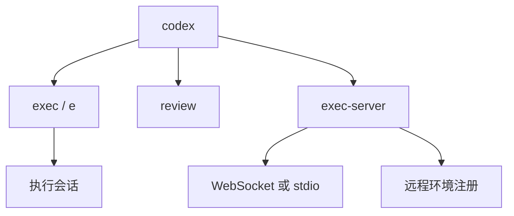
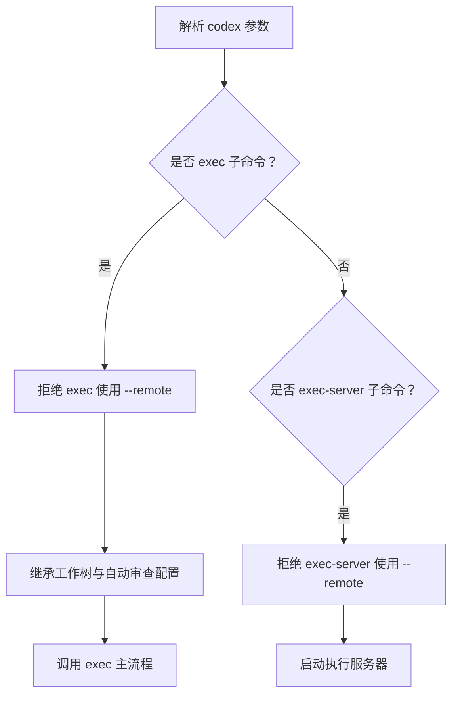
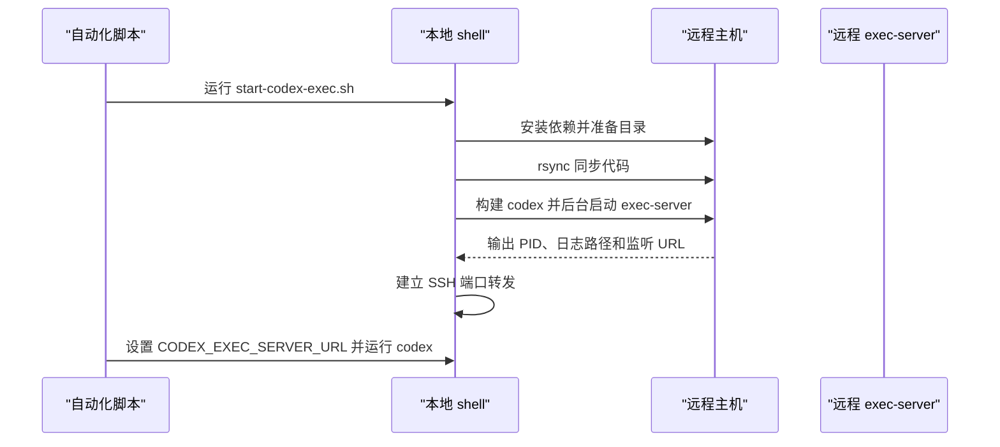
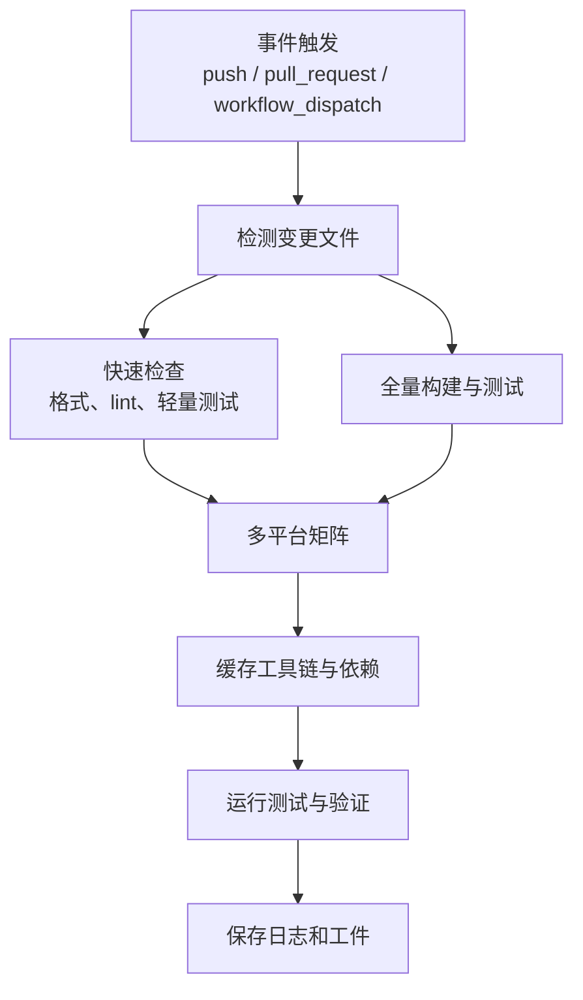
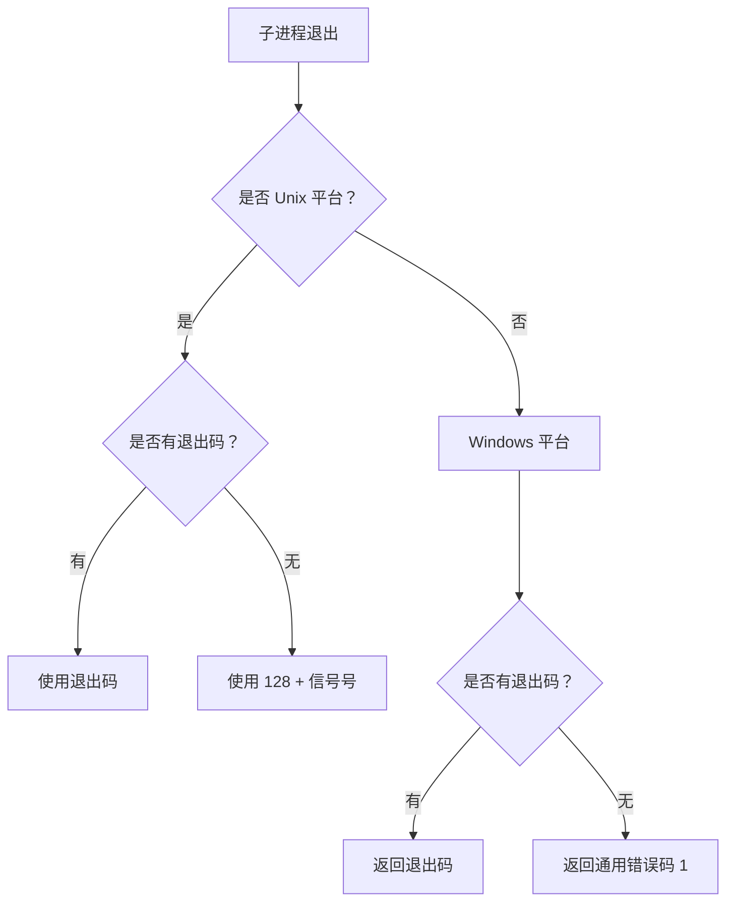
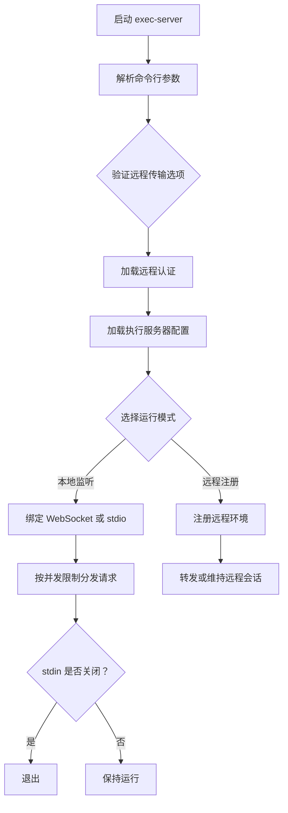
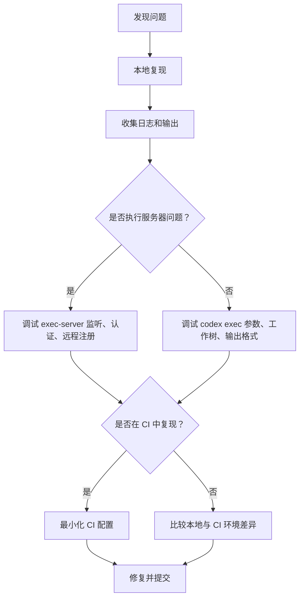

# 非交互执行

<cite>
**本文引用的文件**   
- [exec.md](file://docs/exec.md)
- [main.rs](file://codex-rs/cli/src/main.rs)
- [exit_status.rs](file://codex-rs/cli/src/exit_status.rs)
- [doctor.rs](file://codex-rs/cli/src/doctor.rs)
- [exec_args_tests.rs](file://codex-rs/cli/src/exec_args_tests.rs)
- [command.rs](file://codex-rs/exec-server-cli/src/command.rs)
- [config.rs](file://codex-rs/exec-server-cli/src/config.rs)
- [start-codex-exec.sh](file://scripts/start-codex-exec.sh)
- [rust-ci.yml](file://.github/workflows/rust-ci.yml)
- [rust-ci-full.yml](file://.github/workflows/rust-ci-full.yml)
- [execpolicy.md](file://docs/execpolicy.md)
</cite>

## 目录
1. [引言](#引言)
2. [项目结构中的非交互执行入口](#项目结构中的非交互执行入口)
3. [设计目标与适用场景](#设计目标与适用场景)
4. [命令体系与参数边界](#命令体系与参数边界)
5. [批处理脚本编写方法](#批处理脚本编写方法)
6. [CI/CD 集成最佳实践](#cicd-集成最佳实践)
7. [错误处理、重试与资源限制](#错误处理重试与资源限制)
8. [输出格式与结果解析](#输出格式与结果解析)
9. [性能优化技巧](#性能优化技巧)
10. [调试方法](#调试方法)
11. [常见自动化场景示例](#常见自动化场景示例)
12. [结论](#结论)

## 引言
本仓库的非交互执行能力围绕两个核心组件展开：
- `codex exec`：在终端或 CI 环境中直接发起一次无交互式会话。
- `codex exec-server`：启动一个可被外部进程通过 WebSocket 或标准输入输出调用的执行服务器，适合长期运行、远程环境和批量任务调度。

文档根目录中的 [exec.md](file://docs/exec.md) 明确将“非交互模式”指向外部开发者文档；同时仓库内部实现了该模式的 CLI 入口、执行服务器、远程注册机制和辅助启动脚本。因此，本文以仓库实现为依据，补充面向自动化工程的可操作说明。

**章节来源**
- [exec.md:1-3](file://docs/exec.md#L1-L3)

## 项目结构中的非交互执行入口
非交互执行的代码分布在三个主要区域：

| 区域 | 职责 | 关键路径 |
|---|---|---|
| CLI 主程序 | 解析顶层子命令，分发到 `exec`、`exec-server` 等实现 | [main.rs](file://codex-rs/cli/src/main.rs) |
| 独立执行服务器 CLI | 提供 `codex exec-server` 的完整启动逻辑 | [command.rs](file://codex-rs/exec-server-cli/src/command.rs)、[config.rs](file://codex-rs/exec-server-cli/src/config.rs) |
| 辅助脚本 | 提供远程部署、隧道、超时等待等批处理能力 | [start-codex-exec.sh](file://scripts/start-codex-exec.sh) |

**图表来源**
- [main.rs:1156-1171](file://codex-rs/cli/src/main.rs#L1156-L1171)
- [main.rs:1901-1908](file://codex-rs/cli/src/main.rs#L1901-L1908)
- [command.rs:1-20](file://codex-rs/exec-server-cli/src/command.rs#L1-L20)
- [config.rs:1-20](file://codex-rs/exec-server-cli/src/config.rs#L1-L20)
- [start-codex-exec.sh:1-20](file://scripts/start-codex-exec.sh#L1-L20)

**章节来源**
- [main.rs:152-157](file://codex-rs/cli/src/main.rs#L152-L157)
- [main.rs:1156-1171](file://codex-rs/cli/src/main.rs#L1156-L1171)
- [main.rs:1901-1908](file://codex-rs/cli/src/main.rs#L1901-L1908)

## 设计目标与适用场景
### 设计目标
1. **可脚本化**：不依赖图形界面或人工确认，适合 CI、定时任务和后台服务。
2. **可组合**：支持 `exec` 单次执行和 `exec-server` 长期服务两种形态。
3. **可远端化**：通过 WebSocket、stdio 或远程环境注册机制，把执行环境从调用方解耦。
4. **可观测与可控**：提供退出码映射、并发控制、远程认证、日志和辅助诊断工具。

### 适用场景
- 自动化代码生成、测试生成、文档更新。
- CI 中的模型驱动任务，例如根据变更生成补丁或报告。
- 远程机器上的隔离执行环境，避免本地依赖污染。
- 需要持久执行服务器并被多个调用者共享的场景。
- 需要统一策略校验的执行流程，例如结合执行策略文档进行合规检查。

**章节来源**
- [exec.md:1-3](file://docs/exec.md#L1-L3)
- [execpolicy.md:1-3](file://docs/execpolicy.md#L1-L3)

## 命令体系与参数边界
### 顶层命令关系
`codex` 是总入口，`exec` 和 `exec-server` 是非交互执行相关的主要子命令：

**图表来源**
- [main.rs:152-157](file://codex-rs/cli/src/main.rs#L152-L157)
- [main.rs:1156-1171](file://codex-rs/cli/src/main.rs#L1156-L1171)
- [main.rs:1901-1908](file://codex-rs/cli/src/main.rs#L1901-L1908)
- [command.rs:1-20](file://codex-rs/exec-server-cli/src/command.rs#L1-L20)

### 非交互命令的关键约束
- `exec` 是“非交互执行”入口，并带有短别名 `e`。
- `exec` 会拒绝远程模式参数，确保单次执行命令不会误用交互式远程会话参数。
- `exec-server` 也拒绝顶层远程模式，因为它是服务端而非客户端。
- `exec` 继承交互式子命令的工作树和自动审查配置，但工作树用法受子命令语义限制。

**图表来源**
- [main.rs:1156-1171](file://codex-rs/cli/src/main.rs#L1156-L1171)
- [main.rs:1901-1908](file://codex-rs/cli/src/main.rs#L1901-L1908)
- [main.rs:2315-2327](file://codex-rs/cli/src/main.rs#L2315-L2327)

### 工作树与子命令限制
| 场景 | 行为 |
|---|---|
| 新 `exec` 会话 | 通常允许工作树上下文 |
| `exec resume` | 不支持在工作树上恢复已有会话 |
| `exec review` | 不支持工作树 |
| `exec fork` | 属于工作树支持的分支场景 |

**章节来源**
- [main.rs:152-157](file://codex-rs/cli/src/main.rs#L152-L157)
- [main.rs:1156-1171](file://codex-rs/cli/src/main.rs#L1156-L1171)
- [main.rs:1901-1908](file://codex-rs/cli/src/main.rs#L1901-L1908)
- [main.rs:2315-2327](file://codex-rs/cli/src/main.rs#L2315-L2327)

## 批处理脚本编写方法
### 使用 `codex exec`
推荐在批处理脚本中遵循以下原则：
- 显式传入非交互所需的参数，例如输出格式、会话标识、提示词或配置文件覆盖。
- 使用管道或重定向读取输入，而不是依赖终端交互。
- 检查进程退出码，区分成功、失败和信号终止。
- 对长时间运行的任务设置外层超时，避免僵尸进程。
- 将敏感信息通过环境变量或安全通道传递，不要硬编码在脚本中。

### 使用 `codex exec-server`
当需要复用执行环境时，脚本应：
1. 启动 `exec-server`。
2. 等待其输出监听地址或连接 URL。
3. 记录 PID 和日志路径。
4. 在退出钩子中清理进程和临时文件。
5. 通过 WebSocket、stdio 或远程 URL 调用执行任务。

### 远程执行辅助脚本
脚本 [start-codex-exec.sh](file://scripts/start-codex-exec.sh) 展示了典型的远程非交互执行流程：
- 检查 `git`、`ssh`、`rsync` 是否存在。
- 同步代码到远程主机。
- 在远程构建并启动 `codex exec-server`。
- 轮询日志，直到出现 WebSocket 监听地址。
- 使用 SSH 端口转发暴露本地端口。
- 提供环境变量形式的启动方式，让上层脚本调用 `codex`。

**图表来源**
- [start-codex-exec.sh:1-20](file://scripts/start-codex-exec.sh#L1-L20)
- [start-codex-exec.sh:21-60](file://scripts/start-codex-exec.sh#L21-L60)
- [start-codex-exec.sh:61-120](file://scripts/start-codex-exec.sh#L61-L120)
- [start-codex-exec.sh:121-185](file://scripts/start-codex-exec.sh#L121-L185)

**章节来源**
- [start-codex-exec.sh:1-185](file://scripts/start-codex-exec.sh#L1-L185)

## CI/CD 集成最佳实践
### GitHub Actions
仓库的 CI 工作流采用分阶段检测变化、多平台矩阵和缓存加速的模式。针对非交互执行，建议参考以下实践：

| 实践 | 说明 |
|---|---|
| 使用固定 runner 版本 | 使用带发行版号的 Ubuntu/macOS/Windows runner，保证环境稳定。 |
| 缓存构建产物 | 缓存 Rust 工具链、cargo registry、编译对象，减少重复构建时间。 |
| 设置任务超时 | 为每个 job 设置 `timeout-minutes`，防止长尾任务阻塞流水线。 |
| 条件触发 | 仅当相关代码变更时执行重型任务，降低 CI 成本。 |
| 分离 lint、build、test | 将格式化、静态分析、单元测试、端到端测试拆分到不同 job。 |
| 保留日志和工件 | 将 test output、错误日志、诊断 ZIP 作为工件上传。 |
| 使用环境变量注入密钥 | 使用 CI 平台的 secret 管理 API Key、令牌和远程访问凭证。 |
| 失败即停或选择性继续 | 关键测试使用默认失败行为；可选质量检查可使用 `continue-on-error`。 |

仓库中的 [rust-ci.yml](file://.github/workflows/rust-ci.yml) 和 [rust-ci-full.yml](file://.github/workflows/rust-ci-full.yml) 展示了这些模式，包括：
- 检测变更路径。
- 格式化检查和 benchmark smoke test。
- 多平台 matrix。
- 工具链缓存。
- 超时和失败策略。

**图表来源**
- [rust-ci.yml:1-40](file://.github/workflows/rust-ci.yml#L1-L40)
- [rust-ci.yml:41-120](file://.github/workflows/rust-ci.yml#L41-L120)
- [rust-ci-full.yml:1-40](file://.github/workflows/rust-ci-full.yml#L1-L40)
- [rust-ci-full.yml:120-200](file://.github/workflows/rust-ci-full.yml#L120-L200)

### GitLab CI 和其他平台
虽然仓库未包含 GitLab CI 示例，但非交互执行模式可迁移到任何支持容器或 SSH 的 CI 平台：
- 使用镜像安装 Codex 和相关依赖。
- 通过 `codex exec` 执行一次性任务。
- 或通过 `codex exec-server` 启动长期服务，由编排器调度任务。
- 使用平台 secret 管理认证信息。
- 使用 artifacts 保存输出和日志。
- 使用 retry 或 retry_on_failure 控制短暂网络失败的恢复。

**章节来源**
- [rust-ci.yml:1-200](file://.github/workflows/rust-ci.yml#L1-L200)
- [rust-ci-full.yml:1-200](file://.github/workflows/rust-ci-full.yml#L1-L200)

## 错误处理、重试与资源限制
### 退出码处理
CLI 对底层进程退出状态做了跨平台封装：
- Unix 上优先使用退出码，其次使用信号映射为 `128 + signal`。
- Windows 上优先使用退出码，否则回退到通用错误码。
这使自动化脚本可以通过进程退出码判断任务是否成功。

**图表来源**
- [exit_status.rs:1-23](file://codex-rs/cli/src/exit_status.rs#L1-L23)

### 执行服务器并发与生命周期
执行服务器提供以下控制点：
- `concurrent-requests`：限制单个连接的并发请求数，默认值为 1。
- `exit-on-stdin-close`：当父进程关闭标准输入管道时退出，适合由管理器控制的长生命周期服务。
- `listen`：指定 WebSocket 或 stdio 监听端点。
- `remote`：将执行服务器注册为远程环境，配合认证和传输选项。

**图表来源**
- [command.rs:56-68](file://codex-rs/exec-server-cli/src/command.rs#L56-L68)
- [command.rs:73-92](file://codex-rs/exec-server-cli/src/command.rs#L73-L92)
- [command.rs:175-191](file://codex-rs/exec-server-cli/src/command.rs#L175-L191)
- [command.rs:191-216](file://codex-rs/exec-server-cli/src/command.rs#L191-L216)
- [command.rs:216-313](file://codex-rs/exec-server-cli/src/command.rs#L216-L313)
- [command.rs:382-391](file://codex-rs/exec-server-cli/src/command.rs#L382-L391)

### 超时与资源限制建议
| 控制维度 | 建议 |
|---|---|
| 任务超时 | 在 CI 层设置 job timeout，在脚本层使用 `timeout` 命令包裹长任务。 |
| 并发限制 | 通过 `--concurrent-requests` 限制执行服务器请求并发。 |
| 内存与 CPU | 结合操作系统 cgroup、sandbox 或容器限制资源。 |
| 网络超时 | 通过上游代理、HTTP client 配置和网络策略控制。 |
| 进程生命周期 | 使用 `--exit-on-stdin-close` 让父进程接管服务生命周期。 |
| 失败恢复 | 对外部网络错误使用指数退避重试，对幂等任务可重试，对破坏性任务需谨慎。 |

**章节来源**
- [exit_status.rs:1-23](file://codex-rs/cli/src/exit_status.rs#L1-L23)
- [command.rs:56-68](file://codex-rs/exec-server-cli/src/command.rs#L56-L68)
- [command.rs:175-191](file://codex-rs/exec-server-cli/src/command.rs#L175-L191)
- [command.rs:191-216](file://codex-rs/exec-server-cli/src/command.rs#L191-L216)
- [command.rs:216-313](file://codex-rs/exec-server-cli/src/command.rs#L216-L313)
- [config.rs:178-276](file://codex-rs/exec-server-cli/src/config.rs#L178-L276)

## 输出格式与结果解析
### 输出形式
非交互执行可能产生多种输出：
- 标准输出和标准错误：人类可读日志。
- 结构化输出：例如 JSON、Markdown、Schema 等，由具体 `exec` 子命令决定。
- 执行服务器监听 URL：用于后续远程调用。
- 退出码：表示任务成功或失败。
- 诊断信息：例如 TUI 相关的诊断快照和日志。

### 解析建议
- 对结构化输出使用对应语言的 JSON、Markdown 或 Schema 解析器。
- 对日志使用行级过滤提取关键信息，例如错误、耗时、文件路径。
- 对执行服务器启动过程，解析首行 WebSocket URL。
- 对退出码使用平台无关的判断逻辑，参考 `exit_status.rs` 的设计。
- 对 CI 结果，将结构化输出写入工件目录，便于后续步骤消费。

### 诊断与非交互终端
仓库中包含非交互终端诊断相关测试和快照，例如在 `TERM=dumb` 环境下禁用颜色和控制序列。这说明非交互模式应尽量减少 ANSI 控制字符，以便日志能被 CI 正确记录和搜索。

**章节来源**
- [exit_status.rs:1-23](file://codex-rs/cli/src/exit_status.rs#L1-L23)
- [main.rs:1858-1858](file://codex-rs/cli/src/main.rs#L1858-L1858)
- [doctor.rs:66-67](file://codex-rs/cli/src/doctor.rs#L66-L67)
- [exec_args_tests.rs:1-30](file://codex-rs/cli/src/exec_args_tests.rs#L1-L30)

## 性能优化技巧
### 构建与依赖优化
- 使用 CI 缓存 Rust toolchain、registry、编译对象。
- 使用增量构建开关，但注意某些交叉编译场景下可能需要关闭增量编译以避免混合架构归档问题。
- 使用 sccache 等构建缓存工具，并在不适合的平台关闭它。
- 只构建必要 crate，避免全量 build。

### 执行阶段优化
- 复用执行服务器，避免每次任务都重新初始化运行时。
- 合理设置 `concurrent-requests`，平衡吞吐量和资源占用。
- 使用远程执行服务器集中算力，避免在每个 CI worker 上重复安装大型依赖。
- 使用工作树、沙箱或容器隔离不同任务，减少状态污染。
- 对模型调用和网络请求设置合理的超时和重试上限。

### 日志与可观测性
- 启用遥测和诊断输出，但生产环境应控制日志大小和敏感度。
- 将大输出截断或分页，避免 CI 日志溢出。
- 使用结构化日志便于聚合和分析。

**章节来源**
- [rust-ci.yml:120-200](file://.github/workflows/rust-ci.yml#L120-L200)
- [rust-ci-full.yml:120-200](file://.github/workflows/rust-ci-full.yml#L120-L200)
- [command.rs:56-68](file://codex-rs/exec-server-cli/src/command.rs#L56-L68)

## 调试方法
### 本地调试
- 使用 `codex doctor` 诊断环境、网络、终端和非交互模式行为。
- 查看非交互帮助和参数快照，确认命令是否正确解析。
- 使用 `exec_args_tests.rs` 中的帮助快照测试思路，验证自定义包装脚本的参数组合。

### 执行服务器调试
- 先使用本地 `--listen ws://127.0.0.1:PORT` 启动，再连接测试。
- 查看 exec-server 日志，确认监听 URL、认证方式和远程注册状态。
- 使用 SSH 端口转发模拟远程环境，参考 [start-codex-exec.sh](file://scripts/start-codex-exec.sh)。
- 使用 `--exit-on-stdin-close` 让父进程控制生命周期，方便调试后自动清理。

### CI 调试
- 开启 step-level 日志。
- 保存失败 job 的 stdout、stderr、构建日志和诊断文件。
- 复现时使用最小化 workflow 和固定 runner 镜像。
- 对网络相关失败增加重试和详细错误输出。

**图表来源**
- [doctor.rs:66-67](file://codex-rs/cli/src/doctor.rs#L66-L67)
- [exec_args_tests.rs:1-30](file://codex-rs/cli/src/exec_args_tests.rs#L1-L30)
- [command.rs:382-391](file://codex-rs/exec-server-cli/src/command.rs#L382-L391)
- [start-codex-exec.sh:61-120](file://scripts/start-codex-exec.sh#L61-L120)

**章节来源**
- [doctor.rs:66-67](file://codex-rs/cli/src/doctor.rs#L66-L67)
- [exec_args_tests.rs:1-30](file://codex-rs/cli/src/exec_args_tests.rs#L1-L30)
- [command.rs:382-391](file://codex-rs/exec-server-cli/src/command.rs#L382-L391)
- [start-codex-exec.sh:61-120](file://scripts/start-codex-exec.sh#L61-L120)

## 常见自动化场景示例
以下示例描述典型任务流程，不直接粘贴源码，而是给出可实现的步骤和对应仓库依据。

### 场景一：CI 中执行一次性代码生成任务
1. 检出代码。
2. 安装 Codex。
3. 设置必要的环境变量，例如 API Key 或远程执行 URL。
4. 调用 `codex exec` 执行提示词或脚本。
5. 将生成的文件提交到分支或作为工件上传。
6. 检查退出码决定是否失败。

依据：
- `codex exec` 是非交互执行入口。
- 退出码由 `exit_status.rs` 处理。
- CI 可参考 [rust-ci.yml](file://.github/workflows/rust-ci.yml) 的缓存、超时和条件触发。

**章节来源**
- [main.rs:152-157](file://codex-rs/cli/src/main.rs#L152-L157)
- [exit_status.rs:1-23](file://codex-rs/cli/src/exit_status.rs#L1-L23)
- [rust-ci.yml:1-120](file://.github/workflows/rust-ci.yml#L1-L120)

### 场景二：在远程机器上运行长期执行服务器
1. 使用 [start-codex-exec.sh](file://scripts/start-codex-exec.sh) 同步代码并启动远程 exec-server。
2. 解析返回的监听 URL。
3. 通过 SSH 端口转发暴露本地端口。
4. 设置 `CODEX_EXEC_SERVER_URL` 并调用 `codex`。
5. 在退出时清理远程进程和日志。

依据：
- 脚本包含依赖检查、rsync、后台启动、轮询日志、SSH 转发和清理逻辑。

**章节来源**
- [start-codex-exec.sh:1-185](file://scripts/start-codex-exec.sh#L1-L185)

### 场景三：将执行服务器注册为远程环境
1. 使用 `--remote` 指定基础 URL。
2. 选择认证方式：API Key、ChatGPT、Agent Identity 或 AWS SigV4。
3. 设置 `--environment-id` 和可选名称。
4. 根据需要启用 `--executor-credential-stdin` 或 `--registration-bearer-stdin`。
5. 使用 `--remote-transport` 和 `--aws-sigv4` 控制传输和签名。

依据：
- 执行服务器 CLI 支持远程注册、多种认证和传输选项。
- 配置模块对 ChatGPT token、账户 ID、API Key 主机白名单做了校验。

**章节来源**
- [command.rs:73-175](file://codex-rs/exec-server-cli/src/command.rs#L73-L175)
- [config.rs:178-276](file://codex-rs/exec-server-cli/src/config.rs#L178-L276)

### 场景四：高吞吐批量任务
1. 启动单个或多个 exec-server 实例。
2. 调整 `--concurrent-requests` 控制并发。
3. 使用任务队列或 CI 矩阵分发任务。
4. 监控退出码和日志，统计成功率、延迟和资源使用。
5. 对失败任务使用有限重试和降级策略。

依据：
- `concurrent-requests` 是内置并发控制点。
- CI matrix 和 job timeout 可用于分布式调度。

**章节来源**
- [command.rs:56-68](file://codex-rs/exec-server-cli/src/command.rs#L56-L68)
- [rust-ci-full.yml:120-200](file://.github/workflows/rust-ci-full.yml#L120-L200)

## 结论
非交互执行模式在本仓库中既支持单次脚本化调用，也支持长期运行的执行服务器。对于自动化工程师而言，关键在于：
- 明确使用 `codex exec` 还是 `codex exec-server`。
- 正确理解参数边界，尤其是 `exec` 与远程模式的互斥关系。
- 利用退出码、日志、远程注册和辅助脚本构建可靠流水线。
- 在 CI 中使用缓存、超时、矩阵和工件管理提升稳定性和效率。
- 在执行服务器侧通过并发控制和生命周期管理保障吞吐与安全。

如果需要在组织内扩展该模式，建议将 CLI 调用封装为内部 SDK 或模板，统一认证、超时、重试、日志和结果解析策略，并通过仓库现有的 CI 实践保证一致性和可维护性。