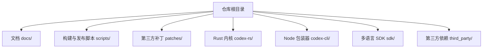
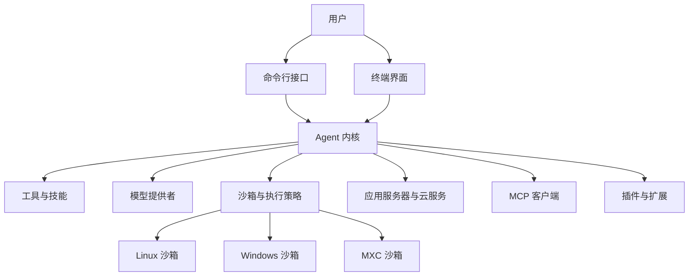
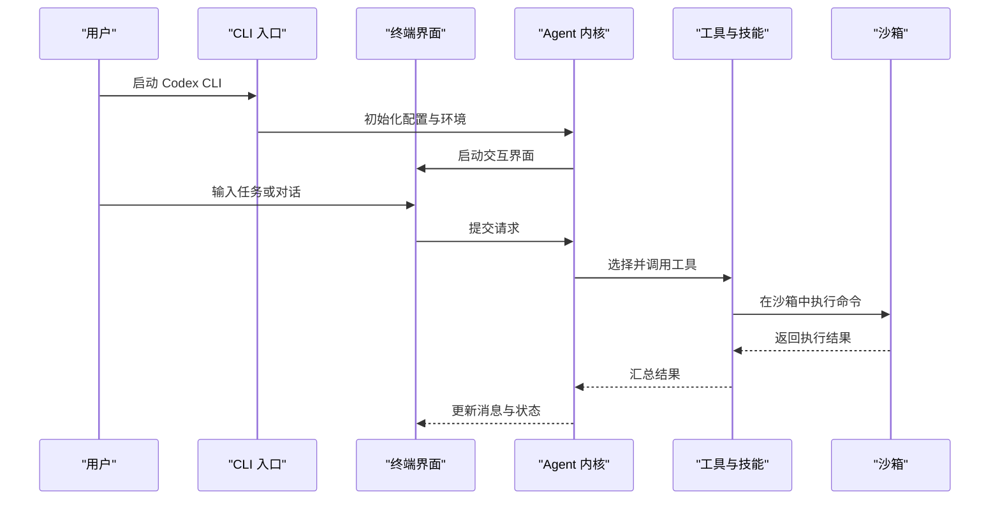
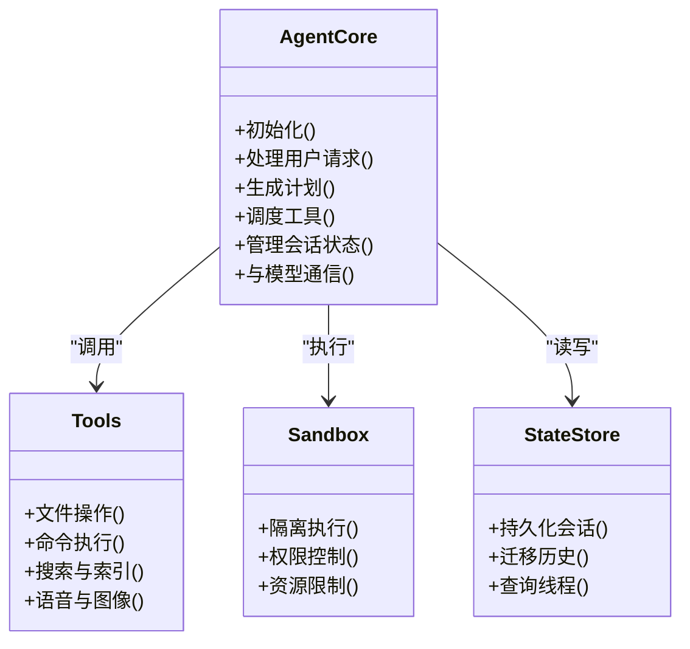
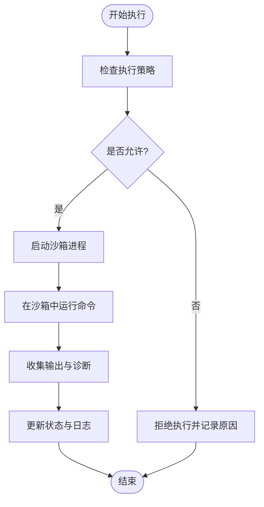
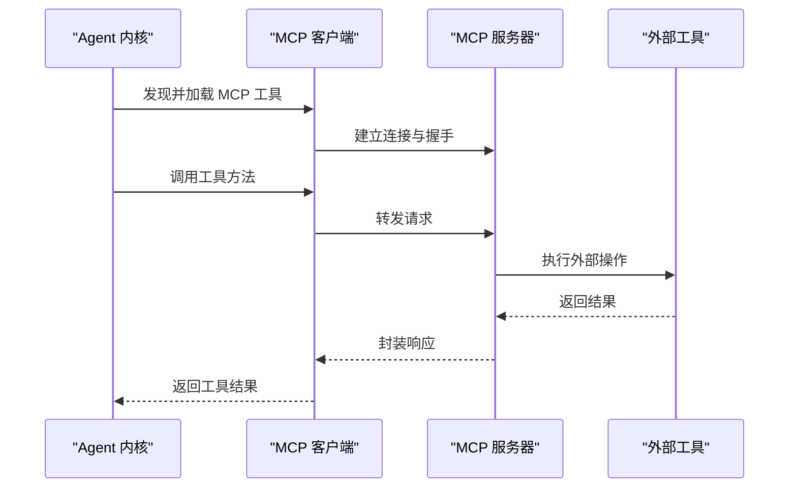
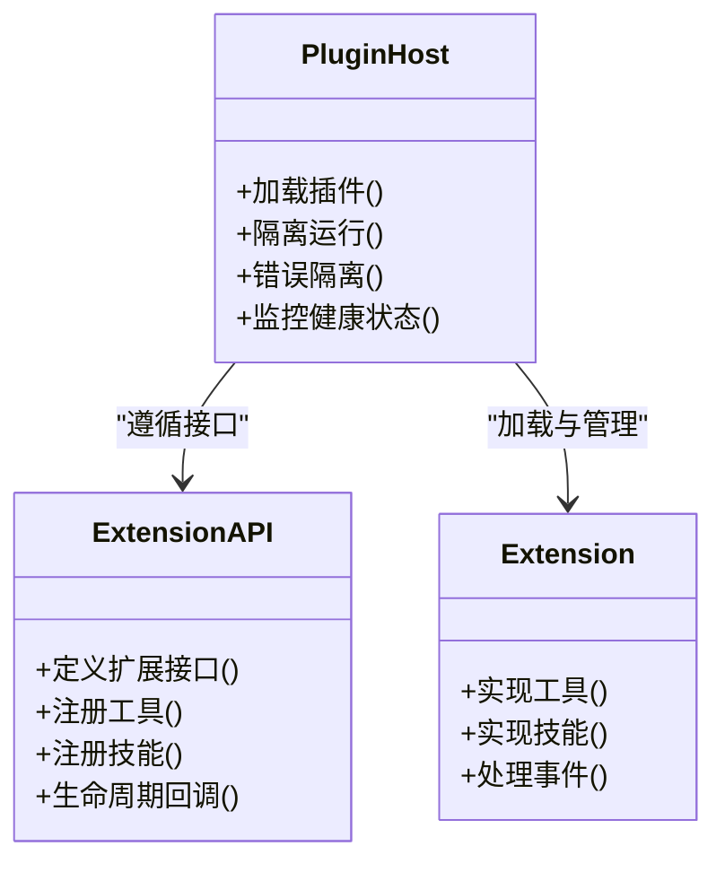
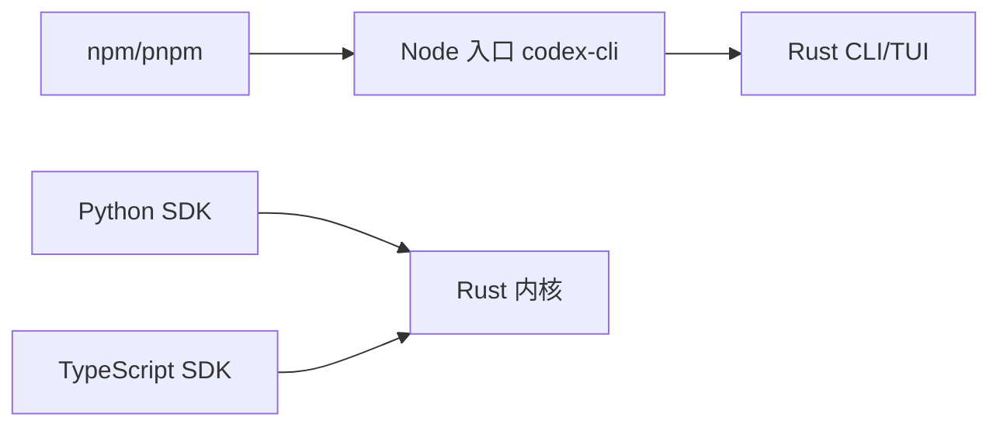
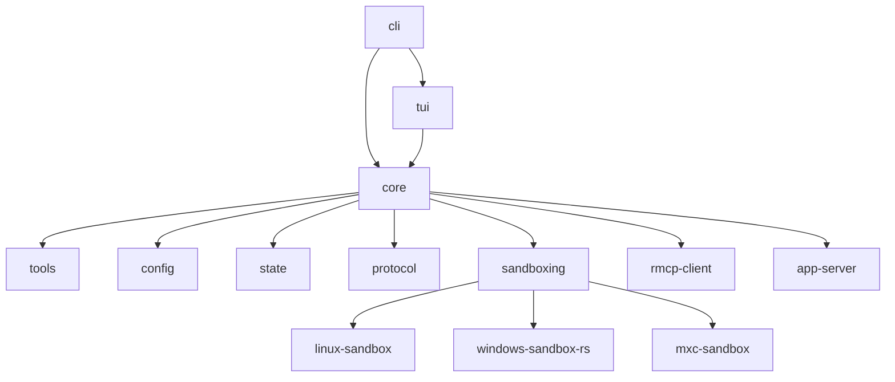

# 项目概览

<cite>
**本文引用的文件**
- [README.md](file://README.md)
- [codex-rs/README.md](file://codex-rs/README.md)
- [codex-rs/Cargo.toml](file://codex-rs/Cargo.toml)
- [codex-rs/config.md](file://codex-rs/config.md)
- [codex-cli/package.json](file://codex-cli/package.json)
- [codex-cli/bin/codex.js](file://codex-cli/bin/codex.js)
- [sdk/python/README.md](file://sdk/python/README.md)
- [sdk/typescript/README.md](file://sdk/typescript/README.md)
- [docs/getting-started.md](file://docs/getting-started.md)
- [docs/install.md](file://docs/install.md)
- [docs/authentication.md](file://docs/authentication.md)
- [docs/sandbox.md](file://docs/sandbox.md)
- [docs/exec.md](file://docs/exec.md)
- [docs/execpolicy.md](file://docs/execpolicy.md)
- [docs/agents_md.md](file://docs/agents_md.md)
- [docs/skills.md](file://docs/skills.md)
- [docs/slack_commands.md](file://docs/slash_commands.md)
- [docs/open-source-fund.md](file://docs/open-source-fund.md)
- [codex-rs/cli/src/main.rs](file://codex-rs/cli/src/main.rs)
- [codex-rs/tui/src/lib.rs](file://codex-rs/tui/src/lib.rs)
- [codex-rs/core/src/lib.rs](file://codex-rs/core/src/lib.rs)
- [codex-rs/app-server/src/server.rs](file://codex-rs/app-server/src/server.rs)
- [codex-rs/sandboxing/src/lib.rs](file://codex-rs/sandboxing/src/lib.rs)
- [codex-rs/linux-sandbox/src/lib.rs](file://codex-rs/linux-sandbox/src/lib.rs)
- [codex-rs/windows-sandbox-rs/src/lib.rs](file://codex-rs/windows-sandbox-rs/src/lib.rs)
- [codex-rs/rmcp-client/src/lib.rs](file://codex-rs/rmcp-client/src/lib.rs)
- [codex-rs/mxc-sandbox/src/lib.rs](file://codex-rs/mxc-sandbox/src/lib.rs)
- [codex-rs/ext/extension-api/src/lib.rs](file://codex-rs/ext/extension-api/src/lib.rs)
- [codex-rs/plugin-host/src/lib.rs](file://codex-rs/plugin-host/src/lib.rs)
</cite>

## 目录
1. [引言](#引言)
2. [项目结构](#项目结构)
3. [核心组件](#核心组件)
4. [架构总览](#架构总览)
5. [详细组件分析](#详细组件分析)
6. [依赖关系分析](#依赖关系分析)
7. [性能与可靠性考量](#性能与可靠性考量)
8. [术语表](#术语表)
9. [发展历程、社区生态与未来规划](#发展历程社区生态与未来规划)
10. [与其他 AI 编码工具的差异](#与其他-ai-编码工具的差异)
11. [结论](#结论)
12. [附录：快速上手路径](#附录快速上手路径)

## 引言
Codex CLI 是 OpenAI 提供的本地编码智能体工具，旨在把大模型能力直接接入开发者日常终端工作流。它既可以在交互式界面中理解任务、规划步骤、读写代码和运行命令，也能通过 SDK 以程序化方式驱动 Agent，甚至将沙箱执行、插件扩展、云端服务集成等能力暴露给其他系统使用。

项目的核心价值主张可以概括为：
- 在本地终端环境中提供“可观察、可审计、可控制”的编码 Agent 体验。
- 通过 Rust monorepo 组织高性能内核，同时维护多语言 SDK 和丰富插件生态。
- 内置沙箱与执行策略，降低 Agent 对宿主环境的破坏风险。
- 支持 MCP（Model Context Protocol）等外部工具协议，让 Agent 能安全调用文件系统、浏览器、数据库等能力。
- 提供 TUI、CLI、服务端、SDK 等多形态入口，覆盖从个人开发到平台集成的广泛场景。

本概览面向不同层次的读者：初学者可通过术语表和快速上手路径建立整体认知；工程师可进入架构与组件章节了解设计思路；平台与生态贡献者可关注插件、SDK 与构建体系。

## 项目结构
仓库采用 Bazel + Cargo + pnpm 的多语言 monorepo 结构，顶层包含文档、脚本、补丁和构建配置，主要代码集中在 `codex-rs`、`codex-cli`、`sdk` 三个区域：

**图示来源**
- [README.md:1-120](file://README.md#L1-L120)
- [codex-rs/Cargo.toml:1-80](file://codex-rs/Cargo.toml#L1-L80)

仓库关键区域职责如下：
- `codex-rs`：Rust monorepo，包含 CLI、TUI、Agent 内核、沙箱、MCP、插件、协议、状态存储、语音、网络、认证等模块。
- `codex-cli`：面向 npm/pnpm 的 Node 入口，负责打包、安装钩子和部分分发逻辑。
- `sdk`：Python 和 TypeScript SDK，提供程序化调用 Agent 的能力。
- `docs`：用户文档，涵盖安装、认证、沙箱、执行策略、技能、斜杠命令等。
- `scripts`：构建、测试、包管理、版本与发布脚本。
- `third_party`：V8、OpenSSL、SQLite、WezTerm 等原生依赖的 Bazel 集成。
- `patches`：针对上游库的平台或兼容性补丁。

**章节来源**
- [README.md:1-120](file://README.md#L1-L120)
- [codex-rs/Cargo.toml:1-80](file://codex-rs/Cargo.toml#L1-L80)

## 核心组件
Codex CLI 的核心由以下层次组成：
- 命令行与交互层：CLI 解析参数，TUI 提供交互式会话界面。
- Agent 内核：负责任务拆解、提示词组装、工具调度、状态管理、历史与记忆。
- 执行与沙箱层：在隔离环境中运行命令、编辑文件和访问资源。
- 模型与服务层：对接 OpenAI 或其他模型后端，以及应用服务器、云任务等。
- 插件与扩展层：通过插件 API、MCP、Skills 等机制扩展能力。
- SDK 与协议层：对外暴露 Python、TypeScript SDK，以及内部进程间通信协议。

这些组件共同构成一个“本地优先、可扩展、可审计”的编码智能体平台。

**章节来源**
- [codex-rs/cli/src/main.rs:1-200](file://codex-rs/cli/src/main.rs#L1-L200)
- [codex-rs/tui/src/lib.rs:1-200](file://codex-rs/tui/src/lib.rs#L1-L200)
- [codex-rs/core/src/lib.rs:1-200](file://codex-rs/core/src/lib.rs#L1-L200)

## 架构总览
下图展示 Codex CLI 的高层架构。用户通过 CLI 或 TUI 发起任务，Agent 内核协调工具、模型、沙箱和执行策略，必要时与应用服务器、云服务和 MCP 工具进行交互。

**图示来源**
- [codex-rs/cli/src/main.rs:1-200](file://codex-rs/cli/src/main.rs#L1-L200)
- [codex-rs/tui/src/lib.rs:1-200](file://codex-rs/tui/src/lib.rs#L1-L200)
- [codex-rs/core/src/lib.rs:1-200](file://codex-rs/core/src/lib.rs#L1-L200)
- [codex-rs/sandboxing/src/lib.rs:1-200](file://codex-rs/sandboxing/src/lib.rs#L1-L200)
- [codex-rs/linux-sandbox/src/lib.rs:1-200](file://codex-rs/linux-sandbox/src/lib.rs#L1-L200)
- [codex-rs/windows-sandbox-rs/src/lib.rs:1-200](file://codex-rs/windows-sandbox-rs/src/lib.rs#L1-L200)
- [codex-rs/mxc-sandbox/src/lib.rs:1-200](file://codex-rs/mxc-sandbox/src/lib.rs#L1-L200)
- [codex-rs/rmcp-client/src/lib.rs:1-200](file://codex-rs/rmcp-client/src/lib.rs#L1-L200)
- [codex-rs/app-server/src/server.rs:1-200](file://codex-rs/app-server/src/server.rs#L1-L200)

该架构图体现以下设计原则：
- 分层清晰：交互层、内核层、基础设施层分离。
- 可扩展：工具、模型、沙箱、插件均可替换或扩展。
- 安全优先：默认在沙箱中执行，配合执行策略限制风险。
- 多入口：CLI、TUI、SDK、服务端都能驱动同一内核。

## 详细组件分析

### CLI 与 TUI
CLI 负责启动流程、参数解析、环境检测、日志和诊断信息输出；TUI 则提供会话列表、消息流、工具调用可视化、计划进度、声音输入输出等交互能力。二者都依赖 Agent 内核完成实际工作。

**图示来源**
- [codex-rs/cli/src/main.rs:1-200](file://codex-rs/cli/src/main.rs#L1-L200)
- [codex-rs/tui/src/lib.rs:1-200](file://codex-rs/tui/src/lib.rs#L1-L200)
- [codex-rs/core/src/lib.rs:1-200](file://codex-rs/core/src/lib.rs#L1-L200)
- [codex-rs/sandboxing/src/lib.rs:1-200](file://codex-rs/sandboxing/src/lib.rs#L1-L200)

**章节来源**
- [codex-rs/cli/src/main.rs:1-200](file://codex-rs/cli/src/main.rs#L1-L200)
- [codex-rs/tui/src/lib.rs:1-200](file://codex-rs/tui/src/lib.rs#L1-L200)

### Agent 内核
Agent 内核是 Codex 的“大脑”，负责：
- 解析用户意图，生成或调整计划。
- 组装提示词、上下文和工具描述。
- 调度工具、技能、插件。
- 管理会话状态、历史、记忆和线程。
- 与模型提供方通信，处理流式响应和错误恢复。

内核与工具、沙箱、状态存储、协议模块紧密耦合，但通过清晰的接口保持内聚性。

**图示来源**
- [codex-rs/core/src/lib.rs:1-200](file://codex-rs/core/src/lib.rs#L1-L200)
- [codex-rs/tools/src/lib.rs:1-200](file://codex-rs/tools/src/lib.rs#L1-L200)
- [codex-rs/sandboxing/src/lib.rs:1-200](file://codex-rs/sandboxing/src/lib.rs#L1-L200)
- [codex-rs/state/src/lib.rs:1-200](file://codex-rs/state/src/lib.rs#L1-L200)

**章节来源**
- [codex-rs/core/src/lib.rs:1-200](file://codex-rs/core/src/lib.rs#L1-L200)

### 沙箱与执行策略
Codex 强调“可观察且可控的执行”。沙箱模块抽象出 Linux、Windows、MXC 等不同实现，执行策略则决定哪些命令、文件路径和网络访问被允许。

**图示来源**
- [codex-rs/sandboxing/src/lib.rs:1-200](file://codex-rs/sandboxing/src/lib.rs#L1-L200)
- [codex-rs/execpolicy/src/lib.rs:1-200](file://codex-rs/execpolicy/src/lib.rs#L1-L200)
- [codex-rs/linux-sandbox/src/lib.rs:1-200](file://codex-rs/linux-sandbox/src/lib.rs#L1-L200)
- [codex-rs/windows-sandbox-rs/src/lib.rs:1-200](file://codex-rs/windows-sandbox-rs/src/lib.rs#L1-L200)
- [codex-rs/mxc-sandbox/src/lib.rs:1-200](file://codex-rs/mxc-sandbox/src/lib.rs#L1-L200)

**章节来源**
- [codex-rs/sandboxing/src/lib.rs:1-200](file://codex-rs/sandboxing/src/lib.rs#L1-L200)
- [codex-rs/execpolicy/src/lib.rs:1-200](file://codex-rs/execpolicy/src/lib.rs#L1-L200)
- [codex-rs/linux-sandbox/src/lib.rs:1-200](file://codex-rs/linux-sandbox/src/lib.rs#L1-L200)
- [codex-rs/windows-sandbox-rs/src/lib.rs:1-200](file://codex-rs/windows-sandbox-rs/src/lib.rs#L1-L200)
- [codex-rs/mxc-sandbox/src/lib.rs:1-200](file://codex-rs/mxc-sandbox/src/lib.rs#L1-L200)

### MCP 客户端
MCP 客户端负责连接外部 MCP 服务器，使 Agent 能够调用文件系统、浏览器、数据库、远程服务等上下文工具。它是插件生态的重要补充。

**图示来源**
- [codex-rs/rmcp-client/src/lib.rs:1-200](file://codex-rs/rmcp-client/src/lib.rs#L1-L200)
- [codex-rs/core/src/lib.rs:1-200](file://codex-rs/core/src/lib.rs#L1-L200)

**章节来源**
- [codex-rs/rmcp-client/src/lib.rs:1-200](file://codex-rs/rmcp-client/src/lib.rs#L1-L200)

### 插件与扩展系统
Codex 提供插件 API 和插件宿主，允许第三方扩展 Agent 能力。扩展可以是工具、技能、Guardian 审查器、历史记录增强器等。

**图示来源**
- [codex-rs/ext/extension-api/src/lib.rs:1-200](file://codex-rs/ext/extension-api/src/lib.rs#L1-L200)
- [codex-rs/plugin-host/src/lib.rs:1-200](file://codex-rs/plugin-host/src/lib.rs#L1-L200)

**章节来源**
- [codex-rs/ext/extension-api/src/lib.rs:1-200](file://codex-rs/ext/extension-api/src/lib.rs#L1-L200)
- [codex-rs/plugin-host/src/lib.rs:1-200](file://codex-rs/plugin-host/src/lib.rs#L1-L200)

### Node 包装器与多语言 SDK
`codex-cli` 是 npm 包的入口，负责安装、启动和分发；Python 与 TypeScript SDK 则提供程序化调用 Agent 的能力，适合自动化脚本、CI、平台集成。

**图示来源**
- [codex-cli/package.json:1-120](file://codex-cli/package.json#L1-L120)
- [codex-cli/bin/codex.js:1-120](file://codex-cli/bin/codex.js#L1-L120)
- [sdk/python/README.md:1-120](file://sdk/python/README.md#L1-L120)
- [sdk/typescript/README.md:1-120](file://sdk/typescript/README.md#L1-L120)

**章节来源**
- [codex-cli/package.json:1-120](file://codex-cli/package.json#L1-L120)
- [codex-cli/bin/codex.js:1-120](file://codex-cli/bin/codex.js#L1-L120)
- [sdk/python/README.md:1-120](file://sdk/python/README.md#L1-L120)
- [sdk/typescript/README.md:1-120](file://sdk/typescript/README.md#L1-L120)

## 依赖关系分析
Rust monorepo 通过 Cargo workspace 和 Bazel 管理大量 crate，形成高内聚、低耦合的模块化结构。关键依赖方向如下：

**图示来源**
- [codex-rs/Cargo.toml:1-200](file://codex-rs/Cargo.toml#L1-L200)
- [codex-rs/cli/src/main.rs:1-200](file://codex-rs/cli/src/main.rs#L1-L200)
- [codex-rs/core/src/lib.rs:1-200](file://codex-rs/core/src/lib.rs#L1-L200)

潜在风险与优化点：
- 模块数量较多，需关注循环依赖和公共 API 稳定性。
- 沙箱与执行策略应持续演进，平衡安全性与可用性。
- MCP 客户端需要适配更多服务器类型和错误场景。
- 插件系统需加强隔离、权限控制和调试能力。

**章节来源**
- [codex-rs/Cargo.toml:1-200](file://codex-rs/Cargo.toml#L1-L200)

## 性能与可靠性考量
- 构建系统：Bazel 提供缓存、并行构建和跨平台一致性，有助于大规模 Rust monorepo 的可重复构建。
- 运行时性能：Rust 内核减少内存与 CPU 开销，TUI 和 CLI 尽量延迟加载重型功能。
- 可观测性：日志、诊断 ZIP、Trace、状态迁移等机制帮助定位问题。
- 可靠性：沙箱隔离、执行策略、重试与回退、会话持久化提升鲁棒性。
- 扩展性：插件、MCP、Skills、SDK 让能力增长不污染核心。

[本节为通用指导，不直接分析具体文件]

## 术语表
- Agent：具备感知、规划、行动能力的智能体，在本项目中指 Codex 的 Agent 内核及其工作流。
- TUI：终端用户界面，提供交互式会话、消息流、工具调用可视化。
- 沙箱：隔离执行环境，限制 Agent 对宿主机文件、网络和进程的影响。
- 执行策略：决定哪些命令、路径、资源可被执行的规则集合。
- MCP：Model Context Protocol，用于连接外部工具和服务的标准协议。
- 插件：通过插件 API 扩展 Agent 能力的第三方模块。
- Skills：可复用的技能模块，封装常见任务与工作流。
- 模型提供者：对接 OpenAI 或其他大模型后端的组件。
- 应用服务器：提供云端会话、状态同步、任务管理等能力的服务端组件。
- SDK：面向 Python 与 TypeScript 的程序化调用接口。

[本节为概念说明，不直接分析具体文件]

## 发展历程、社区生态与未来规划
- 发展历程：项目从 CLI 和 TUI 出发，逐步完善 Agent 内核、沙箱、MCP、插件、语音、云端服务等能力，形成完整的本地编码智能体平台。
- 社区生态：文档涵盖安装、认证、沙箱、执行策略、技能、斜杠命令等主题；开放源码基金和相关文档体现社区治理与透明度。
- 未来规划：通常包括更完善的跨平台沙箱、更强的插件生态、更丰富的 MCP 工具、更好的调试与诊断能力、更开放的 SDK 生态。

**章节来源**
- [docs/getting-started.md:1-200](file://docs/getting-started.md#L1-L200)
- [docs/install.md:1-200](file://docs/install.md#L1-L200)
- [docs/authentication.md:1-200](file://docs/authentication.md#L1-L200)
- [docs/sandbox.md:1-200](file://docs/sandbox.md#L1-L200)
- [docs/exec.md:1-200](file://docs/exec.md#L1-L200)
- [docs/execpolicy.md:1-200](file://docs/execpolicy.md#L1-L200)
- [docs/skills.md:1-200](file://docs/skills.md#L1-L200)
- [docs/slack_commands.md:1-200](file://docs/slash_commands.md#L1-L200)
- [docs/open-source-fund.md:1-200](file://docs/open-source-fund.md#L1-L200)

## 与其他 AI 编码工具的差异
- 本地优先：Codex CLI 强调在用户本地终端环境中运行，便于审计和控制。
- 沙箱与安全：内置多平台沙箱和执行策略，降低 Agent 对宿主环境的破坏风险。
- 插件与 MCP：通过插件 API 和 MCP 协议扩展能力，而非仅依赖内置工具。
- 多语言 SDK：Python 与 TypeScript SDK 便于平台集成和自动化。
- Rust monorepo：高性能内核与严格构建体系，有利于稳定性和跨平台一致性。

[本节为对比说明，不直接分析具体文件]

## 结论
Codex CLI 不仅是一个终端工具，而是一个以 Agent 为核心、以沙箱为安全边界、以插件和 MCP 为扩展边界的本地编码智能体平台。它通过 Rust monorepo 提供高性能内核，通过多语言 SDK 和丰富文档支撑社区生态，通过 TUI、CLI、服务端等多种入口满足不同使用场景。对于初学者，可以从术语表和快速上手路径入手；对于工程师，可以从架构与组件分析入手；对于平台与生态贡献者，可以重点关注插件、MCP、SDK 和构建体系。

[本节为总结，不直接分析具体文件]

## 附录：快速上手路径
- 阅读入门文档，了解安装、认证和基本用法。
- 在终端启动 Codex CLI，尝试简单任务。
- 阅读沙箱与执行策略文档，了解安全边界。
- 使用 Python 或 TypeScript SDK 编写自动化脚本。
- 探索插件、MCP 和 Skills，扩展 Agent 能力。

**章节来源**
- [docs/getting-started.md:1-200](file://docs/getting-started.md#L1-L200)
- [docs/install.md:1-200](file://docs/install.md#L1-L200)
- [docs/authentication.md:1-200](file://docs/authentication.md#L1-L200)
- [docs/sandbox.md:1-200](file://docs/sandbox.md#L1-L200)
- [docs/exec.md:1-200](file://docs/exec.md#L1-L200)
- [docs/execpolicy.md:1-200](file://docs/execpolicy.md#L1-L200)